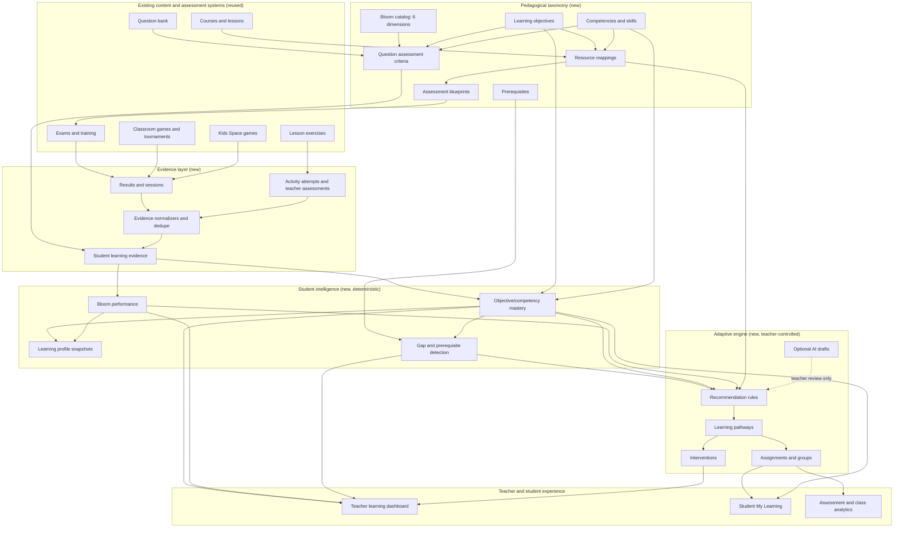
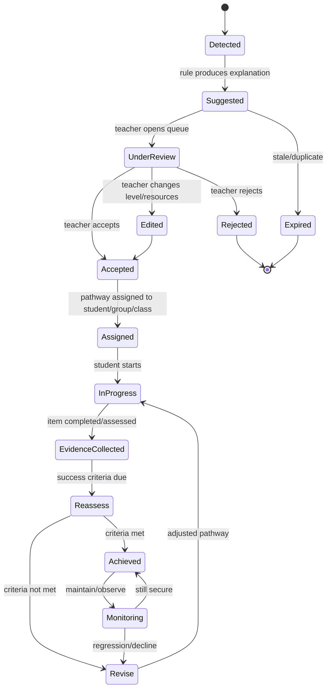
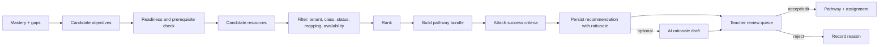
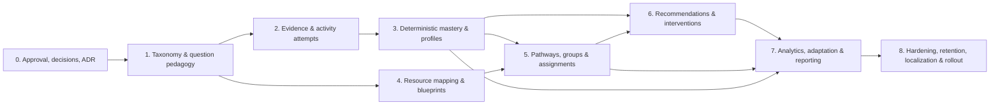

# Adaptive Learning Architecture

**Status:** **READY FOR OWNER APPROVAL — Phase 0 review complete.**
**No source code, Prisma schema, migration, API route or UI has been changed.**
**Branch:** `feature/kid-games`
**Date:** 2026-11-19
**Inputs:** `complete_adaptive_learning _system.md`, `DESIGN THE COMPLETE ADAPTIVE LEARNING ARCHITECTURE..md`, the completed feature audit, and a read-only inspection of the repository.
**Gate:** implementation starts only after the owner records the Phase 0 decisions and explicitly authorizes Phase 1.

**Phase 0 documents:**
- `docs/PHASE0_ARCHITECTURE_REVIEW.md` — review findings and final roadmap.
- `docs/PHASE0_DECISION_REGISTER.md` — the 14 decisions, recommended defaults and approval record.
- `docs/ADR-0001-ADAPTIVE-LEARNING-FOUNDATION.md` — Phase 0 Architecture Decision Record.

**Policy status:** `mastery-v1.1` is a **review candidate**, not approved. Thresholds, weights, the high-stakes gate and all pedagogical policies require owner approval (D4/D5).

---

## 0. Executive summary

The current application is a solid multi-tenant assessment and content platform. It is **not** yet an adaptive learning platform. The audit found that only two of the thirteen requested capabilities exist:

| Capability | Present today |
|---|---|
| Bloom classification (six dimensions) | **No** |
| Question difficulty classification | **Yes** — `Question.difficulty` (`easy` / `medium` / `hard`) |
| Learning objectives and competencies | **No** — only AI-generated prose in prep sheets and exercises |
| Individual student cognitive profiles | **No** |
| Student mastery and progression | **No** |
| Class and student analytics | **Yes** — teacher, school and platform analytics |
| Dynamic learning levels | **No** |
| Personalized courses and exercises | **No** — courses are class-assigned, exercises are static documents |
| Personalized educational games | **No** — games are class/live-session resources |
| Multiple learning pathways in one class | **No** |
| Personalized assessments | **No** — exams are class-assigned |
| AI-assisted recommendations | **No** — AI generates content, not pedagogical recommendations |
| Continuous adaptation | **No** |

The platform already contains the raw material an adaptive system needs: thousands of questions, exams, results, courses, lessons, exercises, classroom games, tournaments and Kids Space games. The missing layer is a **pedagogical model** that describes what each resource teaches, an **evidence model** that records what each student actually demonstrated, and a **deterministic engine** that turns evidence into mastery, gaps and recommendations.

This document designs that layer additively. It does not rebuild questions, exams, courses, exercises, games or results. It does not introduce a second assessment engine, a second course system or a second game system.

### Three non-negotiable invariants

1. **No fabricated evidence.** Evidence is created only from a real persisted `Result` (including game, tournament and Kids results), a `LearningActivityAttempt`, or a teacher-assessed activity. A missing objective, Bloom dimension or competency is recorded as *unmapped*, never guessed.
2. **No permanent global learning level.** Levels are computed per objective, competency or topic, carry an evidence-confidence value, and are recomputed. There is no student-wide “level 3” badge.
3. **No AI authority over mastery.** AI may suggest classifications (Phase 6; not in Phase 1) and pathway drafts. It cannot write evidence, mastery, levels or assignments. A teacher accepts or rejects every AI suggestion.

### Build order

```
Taxonomy → Evidence → Mastery → Resource mapping → Pathways → Recommendations → Analytics → Hardening
```

Each phase is independently shippable and preserves the current product.

### Phase 0 review outcome

The Phase 0 review corrected the following before approval:

- **Mastery math:** parenthesized the high-stakes condition, counted distinct evidence items, stored weight components, and corrected Example 3/4 arithmetic and labels.
- **Repeated attempts:** current mastery now uses two lanes (latest summative and latest formative per item/criterion); all attempts remain for history and trend.
- **Formative recognition:** added `summative_pending` for strong formative evidence without summative evidence; it is a recognition badge, not a level.
- **Evidence model:** limited `source_type` to `result` and `activity_attempt`; added `LearningActivityCriterion`; removed ambiguous `quality`; added method/lane/item/attempt fields.
- **Schema:** added tournament resources, tenant-safe uniques, attempt metadata and mastery counts.
- **Roadmap:** Phase 2 no longer owns `LearningResourceMap`; Phase 4 does. Pathway movement and R10 were added.
- **Localization:** new Learning panels support EN/FR/AR and RTL; full-app RTL is explicitly out of scope.
- **Course mastery:** derived through category ancestry and resource maps, with no duplicate course table.
- **Final validation (2026-11-19):** threshold bands are explicit and cumulative; every numerical example has an independent reconciliation table; the gate order is normative; D9 has a retention/deletion lifecycle; D10 has a durable receipt/reconciliation and replay design; D12 has teacher/student explanation templates; decision approval is staged by dependent phase. **Owner-review pass (2026-11-19):** §E.2.1 classification requires `mode='exam'` for rule 4; §E.2.1.1 documents the ingest trust boundary; §E.2.1.2 pins `source_kind` inside `source_fingerprint` and the `Exam.is_training` reclassification path; D13 (server-authoritative summative evidence, with session-linkage checks, an `is_training`-change confirmation/audit guard and an explicit teacher-attested path for offline/paper exams) and D14 (which formal exams are high-stakes) were added and propagated to the ADR and review; `method` is never a column on `LearningActivityAttempt`; a contract test pins `createFromSession`'s `mode='exam'` write. **Owner dispositions (2026-11-19): D1, D2 and D8 approved; Phase 1 authorized (Phase 1 only); `mastery-v1.1` acknowledged as an unvalidated candidate.**

**None of the pedagogical thresholds are approved.** The owner must record D4/D5 before Phase 3 implementation. D1/D2/D8 gate Phase 1; D3/D7/D9/D10/D12/D13 gate Phase 2; D4/D5/D6/D14 gate Phase 3; D11 gates Phase 5; D9 final retention and D8 full-app RTL are Phase 8 decisions.

**Review documents:** `docs/PHASE0_ARCHITECTURE_REVIEW.md`, `docs/PHASE0_DECISION_REGISTER.md`, `docs/ADR-0001-ADAPTIVE-LEARNING-FOUNDATION.md`.

---

## A. Current architecture and integration-point analysis

### A.1 Runtime, tenancy and layering

| Layer | Current implementation | Consequence for this design |
|---|---|---|
| Runtime | Node.js ESM, Express 4, Socket.IO, Prisma 5, SQLite | All new persistence is Prisma/SQLite; no new runtime |
| Tenant root | `School`; every data table carries `school_id` | Every new table (except the global Bloom catalog) carries `school_id` |
| Tenant enforcement | `enforceTenant` pins `req.schoolId` from the JWT; services scope queries | New routes must use the same middleware chain; services re-check tenant |
| Repository | `IStorageRepository` (`getAll`, `getById`, `create`, `update`, `delete`, `createMany`, `query`) and `PrismaRepository` with `modelFor(table)` | New tables must be added to `MODEL_MAP`; complex reads use named queries |
| Repository tenant rule | The repository deliberately does **not** enforce `school_id`; the application layer does | Every new service must pass `school_id` explicitly |
| Backend DI | `src/backend/container.js` | New backend services are wired there |
| Frontend DI | `src/frontend/container.js` with `ApiRepository`; no LocalStorage fallback | New frontend code calls APIs only; no local source of truth |
| Shared services | Pure services are reused by frontend and backend | Evidence/mastery logic must be backend-only or pure shared modules; shared services cannot write adaptive tables from the browser |
| Routes | `requireAuth`, `enforceTenant`, `requireRole`, `validate`, `auditSvc.log`, `next(err)` | New routes follow the same conventions |
| Validation | Zod schemas in `src/shared/schemas` | New request schemas are additive |
| Bundles | esbuild builds `public/console-bundle.js`, student bundle | New UI modules must be bundled; no inline scripts |
| Migrations | Append-only SQLite SQL; 22 existing migrations; no PostgreSQL support | New migrations are additive; no existing table rebuild |
| Background jobs | Only two intervals in `server.js`; no job queue | Initial recommendation/recompute is synchronous or on-demand; no queue invented |

### A.2 Existing domain entities relevant to adaptive learning

| Entity | What it stores | Adaptive relevance |
|---|---|---|
| `School` | Tenant root | All adaptive data is tenant-scoped |
| `User` | Roles: `super_admin`, `admin`, `teacher`, `student`; class membership | Student identity; teacher scope |
| `Class` | Class roster and class-level grouping | Differentiation happens inside a class; no new class type |
| `Subject` | Top-level subject | Objective/competency scope |
| `Category` | Self-referential curriculum tree (module/chapter/section); leaves hold questions | Objective can point at a topic/chapter; no new curriculum tree |
| `Question` | Type, text, options, answer, difficulty, points, tags, media | Primary content unit; needs Bloom/objective/competency criteria |
| `Exam` | Class-assigned assessment or training; `is_training`; questions via `ExamQuestion` | Assessment/practice resource; needs optional blueprint and mapping |
| `Result` | Aggregate score plus `answers_json`; mode `exam` / `training` / `game` / `tournament`; optional `exam_id` | Primary evidence source; must not be double-counted |
| `Course` | One category branch; class-assigned via `CourseClass` | Common core resource; needs objective mapping |
| `Lesson` | Nested lesson with content, prep sheet, exercise JSON | Teaching resource and open-ended exercise; needs mapping and completion evidence |
| `Game` / `GameSession` | Live classroom game; answers in `GameSession.answers_json` | Practice evidence |
| `Tournament` / `TournamentEntry` | Competitive game; answers in entry JSON | Practice evidence |
| `KidsGame` / `KidsGameSession` | Kids Space game, snapshot `questions_json`, PIN play, unified result | Practice evidence, but only for logged-in sessions |
| `KidQuestProgress` | Per-level Math Quest star progress | Game progress signal, **not** mastery |
| `AuditLog` | Administrative action trail | New taxonomy, mastery override and assignment actions must be audited |

### A.3 Where evidence is written today

| Flow | Write path | Answer shape | Evidence available? | Integration point |
|---|---|---|---|---|
| Training/exam session | `SessionService.saveAnswer` → `POST /sessions/:id/submit` → `ResultService.createFromSession` → `Result.answers_json` | `{ questionId: answer }` | Yes, per question | Ingest after the result is persisted |
| Direct result save | `POST /api/v1/results` (current and legacy shapes) | `{ questionId: answer }` or legacy arrays | Yes, per question | Ingest after upsert |
| Classroom game | `GameService.recordAnswer` → `GameService.finish` → one `Result` per player with `mode:'game'` | `{ questionId: { value, correct } }` | Yes, per question | Ingest after `POST /games/:id/finish` |
| Tournament | `TournamentService.recordAnswer` → `finish` → one `Result` per entry with `mode:'tournament'` | `{ questionId: { value, correct } }` | Yes, per question | Ingest after `POST /tournaments/:id/finish` |
| Kids Space | `KidsGameService.submitAnswers` → `KidsGameSession` + unified `Result` | `{ mode, source:'kids-game', answers:[{question_id, given, correct, time_ms}] }` | Yes, per question; anonymous sessions have no student | Ingest after `PATCH /kids/play/session/:sessionId`, only when `user_id` is present |
| Lesson exercise | `Lesson.exercise` JSON; export only; no student attempt row | Structured situation/tasks, **no answers** | **No** | Add an activity-attempt path; do not infer completion |
| Teacher observation | No model | — | No | Add a teacher-assessed activity attempt |

### A.4 What exists but must not be misrepresented

| Existing feature | Why it is not the adaptive feature |
|---|---|
| `Question.difficulty` | Difficulty is independent of Bloom and of mastery |
| Per-question accuracy (`GET /training/accuracy`) | Accuracy is a raw count over training answers; it has no objective, Bloom, confidence or evidence provenance |
| Gamification EXP/level/badges | Engagement rewards, not academic mastery |
| Math Quest stars | Game progress, not mastery |
| AI `keyCompetencies` prose in exercises | Generated text, not a school-managed competency taxonomy and not evidence |
| Teacher overview attention list | Rule-based operational insight; the service itself states that a training/exam gap is “never proof of mastery” |
| Class-level course/exam assignment | Common access, not individual pathways |

These can become **inputs** and **signals**, but the architecture must label them correctly.

### A.5 Integration points, one by one

| Area | Files / contracts | Change type |
|---|---|---|
| Question model | `prisma/schema.prisma`, `src/shared/schemas/question.schema.js`, `src/backend/routes/questions.routes.js`, `QuestionService` | Additive nullable fields and a criteria relation; existing create/update remains valid |
| Question UI | `admin.html` question editor, question table/filter | Add a “Pedagogy” panel; no replacement of the editor |
| Exam builder | `src/shared/schemas/exam.schema.js`, `ExamService`, exam assignment routes | Optional blueprint and coverage panel; no change to grading or `ExamClass` |
| Course/lesson/exercise | `src/backend/routes/courses.routes.js`, `CourseService`, `lesson.exercise` JSON | Map lessons/exercises to objectives; add an attempt endpoint; do not rebuild course structure |
| Results | `src/backend/routes/results.routes.js`, `src/frontend/services/ResultService.js`, `GradingService` | Add a post-persist evidence hook; result creation remains unchanged and must never be blocked by adaptive failures |
| Games | `src/backend/routes/games.routes.js`, `GameService`, `TournamentService` | Ingest evidence after finish; map game questions via question criteria |
| Kids Space | `src/backend/routes/kids.routes.js`, `KidsGameService` | Enrich `questions_json` snapshots with pedagogy; ingest only logged-in sessions |
| Student workspace | `student-workspace.html`, `student-workspace.js` | Add a “My Learning” tab/section; existing tabs remain |
| Teacher console | `admin.html`, `teacher-overview.js`, `teacher-domain-analytics.js`, `teacher-analytics.js` | Add a Learning tab and profile/pathway views; add one compact Overview card |
| Permissions | `src/shared/permissions.js` | Add learning permissions; do not rename existing strings |
| Audit | `AuditService` | Audit taxonomy, mappings, overrides, assignments, recommendation decisions, backfills |
| Bootstrap | `src/backend/routes/bootstrap.routes.js` | Do **not** add heavy adaptive tables to the preload payload; use dedicated endpoints |
| Build | `scripts/build-student.js`, `scripts/build-console.js` | Add new modules to existing esbuild entries |

### A.6 Hard constraints discovered in the repository

1. **SQLite only.** No PostgreSQL, no `Json` column type; structured values are JSON strings. New JSON payloads use `String`.
2. **Append-only migration history.** Every migration is additive; existing tables are not rebuilt. New tables can reference existing ones, but existing rows need defaults.
3. **No native enums in the current schema style.** Existing status fields are `String` with constants in `src/shared/constants.js`. New status fields follow that style rather than introducing Prisma enums.
4. **Class-level assignment is the current access model.** `ExamClass` and `CourseClass` decide common access. Personalized access must be an additional grant, not a second class.
5. **Shared services run in the browser.** Evidence ingestion and mastery calculation must be backend-only; the frontend must never compute authoritative mastery.
6. **No job queue.** Evidence ingestion and recomputation must be bounded and synchronous, or explicitly requested; heavy backfill is a CLI/administrative operation.
7. **API contracts are frozen.** Existing endpoints keep their request/response shapes. New behavior is additive and optional.
8. **Tenant isolation is application-enforced.** Every new query must include `school_id`; an ID alone is never proof of access.
9. **Teacher ownership is enforced today.** Question author scoping and class scoping must be preserved for taxonomy and pathways.
10. **The student bundle is built with esbuild.** New UI must be plain ES modules and bundled; no new framework.

### A.7 Design principles

| Principle | Consequence |
|---|---|
| Reuse before adding | Questions, exams, courses, lessons, games and results stay the only content/assessment systems |
| Additive by default | New tables, nullable columns, optional API fields and feature flags |
| Evidence first | A profile is only as good as its evidence; every score is traceable to a source row |
| Teacher in control | Recommendations are suggestions; assignments and overrides are teacher actions |
| Deterministic core | Mastery and gap rules are pure functions with versioned policy; AI is optional and outside the core |
| Explainability | Every mastery value has evidence weight, confidence, coverage, source mix and last-evidence date |
| No overclaiming | “Not enough evidence” is a first-class state; games and automatic MCQ cannot prove advanced reasoning |
| Tenant safety | `school_id` on every table, service-level checks, audited cross-scope access |

---

## B. Pedagogical architecture

### B.1 Core concepts

| Concept | Definition | Implementation |
|---|---|---|
| Bloom dimension | The cognitive process a question or task asks for: Remember, Understand, Apply, Analyze, Evaluate, Create | Global `BloomDimension` catalog + `QuestionAssessmentCriterion` |
| Learning objective | A specific, observable outcome for a topic (“Compare two fractions with unlike denominators”) | `LearningObjective`, scoped to school + subject + optional category |
| Competency / skill | A durable capacity that can span objectives (“Mathematical reasoning”, “Written justification”) | `Competency` with `kind = competency|skill` and an optional parent tree |
| Assessment criterion | The part of a question that assesses one objective/Bloom pair, with a weight and optional rubric | `QuestionAssessmentCriterion` |
| Resource mapping | Links a course, lesson, exercise, exam or game to an objective and a pedagogical role | `LearningResourceMap` |
| Evidence | A recorded demonstration by one student from one real source | `LearningEvidence` |
| Mastery | A deterministic, evidence-weighted estimate for one student and one objective/competency | `StudentObjectiveMastery`, `StudentCompetencyMastery` |
| Bloom performance | Observable performance per Bloom dimension, separate from mastery | `StudentBloomPerformance` |
| Learning profile | A multi-axis snapshot of mastery, Bloom performance, coverage and confidence | `StudentCognitiveProfile` snapshot + normalized mastery rows |
| Prerequisite | A dependency between objectives, with strength and minimum state | `LearningPrerequisite` |
| Pathway | A reusable sequence of teaching/practice/assessment resources for one objective and level | `LearningPathway` + `LearningPathwayItem` |
| Assignment | The act of giving a pathway to a student, group or class | `LearningAssignment` + enrollments |
| Intervention | A teacher-recorded action with a reason and an outcome | `LearningIntervention` |
| Recommendation | A rule- or AI-assisted suggestion to act, which a teacher reviews | `LearningRecommendation` |

### B.2 Bloom, difficulty and mastery are three different axes

This distinction is a hard requirement.

| Axis | Question | Values | Where stored |
|---|---|---|---|
| Cognitive process | What kind of thinking does the task require? | Remember, Understand, Apply, Analyze, Evaluate, Create | `QuestionAssessmentCriterion.bloom_dimension_id` |
| Difficulty | How hard is this item for the intended grade/level? | `easy`, `medium`, `hard` | `Question.difficulty` (unchanged) |
| Mastery | How well has this student demonstrated this objective, with what confidence? | insufficient, emerging, developing, proficient, advanced | `StudentObjectiveMastery` |

Examples:

- A **Remember** question can be **hard** (e.g., recall an obscure but grade-appropriate term).
- An **Evaluate** question can be **easy** (e.g., choose the stronger of two simple arguments and say why).
- A student may be **proficient** on an Apply objective while having **insufficient evidence** on a Create objective.
- A difficult question answered correctly **once** does not make a student proficient.

The UI must never display a Bloom dimension as a difficulty label, or a difficulty as a Bloom level.

### B.3 Bloom catalog

The six dimensions are seeded globally (read-only for schools). Schools may localize labels but may not create new dimensions.

| Key | English | French | Arabic (UI label) | Typical evidence |
|---|---|---|---|---|
| `remember` | Remember | Mémoriser | تذكّر | Recall, recognition, definition |
| `understand` | Understand | Comprendre | فهم | Explain, classify, summarize, compare |
| `apply` | Apply | Appliquer | تطبيق | Use a procedure in a new but familiar situation |
| `analyze` | Analyze | Analyser | تحليل | Break down, differentiate, attribute, organize |
| `evaluate` | Evaluate | Évaluer | تقييم | Judge with criteria, critique, justify |
| `create` | Create | Créer | إبداع | Design, construct, produce, plan |

`BloomDimension.labels_json` stores `{ "en": "...", "fr": "...", "ar": "..." }`. The UI falls back to English if a locale is missing. The catalog is seeded with fixed IDs (`remember`, `understand`, …) so migrations and fixtures are deterministic.

### B.4 Objectives and competencies

- **Curriculum structure stays where it is.** `Subject` and `Category` remain the curriculum tree. An objective may point at a category (topic/chapter), but does not replace the tree.
- **Objective codes are stable.** Example: `MATH-5-NF-1`. Unique per school + subject. Teachers and imports use the code; the UUID is internal.
- **Objectives can nest.** A parent objective groups sub-objectives (e.g., “Fractions” → “Equivalent fractions” → “Compare unlike denominators”). Nesting is for organization and prerequisite logic, not for automatic mastery inheritance.
- **Competencies are transversal or subject-specific.** `subject_id` is nullable for transversal competencies. `kind` distinguishes a broad competency from a finer skill. A competency may link to many objectives; an objective may link to many competencies with a weight and a primary flag.
- **No objective is inferred from an AI exercise.** Existing `keyCompetencies` prose is not imported as a taxonomy. Teachers or administrators create objectives explicitly.
- **Teacher creation is a school setting.** `learning.teacher_objective_creation` (default `false`) allows direct `active` creation. When it is off, a teacher-created objective is stored `proposed` and requires admin approval; `rejected` and `archived` are terminal review/retirement states.

### B.5 Evidence and confidence

A mastery value is always presented with:

- **Evidence weight** — the effective amount of evidence after source, method, point and recency weighting.
- **Confidence** — an evidence-sufficiency index, not a statistical probability.
- **Coverage** — how many target objectives in the scope have sufficient evidence.
- **Source mix** — e.g., 4 exam items, 10 training items, 2 teacher-assessed tasks.
- **Last evidence date** — stale profiles are visibly stale.
- **Unmapped count** — evidence that could not be attributed to an objective or Bloom dimension.

If the evidence weight or confidence is too low, the state is `insufficient` and the UI says **“Not enough evidence yet”**. It does not show a low grade or a negative label.

### B.6 Learning profile dimensions

The profile is a collection of views, not a single score:

1. **By subject** — e.g., Mathematics.
2. **By course** — the class’s common course.
3. **By topic/category** — the chapter or section.
4. **By objective** — the finest actionable view.
5. **By competency** — durable skills across topics.
6. **By Bloom dimension** — performance on Remember/Understand/Apply/Analyze/Evaluate/Create.
7. **Evidence health** — coverage, confidence, source mix, stale/unmapped evidence.

There is intentionally **no composite “cognitive score”**. Averaging Bloom dimensions or mixing subjects would hide the exact gaps the teacher needs to act on. “Cognitive profile” is retained as the specification’s internal term; the UI label should be **“Learning profile”** or **“Performance profile”**, because the system observes academic performance, not cognitive ability or learning style.

### B.7 Dynamic learning levels

The four support levels are:

| Level | Key | Meaning | Typical evidence condition |
|---|---|---|---|
| 1 | `foundation` | Foundational support needed | `M < 0.55` with sufficient evidence |
| 2 | `developing` | Developing; some evidence, not yet secure | `0.55 <= M < 0.70`, or `C < 0.55` with sufficient evidence |
| 3 | `proficient` | Meets the objective with sufficient evidence | `0.70 <= M < 0.85`, `C >= 0.55`, high-stakes evidence present |
| 4 | `advanced` | Ready for enrichment/transfer | `M >= 0.85`, `C >= 0.75`, advanced gate passed |

Rules:

- Levels are **per objective/competency/topic**, never global.
- `insufficient` is not a level; it is the absence of enough evidence.
- A level is recalculated when evidence changes, when mappings change, or when a teacher requests recomputation.
- A teacher may override the displayed level for a student/objective. The override is stored separately, requires a reason, is audited, and never changes the computed mastery score or the evidence.
- Prerequisites affect **recommendations**, not the measured mastery of the target objective. A student can be proficient on a target while missing a prerequisite; the engine will still recommend the prerequisite before advanced work.

### B.8 Differentiated instruction inside one class

The model is **common core + multiple pathways**, not multiple classes.

```
Class 5B
├── Common course (CourseClass) ─────────────── all students
├── Pathway A — Foundation (objective NF-1) ── group “Support A”
├── Pathway B — Developing (objective NF-1) ── group “Practice B”
├── Pathway C — Proficient (objective NF-1) ── group “Consolidation C”
├── Pathway D — Advanced (objective NF-1) ─── individuals “Enrichment”
└── Common assessment (ExamClass) ───────────── all students
```

- The common course and common exams remain class-level, exactly as today.
- A pathway is an additional, reusable sequence of existing resources.
- An assignment grants access to a pathway for a student, a `LearningGroup`, or the whole class.
- Groups are lightweight groupings inside a class. They are not `Class` rows and do not change enrolment.
- A student may be in different groups for different subjects/objectives.
- Personalized access is resolved by `LearningAccessService`, which consults both the existing `CourseClass`/`ExamClass` grants and `LearningAssignment` grants. Existing behavior is preserved when no adaptive assignment exists.

### B.9 Pedagogical architecture diagram



The arrows are deliberately one-way for authority: content and evidence feed intelligence; intelligence feeds suggestions; teachers approve pathways and assignments; student experience consumes approved work. AI is a dotted side input, never on the authority path.

---

## C. Database ER diagram and relationships

### C.1 New entity catalog

| Entity | Purpose | Key relationships |
|---|---|---|
| `BloomDimension` | Global six-row cognitive catalog | 1:N criteria, blueprints, evidence, Bloom performance (suggestions arrive in Phase 6) |
| `LearningObjective` | School/subject objective, optionally under a category or parent objective | N:1 School, Subject, Category, parent; 1:N criteria, mastery, evidence, resource maps, pathways |
| `Competency` | Durable competency or skill, optionally under a parent | N:1 School, Subject, parent; N:M objectives; 1:N mastery |
| `LearningObjectiveCompetency` | Weighted objective–competency link | N:1 objective, competency |
| `LearningPrerequisite` | Objective dependency with strength and minimum state | N:1 objective (target), objective (prerequisite) |
| `QuestionAssessmentCriterion` | One objective/Bloom/criterion mapping for a question | N:1 question, objective, competency, Bloom; 1:N evidence |
| `QuestionClassificationSuggestion` | AI or import suggestion awaiting teacher review — **deferred to Phase 6 (roadmap revision 2026-11-19); not created in Phase 1** | N:1 question, optional objective/competency, Bloom |
| `AssessmentBlueprint` | Optional target plan for an existing exam | 1:1 Exam; 1:N targets |
| `AssessmentBlueprintTarget` | Objective/Bloom/difficulty/points target for an exam | N:1 blueprint, objective, Bloom |
| `LearningResourceMap` | Links a course, lesson, exercise, exam, game, tournament or Kids game to an objective | N:1 objective, optional competency/Bloom and exactly one resource |
| `LearningActivityAttempt` | Student attempt at an open-ended exercise/activity, with teacher assessment | N:1 student, optional lesson/course/activity_ref; 1:N criteria, evidence |
| `LearningActivityCriterion` | Per-attempt, per-objective/Bloom rubric | N:1 activity attempt, objective, optional competency, Bloom; 1:N evidence |
| `LearningEvidence` | Immutable-content, idempotent evidence row | N:1 student, optional result/question/criterion/activity criterion/objective/competency/Bloom/activity |
| `StudentObjectiveMastery` | Current mastery for one student/objective | N:1 student, objective |
| `StudentCompetencyMastery` | Current mastery for one student/competency | N:1 student, competency |
| `StudentBloomPerformance` | Current Bloom performance for one student/scope/dimension | N:1 student, Bloom; polymorphic scope via `scope_key` |
| `StudentCognitiveProfile` | Immutable computed profile snapshot for audit/reproducibility | N:1 student |
| `LearningStudentState` | Per-student recompute state and error marker | 1:1 student |
| `LearningGroup` | Lightweight group inside a class | N:1 class; 1:N members, assignments |
| `LearningGroupMember` | Group membership | N:1 group, student |
| `LearningPathway` | Reusable pathway for a class/objective/level | N:1 class, optional subject/course/category/objective; 1:N items, assignments, recommendations |
| `LearningPathwayItem` | Ordered resource in a pathway | N:1 pathway; optional course/lesson/exam/game/tournament/KidsGame/objective/Bloom |
| `LearningAssignment` | Pathway assigned to a student, group or class | N:1 class, pathway; optional student/group; 1:N enrollments |
| `LearningAssignmentEnrollment` | Per-student assignment state | N:1 assignment, student; 1:N item progress |
| `LearningAssignmentItemProgress` | Per-student item completion/evidence link | N:1 enrollment, pathway item, optional evidence |
| `LearningIntervention` | Teacher action with reason and outcome | N:1 student, optional class/objective/pathway/recommendation |
| `LearningRecommendation` | Explainable rule/AI suggestion | N:1 student, class, objective; optional competency/Bloom/pathway |

### C.2 ER diagram

```mermaid
erDiagram
    SCHOOL ||--o{ LEARNING_OBJECTIVE : owns
    SCHOOL ||--o{ COMPETENCY : owns
    SCHOOL ||--o{ QUESTION_ASSESSMENT_CRITERION : scopes
    SCHOOL ||--o{ LEARNING_RESOURCE_MAP : scopes
    SCHOOL ||--o{ LEARNING_EVIDENCE : scopes
    SCHOOL ||--o{ STUDENT_OBJECTIVE_MASTERY : scopes
    SCHOOL ||--o{ STUDENT_COMPETENCY_MASTERY : scopes
    SCHOOL ||--o{ STUDENT_BLOOM_PERFORMANCE : scopes
    SCHOOL ||--o{ STUDENT_COGNITIVE_PROFILE : scopes
    SCHOOL ||--o{ LEARNING_GROUP : scopes
    SCHOOL ||--o{ LEARNING_PATHWAY : scopes
    SCHOOL ||--o{ LEARNING_ASSIGNMENT : scopes
    SCHOOL ||--o{ LEARNING_INTERVENTION : scopes
    SCHOOL ||--o{ LEARNING_RECOMMENDATION : scopes

    SUBJECT ||--o{ LEARNING_OBJECTIVE : groups
    SUBJECT ||--o{ COMPETENCY : groups
    CATEGORY ||--o{ LEARNING_OBJECTIVE : contextualizes
    CATEGORY ||--o{ LEARNING_PATHWAY : contextualizes

    LEARNING_OBJECTIVE ||--o{ LEARNING_OBJECTIVE : parent_of
    COMPETENCY ||--o{ COMPETENCY : parent_of
    LEARNING_OBJECTIVE ||--o{ LEARNING_OBJECTIVE_COMPETENCY : links
    COMPETENCY ||--o{ LEARNING_OBJECTIVE_COMPETENCY : links
    LEARNING_OBJECTIVE ||--o{ LEARNING_PREREQUISITE : target
    LEARNING_OBJECTIVE ||--o{ LEARNING_PREREQUISITE : prerequisite

    BLOOM_DIMENSION ||--o{ LEARNING_ACTIVITY_CRITERION : classifies
    BLOOM_DIMENSION ||--o{ LEARNING_OBJECTIVE : primary_for
    BLOOM_DIMENSION ||--o{ QUESTION_ASSESSMENT_CRITERION : classifies
    BLOOM_DIMENSION ||--o{ QUESTION_CLASSIFICATION_SUGGESTION : suggests
    BLOOM_DIMENSION ||--o{ ASSESSMENT_BLUEPRINT_TARGET : targets
    BLOOM_DIMENSION ||--o{ LEARNING_RESOURCE_MAP : classifies
    BLOOM_DIMENSION ||--o{ LEARNING_EVIDENCE : classifies
    BLOOM_DIMENSION ||--o{ STUDENT_BLOOM_PERFORMANCE : measures

    QUESTION ||--o{ QUESTION_ASSESSMENT_CRITERION : assessed_by
    QUESTION ||--o{ QUESTION_CLASSIFICATION_SUGGESTION : receives
    QUESTION ||--o{ LEARNING_EVIDENCE : produces
    LEARNING_OBJECTIVE ||--o{ QUESTION_ASSESSMENT_CRITERION : assessed_by
    COMPETENCY ||--o{ QUESTION_ASSESSMENT_CRITERION : assessed_by
    QUESTION_ASSESSMENT_CRITERION ||--o{ LEARNING_EVIDENCE : grounds

    EXAM ||--o| ASSESSMENT_BLUEPRINT : has
    ASSESSMENT_BLUEPRINT ||--o{ ASSESSMENT_BLUEPRINT_TARGET : contains
    LEARNING_OBJECTIVE ||--o{ ASSESSMENT_BLUEPRINT_TARGET : targeted_by
    BLOOM_DIMENSION ||--o{ ASSESSMENT_BLUEPRINT_TARGET : targeted_by

    COURSE ||--o{ LEARNING_RESOURCE_MAP : mapped
    LESSON ||--o{ LEARNING_RESOURCE_MAP : mapped
    EXAM ||--o{ LEARNING_RESOURCE_MAP : mapped
    GAME ||--o{ LEARNING_RESOURCE_MAP : mapped
    TOURNAMENT ||--o{ LEARNING_RESOURCE_MAP : mapped
    KIDS_GAME ||--o{ LEARNING_RESOURCE_MAP : mapped
    LEARNING_OBJECTIVE ||--o{ LEARNING_RESOURCE_MAP : teaches
    COMPETENCY ||--o{ LEARNING_RESOURCE_MAP : practices

    USER ||--o{ LEARNING_ACTIVITY_ATTEMPT : attempts
    LESSON ||--o{ LEARNING_ACTIVITY_ATTEMPT : exercise_of
    COURSE ||--o{ LEARNING_ACTIVITY_ATTEMPT : activity_of
    LEARNING_ACTIVITY_ATTEMPT ||--o{ LEARNING_ACTIVITY_CRITERION : assessed_by
    LEARNING_OBJECTIVE ||--o{ LEARNING_ACTIVITY_CRITERION : attributes
    LEARNING_ACTIVITY_CRITERION ||--o{ LEARNING_EVIDENCE : grounds
    LEARNING_ACTIVITY_ATTEMPT ||--o{ LEARNING_EVIDENCE : produces
    RESULT ||--o{ LEARNING_EVIDENCE : produces
    USER ||--o{ LEARNING_EVIDENCE : demonstrates
    LEARNING_OBJECTIVE ||--o{ LEARNING_EVIDENCE : attributes
    COMPETENCY ||--o{ LEARNING_EVIDENCE : attributes

    USER ||--o{ STUDENT_OBJECTIVE_MASTERY : has
    LEARNING_OBJECTIVE ||--o{ STUDENT_OBJECTIVE_MASTERY : measured_by
    USER ||--o{ STUDENT_COMPETENCY_MASTERY : has
    COMPETENCY ||--o{ STUDENT_COMPETENCY_MASTERY : measured_by
    USER ||--o{ STUDENT_BLOOM_PERFORMANCE : has
    USER ||--o{ STUDENT_COGNITIVE_PROFILE : snapshots
    USER ||--o| LEARNING_STUDENT_STATE : tracks

    CLASS ||--o{ LEARNING_GROUP : contains
    USER ||--o{ LEARNING_GROUP_MEMBER : joins
    LEARNING_GROUP ||--o{ LEARNING_GROUP_MEMBER : has
    CLASS ||--o{ LEARNING_PATHWAY : offers
    COURSE ||--o{ LEARNING_PATHWAY : anchors
    LEARNING_OBJECTIVE ||--o{ LEARNING_PATHWAY : targets
    LEARNING_PATHWAY ||--o{ LEARNING_PATHWAY_ITEM : contains
    COURSE ||--o{ LEARNING_PATHWAY_ITEM : includes
    LESSON ||--o{ LEARNING_PATHWAY_ITEM : includes
    EXAM ||--o{ LEARNING_PATHWAY_ITEM : includes
    GAME ||--o{ LEARNING_PATHWAY_ITEM : includes
    TOURNAMENT ||--o{ LEARNING_PATHWAY_ITEM : includes
    KIDS_GAME ||--o{ LEARNING_PATHWAY_ITEM : includes
    LEARNING_PATHWAY ||--o{ LEARNING_ASSIGNMENT : assigned_as
    CLASS ||--o{ LEARNING_ASSIGNMENT : receives
    USER ||--o{ LEARNING_ASSIGNMENT : individual_target
    LEARNING_GROUP ||--o{ LEARNING_ASSIGNMENT : group_target
    LEARNING_ASSIGNMENT ||--o{ LEARNING_ASSIGNMENT_ENROLLMENT : enrolls
    USER ||--o{ LEARNING_ASSIGNMENT_ENROLLMENT : progresses
    LEARNING_ASSIGNMENT_ENROLLMENT ||--o{ LEARNING_ASSIGNMENT_ITEM_PROGRESS : tracks
    LEARNING_PATHWAY_ITEM ||--o{ LEARNING_ASSIGNMENT_ITEM_PROGRESS : tracked_by
    LEARNING_EVIDENCE ||--o{ LEARNING_ASSIGNMENT_ITEM_PROGRESS : proves

    USER ||--o{ LEARNING_INTERVENTION : receives
    CLASS ||--o{ LEARNING_INTERVENTION : contextualizes
    LEARNING_OBJECTIVE ||--o{ LEARNING_INTERVENTION : addresses
    LEARNING_PATHWAY ||--o{ LEARNING_INTERVENTION : uses
    USER ||--o{ LEARNING_RECOMMENDATION : receives
    CLASS ||--o{ LEARNING_RECOMMENDATION : contextualizes
    LEARNING_OBJECTIVE ||--o{ LEARNING_RECOMMENDATION : targets
    LEARNING_PATHWAY ||--o{ LEARNING_RECOMMENDATION : may_create
    LEARNING_RECOMMENDATION ||--o{ LEARNING_ASSIGNMENT : converts_to
    LEARNING_RECOMMENDATION ||--o{ LEARNING_INTERVENTION : informs
```

### C.3 Cardinalities and invariants

| Invariant | Enforcement |
|---|---|
| Every school-scoped row has a valid `school_id` | Service checks; all queries filter by tenant |
| `BloomDimension` is global | No `school_id`; read-only catalog |
| A question may have zero or many criteria | `QuestionAssessmentCriterion`; zero means `unclassified` |
| Criterion weights on one question sum to 1.0 (±0.001) | `PedagogyValidator` on write |
| A criterion has exactly one objective and one Bloom dimension | Non-null FKs |
| A competency may be linked to many objectives; an objective to many competencies | Join table with weight/primary |
| Prerequisite graph is acyclic | `PrerequisiteValidator` on write; DFS |
| An evidence row has exactly one source | `source_type` (`result` or `activity_attempt`) + `source_id`; optional typed FKs |
| Evidence is unique per source/attempt/criterion/method | `dedupe_key` unique, includes `school_id` |
| A result can produce many evidence rows, but an aggregate result is never also counted as per-question evidence | Ingestion chooses one granularity per result |
| An activity score is attributable per criterion | `LearningActivityCriterion`; no lesson-wide score is distributed |
| A student has one current mastery row per objective/competency | `@@unique([school_id, student_id, objective_id])` / competency |
| A student has one Bloom performance row per scope key/dimension | `@@unique([school_id, student_id, scope_key, bloom_dimension_id])` |
| A pathway item references exactly one resource | Service XOR validation; DB `CHECK` in migration |
| A resource map references exactly one resource | Service XOR validation; DB `CHECK` in migration |
| An assignment always has a class and a pathway | Non-null FKs |
| An assignment target is exactly one of student, group or class | Service + `CHECK` |
| An enrollment is unique per assignment/student | `@@unique([assignment_id, student_id])` |
| Item progress is unique per enrollment/item | `@@unique([enrollment_id, item_id])` |
| A recommendation may create at most one pathway | Nullable `pathway_id`; service sets once |
| Teacher overrides do not overwrite computed mastery | Separate override fields; audit |
| Taxonomy is archived, not hard-deleted when referenced | `status='archived'`; `onDelete: Restrict` from criteria/maps |

### C.4 Deliberate non-entities

| Not added | Why |
|---|---|
| `LearningQuestionSet` | Practice is already represented by training exams (`Exam.is_training`); adding another set engine would duplicate it |
| `LearningAssessment` / `LearningExam` | Existing `Exam` + `ExamSession` + `Result` remain the assessment engine |
| `LearningCourse` / `LearningLesson` | Existing `Course` and `Lesson` remain the content system |
| `LearningGame` | Existing `Game`, `Tournament` and `KidsGame` remain the game systems |
| `StudentGlobalLevel` | Explicitly forbidden; levels are per scope and recomputed |
| `AIMasteryDecision` | AI has no authority; AI classification suggestions are deferred to Phase 6 (no suggestion table in Phase 1), and AI pathway drafts live in recommendation rationale only |

For personalized assessments, the architecture uses **existing exams**. A teacher can create different exams per pathway level and assign them through `LearningAssignment`. If a future requirement demands a unique generated exam per student, that should extend `ExamClass`/assignment semantics, not create a parallel exam engine.

---

## D. Proposed Prisma schema changes

> **This section is a proposal only.** It is not applied. It shows the additive models and fields that would be introduced after approval. No migration is created by this document.

### D.1 Additive fields on existing models

Only `Question` needs new columns. Everything else is new tables plus relation fields.

| Model | New field | Type / default | Purpose |
|---|---|---|---|
| `Question` | `pedagogy_status` | `String @default("unclassified")` | `unclassified` / `partial` / `classified` / `needs_review` |
| `Question` | `primary_bloom_dimension_id` | `String?` | Cached filter/display value; criteria remain authoritative |
| `Question` | `pedagogy_reviewed_at` | `DateTime?` | Last teacher review |
| `Question` | `pedagogy_reviewed_by` | `String?` | Reviewer |
| `Question` | `pedagogy_source` | `String?` | `manual` / `ai_accepted` / `imported` |

No existing column is renamed, retyped or removed. `difficulty` is untouched.

### D.2 New models — taxonomy and assessment

**Phase-1 subset.** The blocks below show the final relation graph. Phase 1 creates only `BloomDimension`, `LearningObjective`, `Competency`, `LearningObjectiveCompetency`, `LearningPrerequisite` and `QuestionAssessmentCriterion`, with relations only to models that exist in Phase 1. Later-phase models and their back-relations arrive in their own migrations. `QuestionClassificationSuggestion` is deferred to Phase 6 (roadmap revision 2026-11-19).

```prisma
// ─────────────────────────────────────────────────────────────────────────────
// GLOBAL PEDAGOGICAL CATALOG (no school_id; seeded, read-only for schools)
// ─────────────────────────────────────────────────────────────────────────────

model BloomDimension {
  id            String   @id            // remember | understand | apply | analyze | evaluate | create
  key           String   @unique
  name          String
  labels_json   String                  // {"en":"Remember","fr":"Mémoriser","ar":"تذكّر"}
  description   String?
  verbs_json    String?                 // suggested observable verbs
  examples_json String?
  order_index   Int      @default(0)
  created_at    DateTime @default(now())
  updated_at    DateTime @updatedAt

  primaryObjectives       LearningObjective[]              @relation("ObjectivePrimaryBloom")
  primaryQuestions        Question[]                       @relation("QuestionPrimaryBloom")
  questionCriteria        QuestionAssessmentCriterion[]
  activityCriteria        LearningActivityCriterion[]
  suggestions             QuestionClassificationSuggestion[]
  blueprintTargets        AssessmentBlueprintTarget[]
  resourceMaps            LearningResourceMap[]
  evidence                LearningEvidence[]
  bloomPerformance        StudentBloomPerformance[]
  pathwayItems            LearningPathwayItem[]
  recommendations         LearningRecommendation[]
}

// ─────────────────────────────────────────────────────────────────────────────
// TAXONOMY
// ─────────────────────────────────────────────────────────────────────────────

model LearningObjective {
  id                         String   @id @default(uuid())
  school_id                  String
  subject_id                 String
  category_id                String?
  parent_id                  String?
  primary_bloom_dimension_id String?
  code                       String
  statement                  String
  description                String?
  order_index                Int      @default(0)
  status                     String   @default("active") // proposed | active | rejected | archived
  proposed_by                String?
  reviewed_by                String?
  reviewed_at                DateTime?
  review_note                String?
  created_by                 String?
  created_at                 DateTime @default(now())
  updated_at                 DateTime @updatedAt

  school        School          @relation(fields: [school_id], references: [id], onDelete: Cascade)
  subject       Subject         @relation(fields: [subject_id], references: [id], onDelete: Cascade)
  category      Category?       @relation(fields: [category_id], references: [id], onDelete: SetNull)
  parent        LearningObjective? @relation("ObjectiveTree", fields: [parent_id], references: [id], onDelete: Restrict)
  children      LearningObjective[] @relation("ObjectiveTree")
  primaryBloom  BloomDimension? @relation("ObjectivePrimaryBloom", fields: [primary_bloom_dimension_id], references: [id], onDelete: SetNull)

  competencies       LearningObjectiveCompetency[]
  criteria           QuestionAssessmentCriterion[]
  activityCriteria   LearningActivityCriterion[]
  suggestions        QuestionClassificationSuggestion[]
  prerequisites      LearningPrerequisite[] @relation("ObjectivePrerequisiteTarget")
  prerequisiteFor    LearningPrerequisite[] @relation("ObjectivePrerequisiteSource")
  resourceMaps       LearningResourceMap[]
  blueprintTargets   AssessmentBlueprintTarget[]
  evidence           LearningEvidence[]
  mastery            StudentObjectiveMastery[]
  pathways           LearningPathway[]
  pathwayItems       LearningPathwayItem[]
  interventions      LearningIntervention[]
  recommendations    LearningRecommendation[]

  @@unique([school_id, subject_id, code])
  @@index([school_id, subject_id, status])
  @@index([school_id, category_id])
  @@index([school_id, parent_id])
}

model Competency {
  id          String   @id @default(uuid())
  school_id   String
  subject_id  String?
  parent_id   String?
  kind        String   @default("competency") // competency | skill
  code        String
  name        String
  description String?
  status      String   @default("active") // active | archived
  created_by  String?
  created_at  DateTime @default(now())
  updated_at  DateTime @updatedAt

  school   School      @relation(fields: [school_id], references: [id], onDelete: Cascade)
  subject  Subject?    @relation(fields: [subject_id], references: [id], onDelete: SetNull)
  parent   Competency? @relation("CompetencyTree", fields: [parent_id], references: [id], onDelete: Restrict)
  children Competency[] @relation("CompetencyTree")

  objectives    LearningObjectiveCompetency[]
  criteria      QuestionAssessmentCriterion[]
  activityCriteria LearningActivityCriterion[]
  suggestions   QuestionClassificationSuggestion[]
  resourceMaps  LearningResourceMap[]
  evidence      LearningEvidence[]
  mastery       StudentCompetencyMastery[]
  recommendations LearningRecommendation[]

  @@unique([school_id, code])
  @@index([school_id, subject_id, status])
  @@index([school_id, parent_id])
}

model LearningObjectiveCompetency {
  id            String   @id @default(uuid())
  school_id     String
  objective_id  String
  competency_id String
  weight        Float    @default(1)
  is_primary    Boolean  @default(false)
  created_at    DateTime @default(now())

  school     School           @relation(fields: [school_id], references: [id], onDelete: Cascade)
  objective  LearningObjective @relation(fields: [objective_id], references: [id], onDelete: Cascade)
  competency Competency        @relation(fields: [competency_id], references: [id], onDelete: Cascade)

  @@unique([objective_id, competency_id])
  @@index([school_id, competency_id])
}

model LearningPrerequisite {
  id                       String   @id @default(uuid())
  school_id                String
  objective_id             String
  prerequisite_objective_id String
  strength                 String   @default("required") // required | recommended
  min_mastery_state        String   @default("developing") // emerging | developing | proficient | advanced
  rationale                String?
  created_by               String?
  created_at               DateTime @default(now())

  school       School            @relation(fields: [school_id], references: [id], onDelete: Cascade)
  objective    LearningObjective @relation("ObjectivePrerequisiteTarget", fields: [objective_id], references: [id], onDelete: Cascade)
  prerequisite LearningObjective @relation("ObjectivePrerequisiteSource", fields: [prerequisite_objective_id], references: [id], onDelete: Restrict)

  @@unique([objective_id, prerequisite_objective_id])
  @@index([school_id, prerequisite_objective_id])
}

// ─────────────────────────────────────────────────────────────────────────────
// QUESTION PEDAGOGY
// ─────────────────────────────────────────────────────────────────────────────

model QuestionAssessmentCriterion {
  id                 String   @id @default(uuid())
  school_id          String
  question_id        String
  objective_id       String
  competency_id      String?
  bloom_dimension_id String
  criterion_key      String   @default("main")
  weight             Float    @default(1)
  max_score          Float?
  rubric_json        String?
  source             String   @default("manual") // manual | ai_accepted | imported
  review_status      String   @default("approved") // approved | needs_review | draft
  created_by         String?
  created_at         DateTime @default(now())
  updated_at         DateTime @updatedAt

  school         School          @relation(fields: [school_id], references: [id], onDelete: Cascade)
  question       Question        @relation(fields: [question_id], references: [id], onDelete: Cascade)
  objective      LearningObjective @relation(fields: [objective_id], references: [id], onDelete: Restrict)
  competency     Competency?     @relation(fields: [competency_id], references: [id], onDelete: SetNull)
  bloomDimension BloomDimension  @relation(fields: [bloom_dimension_id], references: [id], onDelete: Restrict)
  evidence       LearningEvidence[]

  @@unique([question_id, objective_id, bloom_dimension_id, criterion_key])
  @@index([school_id, objective_id, bloom_dimension_id])
  @@index([question_id])
}

// DEFERRED (roadmap revision 2026-11-19): AI question-classification suggestions
// are not created in Phase 1. They land in Phase 6 (recommendations / AI layer).
model QuestionClassificationSuggestion {
  id                    String   @id @default(uuid())
  school_id             String
  question_id           String
  objective_id          String?
  competency_id         String?
  bloom_dimension_id    String
  suggested_difficulty  String?
  rationale             String
  confidence            Float
  model                 String?
  prompt_version        String?
  status                String   @default("pending") // pending | accepted | rejected | superseded
  reviewed_by           String?
  reviewed_at           DateTime?
  reviewed_criteria_json String?
  created_at            DateTime @default(now())

  school        School          @relation(fields: [school_id], references: [id], onDelete: Cascade)
  question      Question        @relation(fields: [question_id], references: [id], onDelete: Cascade)
  objective     LearningObjective? @relation(fields: [objective_id], references: [id], onDelete: SetNull)
  competency    Competency?     @relation(fields: [competency_id], references: [id], onDelete: SetNull)
  bloomDimension BloomDimension @relation(fields: [bloom_dimension_id], references: [id], onDelete: Restrict)

  @@index([school_id, question_id, status])
  @@index([school_id, status])
}

// ─────────────────────────────────────────────────────────────────────────────
// ASSESSMENT BLUEPRINT (optional; does not change exam grading)
// ─────────────────────────────────────────────────────────────────────────────

model AssessmentBlueprint {
  id          String   @id @default(uuid())
  school_id   String
  exam_id     String   @unique
  name        String
  description String?
  status      String   @default("draft") // draft | active | archived
  created_by  String?
  created_at  DateTime @default(now())
  updated_at  DateTime @updatedAt

  school  School @relation(fields: [school_id], references: [id], onDelete: Cascade)
  exam    Exam   @relation(fields: [exam_id], references: [id], onDelete: Cascade)
  targets AssessmentBlueprintTarget[]

  @@index([school_id, status])
}

model AssessmentBlueprintTarget {
  id                    String   @id @default(uuid())
  school_id             String
  blueprint_id          String
  objective_id          String
  bloom_dimension_id    String
  min_difficulty        String?
  max_difficulty        String?
  target_question_count Int      @default(1)
  target_points         Int      @default(1)
  weight                Float    @default(1)
  notes                 String?

  school         School          @relation(fields: [school_id], references: [id], onDelete: Cascade)
  blueprint      AssessmentBlueprint @relation(fields: [blueprint_id], references: [id], onDelete: Cascade)
  objective      LearningObjective @relation(fields: [objective_id], references: [id], onDelete: Restrict)
  bloomDimension BloomDimension  @relation(fields: [bloom_dimension_id], references: [id], onDelete: Restrict)

  @@unique([blueprint_id, objective_id, bloom_dimension_id])
  @@index([school_id, objective_id])
}

// ─────────────────────────────────────────────────────────────────────────────
// RESOURCE MAPPING (non-question resources; questions use criteria above)
// ─────────────────────────────────────────────────────────────────────────────

model LearningResourceMap {
  id                 String   @id @default(uuid())
  school_id          String
  resource_kind      String   // course | lesson | lesson_exercise | exam | game | tournament | kids_game
  resource_key       String   // canonical: course:<id>, lesson:<id>, lesson:<id>:exercise, exam:<id>, game:<id>, tournament:<id>, kids_game:<id>
  course_id          String?
  lesson_id          String?
  exam_id            String?
  game_id            String?
  tournament_id      String?
  kids_game_id       String?
  objective_id       String
  competency_id      String?
  bloom_dimension_id String?
  role               String   @default("practice") // teach | practice | assess | remediate | enrich
  difficulty         String?
  weight             Float    @default(1)
  is_verified        Boolean  @default(false)
  created_by         String?
  created_at         DateTime @default(now())
  updated_at         DateTime @updatedAt

  school         School          @relation(fields: [school_id], references: [id], onDelete: Cascade)
  course         Course?         @relation(fields: [course_id], references: [id], onDelete: Cascade)
  lesson         Lesson?         @relation(fields: [lesson_id], references: [id], onDelete: Cascade)
  exam           Exam?           @relation(fields: [exam_id], references: [id], onDelete: Cascade)
  game           Game?           @relation(fields: [game_id], references: [id], onDelete: Cascade)
  tournament     Tournament?     @relation(fields: [tournament_id], references: [id], onDelete: Cascade)
  kidsGame       KidsGame?       @relation(fields: [kids_game_id], references: [id], onDelete: Cascade)
  objective      LearningObjective @relation(fields: [objective_id], references: [id], onDelete: Restrict)
  competency     Competency?     @relation(fields: [competency_id], references: [id], onDelete: SetNull)
  bloomDimension BloomDimension? @relation(fields: [bloom_dimension_id], references: [id], onDelete: SetNull)

  @@unique([school_id, resource_key, objective_id, role])
  @@index([school_id, objective_id, role])
  @@index([school_id, resource_kind])
  @@index([school_id, competency_id])
}
```

**Criteria lifecycle (normative).** (a) **Question delete** — the question hard-delete cascades its `QuestionAssessmentCriterion` rows; taxonomy rows are untouched; deletion stays blocked while the question is in an `active` exam; the delete is audited. (b) **Duplicate** — no duplicate-question feature exists today; any future copy must copy the criteria, set `pedagogy_status='needs_review'`, clear `pedagogy_reviewed_*` and require re-approval. (c) **Import** — bulk/backup imports create questions without criteria (`pedagogy_status='unclassified'`); a carried `primary_bloom_dimension_id` is accepted only if the Bloom ID exists; never auto-classify. (d) **Export** — question rows carry the additive fields; the backup store list must include the taxonomy tables (WP4); `bloom_dimensions` is global/seeded and is not exported.

### D.3 New models — evidence, mastery and profiles

```prisma
// ─────────────────────────────────────────────────────────────────────────────
// OPEN-ENDED ACTIVITY EVIDENCE
// Lesson exercises have no answer key; a teacher assessment is the only
// defensible evidence. A self-reported completion is recorded but has zero
// mastery weight.
// ─────────────────────────────────────────────────────────────────────────────

model LearningActivityAttempt {
  id                    String   @id @default(uuid())
  school_id             String
  student_id            String
  activity_kind         String   // lesson_exercise | teacher_activity | project
  resource_kind         String   // lesson | course | activity
  resource_key          String   // canonical resource or ad hoc activity key
  activity_ref          String?  // stable teacher-defined reference for ad hoc activities
  lesson_id             String?
  course_id             String?
  attempt_number        Int      @default(1)
  status                String   @default("in_progress") // in_progress | submitted | assessed | returned
  answers_json          String?
  self_assessment_json  String?
  teacher_score         Float?
  max_score             Float?
  rubric_json           String?
  teacher_feedback      String?
  submitted_at          DateTime?
  assessed_at           DateTime?
  assessed_by           String?
  created_at            DateTime @default(now())
  updated_at            DateTime @updatedAt

  school  School @relation(fields: [school_id], references: [id], onDelete: Cascade)
  student User   @relation("StudentLearningActivities", fields: [student_id], references: [id], onDelete: Cascade)
  lesson  Lesson? @relation(fields: [lesson_id], references: [id], onDelete: SetNull)
  course  Course? @relation(fields: [course_id], references: [id], onDelete: SetNull)
  criteria LearningActivityCriterion[]
  evidence LearningEvidence[]

  @@unique([school_id, student_id, resource_key, attempt_number])
  @@index([school_id, student_id, status])
  @@index([school_id, resource_key])
  @@index([school_id, lesson_id])
}

// Per-attempt, per-objective rubric. This is what makes an open-ended exercise
// attributable without guessing which objective the whole score belongs to.
model LearningActivityCriterion {
  id                    String   @id @default(uuid())
  school_id             String
  activity_attempt_id   String
  objective_id          String
  competency_id         String?
  bloom_dimension_id    String
  criterion_key         String   @default("main")
  weight                Float    @default(1)
  max_score             Float    @default(1)
  earned_score          Float?
  credit                Float?   // derived, 0..1
  rubric_json           String?
  assessed_by           String?
  assessed_at           DateTime?
  created_at            DateTime @default(now())
  updated_at            DateTime @updatedAt

  school          School @relation(fields: [school_id], references: [id], onDelete: Cascade)
  activityAttempt LearningActivityAttempt @relation(fields: [activity_attempt_id], references: [id], onDelete: Cascade)
  objective       LearningObjective @relation(fields: [objective_id], references: [id], onDelete: Restrict)
  competency      Competency? @relation(fields: [competency_id], references: [id], onDelete: SetNull)
  bloomDimension  BloomDimension @relation(fields: [bloom_dimension_id], references: [id], onDelete: Restrict)
  evidence        LearningEvidence[]

  @@unique([activity_attempt_id, objective_id, bloom_dimension_id, criterion_key])
  @@index([school_id, objective_id, bloom_dimension_id])
  @@index([school_id, activity_attempt_id])
}

// ─────────────────────────────────────────────────────────────────────────────
// EVIDENCE
// ─────────────────────────────────────────────────────────────────────────────

model LearningEvidence {
  id                    String   @id @default(uuid())
  school_id             String
  student_id            String
  source_type           String   // result | activity_attempt
  source_id             String   // the source row id; kept even if the row is later deleted
  source_kind           String   // exam | training | exercise | teacher_activity | game | tournament | kids_game
  source_result_id      String?
  source_mode           String?  // exam | training | game | tournament | kids-game | exercise | activity
  source_granularity    String   @default("question") // question | assessment | activity
  question_id           String?
  criterion_id          String?  // question criterion only
  activity_attempt_id   String?
  activity_criterion_id String?
  objective_id          String?
  competency_id         String?
  bloom_dimension_id    String?
  difficulty            String?
  earned_points         Float
  max_points            Float
  credit                Float    // earned / max, 0..1
  method                String   @default("auto") // auto | teacher_rubric | self_report
  evidence_class        String   // summative | formative
  evidence_item_key     String   // q:<id> | a:<attempt> | x:<source>:assessment
  criterion_identity    String   @default("-") // qcrit:<criterion_id> | acrit:<activity_criterion_id> | -
  source_fingerprint    String   // hash of the normalized source item; changes on correction
  attempt_number        Int      @default(1)
  source_weight         Float
  method_weight         Float
  criterion_weight      Float    @default(1)
  point_factor          Float
  raw_weight            Float    // source * method * criterion * point factor (before recency)
  occurred_at           DateTime
  dedupe_key            String   @unique
  status                String   @default("active") // active | retracted
  retracted_at          DateTime?
  retraction_reason     String?
  objective_code_snapshot String?
  bloom_key_snapshot    String?
  metadata_json         String?
  created_at            DateTime @default(now())

  school          School          @relation(fields: [school_id], references: [id], onDelete: Cascade)
  student         User            @relation("StudentLearningEvidence", fields: [student_id], references: [id], onDelete: Cascade)
  result          Result?         @relation(fields: [source_result_id], references: [id], onDelete: SetNull)
  question        Question?       @relation(fields: [question_id], references: [id], onDelete: SetNull)
  criterion       QuestionAssessmentCriterion? @relation(fields: [criterion_id], references: [id], onDelete: SetNull)
  activityAttempt LearningActivityAttempt? @relation(fields: [activity_attempt_id], references: [id], onDelete: Cascade)
  activityCriterion LearningActivityCriterion? @relation(fields: [activity_criterion_id], references: [id], onDelete: SetNull)
  objective       LearningObjective? @relation(fields: [objective_id], references: [id], onDelete: SetNull)
  competency      Competency?     @relation(fields: [competency_id], references: [id], onDelete: SetNull)
  bloomDimension  BloomDimension? @relation(fields: [bloom_dimension_id], references: [id], onDelete: SetNull)
  itemProgress    LearningAssignmentItemProgress[]

  @@index([school_id, student_id, status, occurred_at])
  @@index([school_id, student_id, evidence_class, occurred_at])
  @@index([school_id, objective_id, status])
  @@index([school_id, competency_id, status])
  @@index([school_id, bloom_dimension_id, status])
  @@index([school_id, source_result_id])
  @@index([school_id, question_id])
  @@index([school_id, source_type, source_id])
  @@index([school_id, evidence_item_key, objective_id, criterion_identity, evidence_class])
}

// ─────────────────────────────────────────────────────────────────────────────
// MASTERY AND PROFILES
// ─────────────────────────────────────────────────────────────────────────────

model StudentObjectiveMastery {
  id                      String   @id @default(uuid())
  school_id               String
  student_id              String
  objective_id            String
  mastery_score           Float    @default(0)
  recent_mastery          Float?
  previous_mastery        Float?
  evidence_weight         Float    @default(0)
  confidence              Float    @default(0)
  mastery_state           String   @default("insufficient") // insufficient | emerging | developing | proficient | advanced
  support_level           String?  // foundation | developing | proficient | advanced
  recognition             String   @default("none") // none | insufficient | formative_only | summative_pending | sufficient
  trend                   String   @default("unknown") // improving | stable | declining | unknown
  trend_delta             Float    @default(0)
  trend_confidence        Float    @default(0)
  evidence_count          Int      @default(0) // distinct current evidence items
  attempt_count           Int      @default(0) // all active attempts, including superseded
  success_count           Int      @default(0) // distinct current items with credit >= 0.50
  high_stakes_count       Int      @default(0) // distinct current summative items with credit >= 0.60
  last_evidence_at        DateTime?
  last_computed_at        DateTime?
  algorithm_version       String
  teacher_override_state  String?  // foundation | developing | proficient | advanced
  teacher_override_reason String?
  teacher_override_by     String?
  teacher_override_at     DateTime?
  teacher_override_expires_at DateTime?
  created_at              DateTime @default(now())
  updated_at              DateTime @updatedAt

  school    School            @relation(fields: [school_id], references: [id], onDelete: Cascade)
  student   User              @relation("StudentObjectiveMastery", fields: [student_id], references: [id], onDelete: Cascade)
  objective LearningObjective @relation(fields: [objective_id], references: [id], onDelete: Restrict)

  @@unique([school_id, student_id, objective_id])
  @@index([school_id, objective_id, mastery_state])
  @@index([school_id, student_id, support_level])
}

model StudentCompetencyMastery {
  id                      String   @id @default(uuid())
  school_id               String
  student_id              String
  competency_id           String
  mastery_score           Float    @default(0)
  recent_mastery          Float?
  previous_mastery        Float?
  evidence_weight         Float    @default(0)
  confidence              Float    @default(0)
  mastery_state           String   @default("insufficient")
  support_level           String?
  recognition             String   @default("none") // none | insufficient | formative_only | summative_pending | sufficient
  trend                   String   @default("unknown")
  trend_delta             Float    @default(0)
  trend_confidence        Float    @default(0)
  evidence_count          Int      @default(0)
  attempt_count           Int      @default(0)
  success_count           Int      @default(0)
  high_stakes_count       Int      @default(0)
  last_evidence_at        DateTime?
  last_computed_at        DateTime?
  algorithm_version       String
  teacher_override_state  String?
  teacher_override_reason String?
  teacher_override_by     String?
  teacher_override_at     DateTime?
  teacher_override_expires_at DateTime?
  created_at              DateTime @default(now())
  updated_at              DateTime @updatedAt

  school     School     @relation(fields: [school_id], references: [id], onDelete: Cascade)
  student    User       @relation("StudentCompetencyMastery", fields: [student_id], references: [id], onDelete: Cascade)
  competency Competency @relation(fields: [competency_id], references: [id], onDelete: Restrict)

  @@unique([school_id, student_id, competency_id])
  @@index([school_id, competency_id, mastery_state])
  @@index([school_id, student_id, support_level])
}

model StudentBloomPerformance {
  id               String   @id @default(uuid())
  school_id        String
  student_id       String
  scope_type       String   // overall | subject | course | category | objective
  scope_key        String   // overall | subject:<id> | course:<id> | category:<id> | objective:<id>
  scope_id         String?
  bloom_dimension_id String
  performance      Float    @default(0)
  recent_performance Float?
  previous_performance Float?
  evidence_weight  Float    @default(0)
  confidence       Float    @default(0)
  state            String   @default("insufficient") // insufficient | emerging | developing | proficient | advanced
  trend            String   @default("unknown")
  trend_delta      Float    @default(0)
  evidence_count   Int      @default(0) // distinct current evidence items
  attempt_count    Int      @default(0)
  high_stakes_count Int     @default(0)
  last_evidence_at DateTime?
  last_computed_at DateTime?
  algorithm_version String
  updated_at       DateTime @updatedAt

  school         School         @relation(fields: [school_id], references: [id], onDelete: Cascade)
  student        User           @relation("StudentBloomPerformance", fields: [student_id], references: [id], onDelete: Cascade)
  bloomDimension BloomDimension @relation(fields: [bloom_dimension_id], references: [id], onDelete: Restrict)

  @@unique([school_id, student_id, scope_key, bloom_dimension_id])
  @@index([school_id, student_id, scope_type])
  @@index([school_id, bloom_dimension_id])
}

// Immutable computed snapshot. This is a cache/audit record, not a source of
// truth. The normalized mastery rows are the queryable current state.
model StudentCognitiveProfile {
  id                  String   @id @default(uuid())
  school_id           String
  student_id          String
  scope_type          String
  scope_key           String
  algorithm_version   String
  policy_json         String
  evidence_watermark  DateTime?
  evidence_weight     Float    @default(0)
  confidence          Float    @default(0)
  coverage_json       String
  payload_json        String
  computed_at         DateTime @default(now())

  school  School @relation(fields: [school_id], references: [id], onDelete: Cascade)
  student User   @relation("StudentCognitiveProfiles", fields: [student_id], references: [id], onDelete: Cascade)
  interventionsBefore LearningIntervention[] @relation("InterventionBeforeProfile")
  interventionsAfter  LearningIntervention[] @relation("InterventionAfterProfile")

  @@index([school_id, student_id, scope_type, computed_at])
  @@index([school_id, student_id, scope_key, computed_at])
}

// Operational retry marker. Not a job queue.
model LearningStudentState {
  id                 String   @id @default(uuid())
  school_id          String
  student_id         String   @unique
  dirty_at           DateTime?
  last_recomputed_at DateTime?
  last_error         String?
  last_error_code    String?
  last_error_at      DateTime?
  algorithm_version  String?
  updated_at         DateTime @updatedAt

  school  School @relation(fields: [school_id], references: [id], onDelete: Cascade)
  student User   @relation("LearningStudentState", fields: [student_id], references: [id], onDelete: Cascade)

  @@index([school_id, dirty_at])
}

// Durable ingestion receipt for reconciliation/replay. This is NOT a job queue:
// there is no broker, worker or independent scheduler. A row records whether a
// persisted source row was inspected and whether its evidence is complete.
// Unique per source fingerprint, so a correction creates a new receipt and the
// prior receipt is superseded rather than overwritten.
model LearningSourceIngestion {
  id                  String   @id @default(uuid())
  school_id           String
  student_id          String
  source_type         String   // result | activity_attempt
  source_id           String
  source_fingerprint  String   // hash of the normalized source snapshot
  status              String   @default("pending") // pending | complete | failed | superseded
  evidence_count      Int      @default(0)
  retry_count         Int      @default(0)
  last_error_code     String?
  first_seen_at       DateTime @default(now())
  last_attempt_at     DateTime?
  completed_at        DateTime?
  next_retry_at       DateTime?
  lease_until         DateTime? // prevents two reconciliations processing one receipt
  created_at          DateTime @default(now())
  updated_at          DateTime @updatedAt

  school  School @relation(fields: [school_id], references: [id], onDelete: Cascade)
  student User   @relation("StudentLearningSourceIngestions", fields: [student_id], references: [id], onDelete: Cascade)

  @@unique([school_id, source_type, source_id, source_fingerprint])
  @@index([school_id, student_id, status])
  @@index([school_id, status, next_retry_at])
  @@index([school_id, source_type, source_id])
  @@index([school_id, last_attempt_at])
}
```

### D.4 New models — pathways, assignments, interventions and recommendations

```prisma
model LearningGroup {
  id          String   @id @default(uuid())
  school_id   String
  class_id    String
  name        String
  description String?
  purpose     String?  // support | enrichment | mixed | project
  status      String   @default("active") // active | archived
  created_by  String?
  created_at  DateTime @default(now())
  updated_at  DateTime @updatedAt

  school      School @relation(fields: [school_id], references: [id], onDelete: Cascade)
  class       Class  @relation(fields: [class_id], references: [id], onDelete: Cascade)
  members     LearningGroupMember[]
  assignments LearningAssignment[]

  @@unique([school_id, class_id, name])
  @@index([school_id, class_id, status])
}

model LearningGroupMember {
  id         String   @id @default(uuid())
  school_id  String
  group_id   String
  student_id String
  added_by   String?
  added_at   DateTime @default(now())

  school  School       @relation(fields: [school_id], references: [id], onDelete: Cascade)
  group   LearningGroup @relation(fields: [group_id], references: [id], onDelete: Cascade)
  student User         @relation("StudentLearningGroups", fields: [student_id], references: [id], onDelete: Cascade)

  @@unique([group_id, student_id])
  @@index([school_id, student_id])
}

model LearningPathway {
  id          String   @id @default(uuid())
  school_id   String
  class_id    String
  subject_id  String?
  course_id   String?
  category_id String?
  objective_id String?
  name        String
  description String?
  level       String   // foundation | developing | proficient | advanced
  status      String   @default("draft") // draft | active | archived
  source      String   @default("teacher") // teacher | recommendation
  rationale   String?
  created_by  String?
  created_at  DateTime @default(now())
  updated_at  DateTime @updatedAt

  school    School          @relation(fields: [school_id], references: [id], onDelete: Cascade)
  class     Class           @relation(fields: [class_id], references: [id], onDelete: Cascade)
  subject   Subject?        @relation(fields: [subject_id], references: [id], onDelete: SetNull)
  course    Course?         @relation(fields: [course_id], references: [id], onDelete: SetNull)
  category  Category?       @relation(fields: [category_id], references: [id], onDelete: SetNull)
  objective LearningObjective? @relation(fields: [objective_id], references: [id], onDelete: SetNull)
  items     LearningPathwayItem[]
  assignments LearningAssignment[]
  recommendations LearningRecommendation[]
  interventions LearningIntervention[]

  @@index([school_id, class_id, status])
  @@index([school_id, objective_id])
  @@index([school_id, level])
}

model LearningPathwayItem {
  id                    String   @id @default(uuid())
  school_id             String
  pathway_id            String
  item_type             String   // course | lesson | exercise | exam | game | tournament | kids_game
  resource_key          String
  course_id             String?
  lesson_id             String?
  exam_id               String?
  game_id               String?
  tournament_id         String?
  kids_game_id          String?
  objective_id          String?
  bloom_dimension_id    String?
  difficulty            String?
  order_index           Int      @default(0)
  is_required           Boolean  @default(true)
  estimated_minutes     Int?
  success_criteria_json String?
  created_at            DateTime @default(now())
  updated_at            DateTime @updatedAt

  pathway        LearningPathway  @relation(fields: [pathway_id], references: [id], onDelete: Cascade)
  school         School           @relation(fields: [school_id], references: [id], onDelete: Cascade)
  course         Course?          @relation(fields: [course_id], references: [id], onDelete: SetNull)
  lesson         Lesson?          @relation(fields: [lesson_id], references: [id], onDelete: SetNull)
  exam           Exam?            @relation(fields: [exam_id], references: [id], onDelete: SetNull)
  game           Game?            @relation(fields: [game_id], references: [id], onDelete: SetNull)
  tournament     Tournament?      @relation(fields: [tournament_id], references: [id], onDelete: SetNull)
  kidsGame       KidsGame?        @relation(fields: [kids_game_id], references: [id], onDelete: SetNull)
  objective      LearningObjective? @relation(fields: [objective_id], references: [id], onDelete: SetNull)
  bloomDimension BloomDimension?  @relation(fields: [bloom_dimension_id], references: [id], onDelete: SetNull)
  progress       LearningAssignmentItemProgress[]

  @@unique([pathway_id, resource_key, order_index])
  @@index([school_id, pathway_id, order_index])
  @@index([school_id, objective_id])
}

model LearningAssignment {
  id                String   @id @default(uuid())
  school_id         String
  class_id          String
  pathway_id        String
  target_type       String   // student | group | class
  student_id        String?
  group_id          String?
  title             String?
  rationale         String?
  source            String   @default("teacher") // teacher | recommendation
  recommendation_id String?
  status            String   @default("assigned") // assigned | active | completed | cancelled
  due_at            DateTime?
  assigned_by       String?
  assigned_at       DateTime @default(now())
  created_at        DateTime @default(now())
  updated_at        DateTime @updatedAt

  school         School          @relation(fields: [school_id], references: [id], onDelete: Cascade)
  class          Class           @relation(fields: [class_id], references: [id], onDelete: Cascade)
  pathway        LearningPathway @relation(fields: [pathway_id], references: [id], onDelete: Cascade)
  student        User?           @relation("StudentLearningAssignments", fields: [student_id], references: [id], onDelete: SetNull)
  group          LearningGroup?  @relation(fields: [group_id], references: [id], onDelete: SetNull)
  recommendation LearningRecommendation? @relation("AssignmentFromRecommendation", fields: [recommendation_id], references: [id], onDelete: SetNull)
  enrollments    LearningAssignmentEnrollment[]

  @@index([school_id, class_id, status])
  @@index([school_id, student_id, status])
  @@index([school_id, group_id, status])
}

model LearningAssignmentEnrollment {
  id               String   @id @default(uuid())
  school_id        String
  assignment_id    String
  student_id       String
  status           String   @default("assigned") // assigned | in_progress | completed | cancelled
  started_at       DateTime?
  completed_at     DateTime?
  last_activity_at DateTime?
  created_at       DateTime @default(now())
  updated_at       DateTime @updatedAt

  school     School           @relation(fields: [school_id], references: [id], onDelete: Cascade)
  assignment LearningAssignment @relation(fields: [assignment_id], references: [id], onDelete: Cascade)
  student    User             @relation("StudentLearningEnrollments", fields: [student_id], references: [id], onDelete: Cascade)
  itemProgress LearningAssignmentItemProgress[]

  @@unique([assignment_id, student_id])
  @@index([school_id, student_id, status])
}

model LearningAssignmentItemProgress {
  id            String   @id @default(uuid())
  school_id     String
  enrollment_id String
  item_id       String
  status        String   @default("not_started") // not_started | in_progress | completed | skipped
  evidence_id   String?
  score         Float?
  completed_at  DateTime?
  metadata_json String?
  created_at    DateTime @default(now())
  updated_at    DateTime @updatedAt

  school     School                 @relation(fields: [school_id], references: [id], onDelete: Cascade)
  enrollment LearningAssignmentEnrollment @relation(fields: [enrollment_id], references: [id], onDelete: Cascade)
  item       LearningPathwayItem    @relation(fields: [item_id], references: [id], onDelete: Cascade)
  evidence   LearningEvidence?      @relation(fields: [evidence_id], references: [id], onDelete: SetNull)

  @@unique([enrollment_id, item_id])
  @@index([school_id, item_id])
  @@index([school_id, status])
}

model LearningIntervention {
  id                String   @id @default(uuid())
  school_id         String
  student_id        String
  class_id          String?
  objective_id      String?
  pathway_id        String?
  recommendation_id String?
  type              String   // reteach | practice | enrichment | prerequisite | teacher_override | other
  reason            String
  before_profile_id String?
  after_profile_id  String?
  status            String   @default("open") // open | in_progress | resolved | monitoring
  outcome           String?
  outcome_evidence_json String?
  created_by        String?
  created_at        DateTime @default(now())
  resolved_at       DateTime?

  school         School          @relation(fields: [school_id], references: [id], onDelete: Cascade)
  student        User            @relation("StudentLearningInterventions", fields: [student_id], references: [id], onDelete: Cascade)
  class          Class?          @relation(fields: [class_id], references: [id], onDelete: SetNull)
  objective      LearningObjective? @relation(fields: [objective_id], references: [id], onDelete: SetNull)
  pathway        LearningPathway? @relation(fields: [pathway_id], references: [id], onDelete: SetNull)
  recommendation LearningRecommendation? @relation("InterventionFromRecommendation", fields: [recommendation_id], references: [id], onDelete: SetNull)
  beforeProfile  StudentCognitiveProfile? @relation("InterventionBeforeProfile", fields: [before_profile_id], references: [id], onDelete: SetNull)
  afterProfile   StudentCognitiveProfile? @relation("InterventionAfterProfile", fields: [after_profile_id], references: [id], onDelete: SetNull)

  @@index([school_id, student_id, status])
  @@index([school_id, objective_id, status])
}

model LearningRecommendation {
  id                    String   @id @default(uuid())
  school_id             String
  student_id            String
  class_id              String
  objective_id          String
  competency_id         String?
  bloom_dimension_id    String?
  recommendation_type   String   // practice | reteach | prerequisite | enrichment | assessment | pathway
  target_level          String?  // foundation | developing | proficient | advanced
  pathway_id            String?
  score                 Float    @default(0)
  confidence            Float    @default(0)
  source                String   @default("rule") // rule | ai
  rule_id               String?
  rationale_json        String
  candidates_json       String?
  success_criteria_json String?
  status                String   @default("suggested") // suggested | under_review | accepted | rejected | assigned | expired
  generated_at          DateTime @default(now())
  reviewed_by           String?
  reviewed_at           DateTime?
  review_note           String?
  expires_at            DateTime?

  school         School          @relation(fields: [school_id], references: [id], onDelete: Cascade)
  student        User            @relation("StudentLearningRecommendations", fields: [student_id], references: [id], onDelete: Cascade)
  class          Class           @relation(fields: [class_id], references: [id], onDelete: Cascade)
  objective      LearningObjective @relation(fields: [objective_id], references: [id], onDelete: Cascade)
  competency     Competency?     @relation(fields: [competency_id], references: [id], onDelete: SetNull)
  bloomDimension BloomDimension? @relation(fields: [bloom_dimension_id], references: [id], onDelete: SetNull)
  pathway        LearningPathway? @relation(fields: [pathway_id], references: [id], onDelete: SetNull)
  assignments    LearningAssignment[] @relation("AssignmentFromRecommendation")
  interventions  LearningIntervention[] @relation("InterventionFromRecommendation")

  @@index([school_id, student_id, status, generated_at])
  @@index([school_id, class_id, status])
  @@index([school_id, objective_id, status])
}
```

**D.4.1 Pathway and assignment semantics.**

- `LearningPathway.objective_id` is required for recommendation-driven pathways and optional for teacher-authored multi-objective/general pathways. The service must set `objective_id` when `source='recommendation'`; the UI must not imply a single objective for a general pathway.
- `LearningPathway.level` is one of `foundation | developing | proficient | advanced`. If the owner later needs mixed-level pathways, that is a policy change; do not silently store `mixed` in a column documented as four levels.
- `LearningAssignment.target_type` shape is enforced by CHECK, but class membership (student belongs to class; group belongs to class) and pathway/group class equality are **service validations** with integration tests.
- Moving a student between pathways is an explicit operation: cancel/close the old enrollment and create a new one, or update the assignment target. Both require audit, target-class validation and access recomputation. Do not delete item progress; preserve it for history.
- Duplicate resources in a pathway are rejected by the validator even though the DB unique key includes `order_index`.
- Group names are private to the teacher; avoid stigmatizing labels.

### D.5 Back-relations required on existing models

Prisma requires the opposite relation field. Add these without changing existing columns:

```prisma
model School {
  // ... existing fields ...
  learningObjectives          LearningObjective[]
  competencies                Competency[]
  questionAssessmentCriteria  QuestionAssessmentCriterion[]
  activityCriteria            LearningActivityCriterion[]
  classificationSuggestions   QuestionClassificationSuggestion[]
  assessmentBlueprints        AssessmentBlueprint[]
  blueprintTargets            AssessmentBlueprintTarget[]
  resourceMaps                LearningResourceMap[]
  learningActivities          LearningActivityAttempt[]
  learningEvidence            LearningEvidence[]
  objectiveMastery            StudentObjectiveMastery[]
  competencyMastery           StudentCompetencyMastery[]
  bloomPerformance            StudentBloomPerformance[]
  cognitiveProfiles           StudentCognitiveProfile[]
  learningStudentStates       LearningStudentState[]
  learningSourceIngestions    LearningSourceIngestion[]
  learningObjectivesLink      LearningObjectiveCompetency[]
  prerequisites               LearningPrerequisite[]
  learningGroups              LearningGroup[]
  groupMembers                LearningGroupMember[]
  learningPathways            LearningPathway[]
  pathwayItems                LearningPathwayItem[]
  learningAssignments         LearningAssignment[]
  learningEnrollments         LearningAssignmentEnrollment[]
  learningItemProgress        LearningAssignmentItemProgress[]
  learningInterventions       LearningIntervention[]
  learningRecommendations     LearningRecommendation[]
}

model User {
  // ... existing fields ...
  learningActivities          LearningActivityAttempt[] @relation("StudentLearningActivities")
  learningEvidence            LearningEvidence[] @relation("StudentLearningEvidence")
  objectiveMastery            StudentObjectiveMastery[] @relation("StudentObjectiveMastery")
  competencyMastery           StudentCompetencyMastery[] @relation("StudentCompetencyMastery")
  bloomPerformance            StudentBloomPerformance[] @relation("StudentBloomPerformance")
  cognitiveProfiles           StudentCognitiveProfile[] @relation("StudentCognitiveProfiles")
  learningState               LearningStudentState? @relation("LearningStudentState")
  learningSourceIngestions    LearningSourceIngestion[] @relation("StudentLearningSourceIngestions")
  learningGroups              LearningGroupMember[] @relation("StudentLearningGroups")
  learningAssignments         LearningAssignment[] @relation("StudentLearningAssignments")
  learningEnrollments         LearningAssignmentEnrollment[] @relation("StudentLearningEnrollments")
  learningInterventions       LearningIntervention[] @relation("StudentLearningInterventions")
  learningRecommendations     LearningRecommendation[] @relation("StudentLearningRecommendations")
}

model Question {
  // ... existing fields ...
  pedagogy_status             String   @default("unclassified")
  primary_bloom_dimension_id  String?
  pedagogy_reviewed_at        DateTime?
  pedagogy_reviewed_by        String?
  pedagogy_source             String?
  primaryBloom                BloomDimension? @relation("QuestionPrimaryBloom", fields: [primary_bloom_dimension_id], references: [id], onDelete: SetNull)
  assessmentCriteria          QuestionAssessmentCriterion[]
  classificationSuggestions   QuestionClassificationSuggestion[]
  learningEvidence            LearningEvidence[]
}

model Subject {
  // ... existing fields ...
  learningObjectives          LearningObjective[]
  competencies                Competency[]
  learningPathways            LearningPathway[]
}

model Category {
  // ... existing fields ...
  learningObjectives          LearningObjective[]
  learningPathways            LearningPathway[]
}

model Class {
  // ... existing fields ...
  learningGroups              LearningGroup[]
  learningPathways            LearningPathway[]
  learningAssignments         LearningAssignment[]
  learningInterventions       LearningIntervention[]
  learningRecommendations     LearningRecommendation[]
}

model Course {
  // ... existing fields ...
  resourceMaps                LearningResourceMap[]
  learningActivities          LearningActivityAttempt[]
  learningPathways            LearningPathway[]
  pathwayItems                LearningPathwayItem[]
}

model Lesson {
  // ... existing fields ...
  resourceMaps                LearningResourceMap[]
  learningActivities          LearningActivityAttempt[]
  pathwayItems                LearningPathwayItem[]
}

model Exam {
  // ... existing fields ...
  assessmentBlueprint         AssessmentBlueprint?
  resourceMaps                LearningResourceMap[]
  pathwayItems                LearningPathwayItem[]
}

model Game {
  // ... existing fields ...
  resourceMaps                LearningResourceMap[]
  pathwayItems                LearningPathwayItem[]
}

model Tournament {
  // ... existing fields ...
  resourceMaps                LearningResourceMap[]
  pathwayItems                LearningPathwayItem[]
}

model KidsGame {
  // ... existing fields ...
  resourceMaps                LearningResourceMap[]
  pathwayItems                LearningPathwayItem[]
}

model Result {
  // ... existing fields ...
  learningEvidence            LearningEvidence[]
}
```

### D.6 Constraints that Prisma cannot express

The migration SQL should add `CHECK` constraints for the polymorphic tables:

```sql
-- LearningResourceMap: exactly one typed resource FK.
CHECK (
  (course_id IS NOT NULL) +
  (lesson_id IS NOT NULL) +
  (exam_id IS NOT NULL) +
  (game_id IS NOT NULL) +
  (tournament_id IS NOT NULL) +
  (kids_game_id IS NOT NULL) = 1
)

-- LearningPathwayItem: exactly one typed resource FK.
CHECK (
  (course_id IS NOT NULL) +
  (lesson_id IS NOT NULL) +
  (exam_id IS NOT NULL) +
  (game_id IS NOT NULL) +
  (tournament_id IS NOT NULL) +
  (kids_game_id IS NOT NULL) = 1
)

-- LearningAssignment: target shape.
CHECK (
  (target_type = 'student' AND student_id IS NOT NULL AND group_id IS NULL) OR
  (target_type = 'group'   AND student_id IS NULL AND group_id IS NOT NULL) OR
  (target_type = 'class'   AND student_id IS NULL AND group_id IS NULL)
)

-- LearningActivityAttempt: exactly one lesson, course or explicit activity_ref.
CHECK (
  (lesson_id IS NOT NULL) + (course_id IS NOT NULL) + (activity_ref IS NOT NULL) = 1
)

-- LearningActivityCriterion: positive max_score and non-negative weight.
CHECK (max_score > 0 AND weight > 0)
```

`resource_key` is the canonical unique key, not the nullable FKs, because SQLite unique constraints treat `NULL` values as distinct. Services set it, e.g.:

- `course:<id>`
- `lesson:<id>`
- `lesson:<id>:exercise`
- `exam:<id>`
- `game:<id>`
- `tournament:<id>`
- `kids_game:<id>`
- `activity:<teacher-defined-stable-key>`

### D.7 Migration order (proposed filenames, not created)

| Order | Migration | Contents |
|---|---|---|
| 1 | `2026xxxx_learning_taxonomy` | `Question` nullable fields + objectives, competencies, links, prerequisites, criteria. **No suggestions table** (deferred to Phase 6). The Bloom catalog is seeded idempotently by `LearningTaxonomyService.ensureSeeded()` (provider-agnostic), not by hand-written migration SQL. |
| 2 | `2026xxxx_learning_assessment_blueprint` | `AssessmentBlueprint`, `AssessmentBlueprintTarget` |
| 3 | `2026xxxx_learning_resources` | `LearningResourceMap` + CHECK constraints; tournament resource support |
| 4 | `2026xxxx_learning_evidence` | `LearningActivityAttempt`, `LearningActivityCriterion`, `LearningEvidence`, `LearningSourceIngestion` + indexes, evidence lanes and weight components |
| 5 | `2026xxxx_learning_mastery` | Mastery tables, Bloom performance, profile snapshots, student state, recognition/attempt fields |
| 6 | `2026xxxx_learning_pathways` | Groups, pathways, items, assignments, enrollments, item progress, interventions |
| 7 | `2026xxxx_learning_recommendations` | Recommendations + indexes |

`LearningResourceMap` is owned by Phase 4 even though its migration appears early. Phase 2 uses question criteria and `LearningActivityCriterion` only; it does not require resource maps.

Each migration is additive and can be applied independently. A later table never requires rebuilding an earlier one.

### D.8 Phase 0 corrections applied (normative)

These corrections are part of the proposal, not optional implementation details:

1. `LearningEvidence.source_type` is limited to `result` and `activity_attempt`. Teacher assessment is a `LearningActivityAttempt` with assessed `LearningActivityCriterion` rows; the evidence it produces carries `method='teacher_rubric'` (derived from the criteria; the attempt table has no `method` column). An intervention is not evidence.
2. Evidence stores `source_kind`, `method`, `evidence_class`, `evidence_item_key`, `criterion_identity`, `source_fingerprint`, `attempt_number`, `source_weight`, `method_weight`, `criterion_weight` and `point_factor`. The removed `quality` field is not a v1.1 multiplier.
3. `LearningActivityCriterion` is required for per-objective teacher assessment. A lesson-wide score is never distributed across objectives.
4. `LearningActivityAttempt` supports `lesson_id`, `course_id`, or a stable `activity_ref`; exactly one is required. Attempts are unique per school/student/resource/attempt number.
5. Current mastery uses two lanes: latest summative and latest formative per `(evidence_item_key, objective_id, criterion_identity)`. All attempts remain in `LearningEvidence`.
6. Mastery counts use distinct `evidence_item_key` values. `attempt_count` is separate.
7. The high-stakes condition is `((source_kind = exam AND exam_is_high_stakes) OR method = teacher_rubric) AND credit >= 0.60`, and counts distinct items. `exam_is_high_stakes` is the D14 designation (default `true` for `is_training=false` exams).
8. `recognition` is a separate field, not a level. `summative_pending` keeps the level at `developing`.
9. Tournament resources are supported by `LearningResourceMap` and `LearningPathwayItem`.
10. Tenant-safe unique constraints include `school_id` where appropriate; taxonomy relations use archive/`Restrict` rather than cascading deletion.
11. Course mastery uses `CourseScopeResolver` (category ancestry and/or resource maps); no duplicate course/curriculum table exists in v1.
12. `LearningResourceMap` is owned by Phase 4; Phase 2 uses question criteria and activity criteria only.
13. `LearningSourceIngestion` is a durable receipt/reconciliation ledger, not a job queue. It makes source-to-evidence recovery observable and idempotent; `LearningStudentState.dirty_at` is only the mastery-retry marker and is not sufficient by itself.
14. Student deletion cascades all student-linked adaptive rows in v1. Anonymized retention is not a v1 promise; it requires a separate privacy-approved retention design (D9).
15. `source_kind` is **derived** from real columns by the normative rules in §E.2.1, not read from the database. A formal exam requires `Result.mode='exam'` **and** a real `Result.exam_id` **and** joined `Exam.is_training=false`; a training exam completed through the session runtime is still `training`/`formative`. `Result.mode` alone is never trusted for classification, because `ResultService.createFromSession` writes `mode='exam'` for every session.
16. Summative (`exam`) evidence is only trusted when it is **server-authoritative**: classified as `exam` by rule 4 **and** linked to a committed `ExamSession` for the same `(exam_id, user_id)` (completed, single-use) **and** re-graded with `GradingService`. A rule-4 row that fails this check is ingested as `formative` and flagged (`trust='client_supplied'` / `'session_mismatch'` / `'session_reused'`). `source_kind`/`evidence_class`/`Exam.is_training` are part of the `source_fingerprint`, so a classification change retracts and recomputes rather than silently persisting. Flipping `Exam.is_training` with existing results requires confirmation + audit + reconciliation. This is decision D13 in the register, and it also carries the explicit teacher-attested path for offline/bulk/paper exams (`method='teacher_attestation'`).
17. High-stakes exam evidence requires the **D14 designation**: every `is_training=false` exam is high-stakes by default, but a school may designate a formal-but-non-summative exam as `is_high_stakes=false`. The high-stakes condition reads `((source_kind='exam' AND exam_is_high_stakes) OR method='teacher_rubric') AND credit >= 0.60`; the designation does not promote any evidence that fails D13.

---

## E. Learning evidence model

### E.1 Principles

1. **Evidence is derived, not invented.** Every row points to a real persisted source: a `Result` or a `LearningActivityAttempt` (including a teacher-assessed activity). Interventions are pedagogical actions, not evidence sources.
2. **Evidence content is immutable; status may change.** Corrections create retractions or new evidence; they do not silently rewrite history.
3. **Evidence is idempotent.** A deterministic `dedupe_key` prevents double counting when a result is re-saved, a route retries, or a backfill runs twice.
4. **Evidence is tenant-scoped.** `school_id` is part of the row and the dedupe key.
5. **Unmapped is a valid state.** If the question or game has no objective/Bloom mapping, the evidence is stored with null objective/Bloom and is excluded from mastery. It still appears in coverage and “unmapped evidence” counts so the teacher knows what to classify.
6. **One source, one granularity.** A result is either ingested per question or as one assessment-level row, never both.
7. **No evidence without a learner.** Anonymous Kids Space sessions, anonymous game joins and public PIN plays do not create student evidence.

### E.2 Evidence fields and meaning

| Field | Meaning |
|---|---|
| `source_type` | `result` or `activity_attempt` |
| `source_kind` | `exam`, `training`, `exercise`, `teacher_activity`, `game`, `tournament`, `kids_game` |
| `source_id` | The source row ID; retained as a string even if the source is later deleted |
| `source_result_id` | Optional FK to `Result` when the source produced a result |
| `source_mode` | `exam`, `training`, `game`, `tournament`, `kids-game`, `exercise`, `activity` |
| `source_granularity` | `question`, `assessment` or `activity` |
| `question_id` | The question, when the evidence is question-level |
| `criterion_id` | The exact `QuestionAssessmentCriterion` that grounds the objective/Bloom attribution |
| `activity_attempt_id` | The open-ended attempt, when applicable |
| `activity_criterion_id` | The exact `LearningActivityCriterion` used by the teacher |
| `criterion_identity` | Canonical grouping identity: `qcrit:<QuestionAssessmentCriterion.id>`, `acrit:<LearningActivityCriterion.id>`, or `-` when the evidence has no criterion |
| `source_fingerprint` | Deterministic hash of the normalized source item (answer/correctness/score/assessment). It makes re-ingestion idempotent and lets a correction create a new evidence row while the old one is retracted. |
| `method` | `auto`, `teacher_rubric`, `teacher_attestation` or `self_report` |
| `evidence_class` | `summative` or `formative`; controls the two current-evidence lanes |
| `evidence_item_key` | Stable item identity for counts/dedupe: `q:<id>`, `a:<attempt>`, `x:<source>:assessment` |
| `attempt_number` | Attempt within the source; used by unique constraints and history |
| `objective_id` / `competency_id` / `bloom_dimension_id` | The attribution; null means unmapped |
| `difficulty` | The question difficulty at the time of evidence (snapshot) |
| `earned_points` / `max_points` | The observed score and the maximum |
| `credit` | `earned_points / max_points`, clamped to `[0, 1]` |
| `source_weight` / `method_weight` / `criterion_weight` / `point_factor` | Stored weight components for reproducibility |
| `raw_weight` | Source × method × criterion × point factor, before recency |
| `occurred_at` | When the demonstration happened |
| `dedupe_key` | Unique deterministic key |
| `status` | `active` or `retracted` |
| `objective_code_snapshot` / `bloom_key_snapshot` | Human-readable provenance that survives objective deletion/archive |
| `metadata_json` | Source-specific provenance (game name, exam id, question type, time, rubric note, import batch) |

`quality` is intentionally absent: source and method quality are already represented by `source_weight` and `method_weight`; a separate unnamed multiplier would double count.

#### E.2.1 Mapping the existing data model to evidence (normative)

The evidence fields above are new. They are **derived** from fields that already exist. This subsection is normative: it fixes how each existing record becomes evidence and which lane it enters, using only real columns. `source_kind`, `source_mode` and `evidence_class` are new derived evidence attributes; they are never read from, or written to, the existing database.

**Existing fields available for classification.** Inspection of `prisma/schema.prisma`, the repositories and the result-generation flows shows that classification can only use:

| Existing field | Where | Values observed today |
|---|---|---|
| `Result.mode` | `results` table | `exam`, `training`, `game`, `tournament` (`RESULT_MODE` in `src/shared/constants.js`) |
| `Result.exam_id` | `results` table | nullable; a real exam id for formal exams; `null` for legacy training, game, tournament and Kids results |
| `Result.answers_json` | `results` table | JSON; Kids results carry `"source":"kids-game"`; training carries `userAnswers`; games/tournaments carry lobby/tournament ids |
| `Result.user_id` | `results` table | nullable; `null` for anonymous Kids plays, which are never evidence |
| `Exam.is_training` | `exams` table | boolean; the only training-vs-summative discriminator on the exam side |
| `ExamSession.exam_id` / `ExamSession.user_id` | `exam_sessions` table | the session path that produces a `Result` on submit |
| `LearningActivityAttempt.answers_json` + `LearningActivityCriterion.*` | new tables | exercise and teacher-assessed activity (E.6) |

**Critical finding (recorded here; this is not a source change).** `ResultService.createFromSession` writes `mode: RESULT_MODE.EXAM` for **every** completed session, including a session started from a training exam (see `src/frontend/services/ResultService.js:56`, reached from `src/backend/routes/sessions.routes.js:141`). `Result.mode` alone therefore does **not** distinguish a formal exam from a training exam. The existing analytics already work around this: a formal exam is defined as `mode='exam'` **and** a real `exam_id` **and** `Exam.is_training = false` (see `OverviewAnalyticsService` and `TeacherOverviewService`). The classification below adopts that definition and extends it.

**Normative classification of a `Result` row** (`source_type='result'`), evaluated in this order:

1. `answers_json.source == 'kids-game'` → `source_kind='kids_game'`, `source_mode='kids-game'`.
2. else `mode='game'` → `source_kind='game'`, `source_mode='game'`.
3. else `mode='tournament'` → `source_kind='tournament'`, `source_mode='tournament'`.
4. else `mode='exam'` **and** `exam_id` is non-null **and** the joined `Exam.is_training = false` → `source_kind='exam'`, `source_mode='exam'`. **All three conditions are required.** A `mode='training'` row that happens to carry a real `exam_id` is explicitly **not** exam evidence (rule 5), and a `mode='exam'` row for a training exam is not exam evidence either (rule 5, `is_training=true`).
5. else → `source_kind='training'`, `source_mode='training'`. This branch deliberately catches `mode='training'` (with or without a real `exam_id`), `mode='exam'` with a null `exam_id`, **and** `mode='exam'` whose joined `Exam.is_training = true` (a training exam taken through the session runtime).

**Trust boundary for summative (`exam`) evidence.** Rule 4 identifies *which* rows are exam-shaped, but classification alone is not enough to make them trustworthy. `mode`, `exam_id` and the score in these rows can be client-supplied (see the ingest-trust note below), so a row is promoted to `summative` **exam** evidence only when it is also **server-authoritative**, which is a conjunction of checks:

1. **Exam identity.** The row's joined `Exam` has `is_training = false` and `Exam.school_id = Result.school_id`.
2. **Session linkage.** There exists an `ExamSession` `S` with `S.id` the session that produced this result, `S.exam_id = Result.exam_id`, `S.user_id = Result.user_id`, `S.school_id = Result.school_id`, and `Result.user_id` is non-null. A row with no such session (e.g. written by a direct `POST /api/v1/results` or a bulk import) fails this check.
3. **Completed session.** `S.status = 'completed'` (the `SESSION_STATUS.COMPLETED` value) with `S.completed_at` non-null, and `Result.date_taken` is at or after `S.started_at`. An `active`, `pending`, `expired` or `abandoned` session does not qualify.
4. **Single use.** The session is consumed exactly once: at most one `Result` may map to a given `ExamSession`, and a repeat submit on a `completed` session is rejected (the current `SessionService.completeSession` requires `status = 'active'` and then sets `'completed'`, so a second submit throws `Session is not active`). The link check must enforce this from the data, not assume it: if more than one `Result` references the same session, none of them is promoted to `summative` and the conflict is flagged for admin review. **Known limitation to resolve in Phase 2:** `ExamSession` is unique per `(exam_id, user_id)`, so retakes currently reuse one session slot per exam; the promotion rule must therefore bind to the specific consumed session/result pair rather than assume one session per attempt.
5. **Server re-grade.** The row's per-question correctness is (re)derived server-side from the exam's question bank with `GradingService.gradeAttempt` (the same path used by `GET /api/v1/results/:id/corrections`), not taken from a client-provided `correct` flag or client-computed score. A mismatch against the stored aggregate is recorded as `metadata_json.grading_mismatch`.

Checks 1–5 are all required. If rule 4 matches but any check fails, the row is ingested as `source_kind='training'`/`formative` (never `summative`) and flagged `metadata_json.trust='client_supplied'` (or `trust='session_mismatch'` / `trust='session_reused'` for checks 2–4) for admin review. Training, game, tournament and Kids rows are always `formative` and are not affected: their low source weight and lane exclusion are the safeguard. This is the topic of decision **D13** in `docs/PHASE0_DECISION_REGISTER.md`.

**Normative classification of a `LearningActivityAttempt`** (`source_type='activity_attempt'`). The attempt table has **no `method` column** (`activity_kind` is `lesson_exercise | teacher_activity | project`; `status` is `in_progress | submitted | assessed | returned`), so `method` is **derived from the evidence, not stored on the attempt**:

- the attempt has at least one `LearningActivityCriterion` with an `earned_score` (i.e. it is teacher-assessed) → `source_kind='teacher_activity'`, `source_mode='activity'`, and the derived evidence `method='teacher_rubric'`.
- otherwise (submitted but unassessed, or self-only) → `source_kind='exercise'`, `source_mode='exercise'`, and any derived evidence `method='self_report'` with zero mastery weight (participation only).

**Evidence class (the lane).** `evidence_class='summative'` if and only if `source_kind='exam'` **or** `method='teacher_rubric'`; every other combination is `formative`. `source_mode` is provenance only and must never decide a gate; `source_kind` and `method` decide the high-stakes gate.

**Relationship summary.**

- `Result.mode` — a coarse transport label the runtime happens to send; unreliable on its own because the session path always sends `exam`.
- Exam assignment type and context — expressed by the joined `Exam.is_training` flag plus the presence of a real `Result.exam_id` **plus** `mode='exam'`; together they decide whether an exam attempt is `exam` (summative) or `training` (formative), and a server-authoritative check is still required before `summative`.
- `source_type` — `result` or `activity_attempt`, derived from which table produced the evidence.
- `source_kind` — the normalized classification the policy uses; derived by the rules above; **still used** in the high-stakes condition and in weighting.
- `source_mode` — the raw label preserved for provenance; **not** used for gating.
- `evidence_class` — the two-lane selector; `summative` iff `source_kind='exam'` or `method='teacher_rubric'`.
- `method` — an **evidence field** (`auto`, `teacher_rubric`, `teacher_attestation`, `self_report`), derived from how the evidence was produced; it is **not** a column on `LearningActivityAttempt`.

**Offline, bulk-imported and paper exams (teacher-attested path).** A row without a committed session fails the trust checks above and is `formative` by default. Legitimate offline/paper exams enter only through an **explicit, audited attestation**: a teacher/admin attests a named exam import (per-import, attributed, not a remembered default), and the row is ingested `source_kind='exam'`/`summative` with `method='teacher_attestation'` and `metadata_json.trust='teacher_attested'`. Because there is no session or answer key, checks 2–5 do not apply — the attestation is the trust anchor and the attesting teacher is accountable. A teacher-entered paper score is modeled as a rubric-based activity (`method='teacher_rubric'`) or an attested exam import, never as an unattested bulk row. Revoking an attestation retracts the evidence (`retraction_reason='attestation_revoked'`) and recomputes. This is part of D13; it is a Phase 2 design constraint and requires the owner's approval of the mechanism.

**Which exams are high-stakes (D14).** `source_kind='exam'` evidence counts toward the high-stakes gate only when the exam is high-stakes-designated: by default **every `is_training=false` exam is high-stakes**, and a school may explicitly designate a formal-but-non-summative exam (diagnostic, placement) as **not** high-stakes via `Exam.is_high_stakes` (default `true`, meaningful only when `is_training=false`). Effective high-stakes = `is_training=false AND is_high_stakes=true` **and** the D13 trust checks pass. The A.7 condition is read as `((source_kind='exam' AND exam is high-stakes) OR method='teacher_rubric') AND credit >= 0.60`; distinct-item counting is unchanged. Changing the designation on an exam with existing evidence follows the same confirmation/audit/recompute guard as flipping `Exam.is_training`. This is decision D14.

**Is `source_kind` part of the fingerprint?** Yes. `source_fingerprint` is the deterministic hash of the normalized source item **including the classification inputs** (`source_type`, `source_kind`, `evidence_class`, `exam_id`, and the joined `Exam.is_training` value at ingest) together with the answer/correctness/credit payload. This matters because classification can change without the answer payload changing:

- If `Exam.is_training` is flipped **from `false` to `true`** (a formal exam converted to training), the next reconciliation sees a fingerprint mismatch and processes it as a correction: it upserts a new receipt/evidence with `source_kind='training'`/`formative`, **retracts** the previous `summative` evidence (`retraction_reason='source_reclassified'`), and recomputes mastery. A student who was `proficient` on that exam can drop to `developing` — the correct, conservative outcome.
- If it is flipped **from `true` to `false`**, the reverse happens: the training evidence is retracted and new `exam`/`summative` evidence is created, but the new evidence is only promoted to `summative` after the D13 server-authoritative check passes.
- If neither the answers nor the classification inputs changed, re-ingestion yields the identical `dedupe_key` and is a no-op. `source_kind` is therefore **inside** the fingerprint precisely so that a classification change is never silently ignored.

**Reclassification guard: flipping `Exam.is_training` when results exist.** Because flipping `is_training` reclassifies evidence and can move a student's level, it is a governance action, not a silent field edit. When an admin attempts to change `Exam.is_training`, the platform must:

1. **Detect impact.** Before writing, count the exam's existing `ExamSession` rows with `status='completed'`, `Result` rows and `LearningEvidence` rows (by class `summative`/`formative`), and the distinct students whose mastery would be affected.
2. **Require explicit confirmation.** If any completed session/result/evidence exists, the change is blocked behind a confirmation dialog that states, in plain language: the exam will move from `exam`/`summative` to `training`/`formative` (or the reverse); existing summative evidence will be **retracted** (`retraction_reason='source_reclassified'`) and replaced; affected students' levels will be recomputed and **may go down**; and the change cannot be undone without another recompute. Confirmation is per-change and is never remembered as a default.
3. **Audit.** Write an immutable audit record: actor, timestamp, `exam_id`, `old_value → new_value`, the impact counts from step 1, the confirmation acknowledgement, and the resulting `LearningSourceIngestion` reconciliation run reference (scan window, retracted/inserted/recomputed counts, errors). The audit entry is retained with the same lifecycle as the other governance audit rows (D9).
4. **Reconcile, don't rewrite history.** The flip does not edit or delete evidence rows: it triggers the bounded reconciliation in §I.6, which inserts new-classification evidence, retracts the old rows, and recomputes mastery. A `true→false` flip only creates `summative` evidence if the D13 server-authoritative checks pass.

This guard is a **Phase 2 requirement** (admin exam-edit path + audit), documented here so it is not lost. It is decision D13; the confirmation/audit behavior is part of the same decision.

##### E.2.1.1 Ingest trust boundary (what the server can trust today)

Inspection of the write paths shows that the persisted score/mode/exam linkage are **not** uniformly server-derived:

| Write path | `mode` | `exam_id` | score / correctness | Server-authoritative? |
|---|---|---|---|---|
| `POST /api/v1/sessions/:id/submit` → `SessionService.completeSession` → `ResultService.createFromSession` (`src/backend/routes/sessions.routes.js:141`, `src/frontend/services/ResultService.js:16-60`) | server writes `RESULT_MODE.EXAM` | taken from the committed `ExamSession` | recomputed from the exam's questions (`ResultService.js:22-33`) | **yes** |
| `POST /api/v1/results` (`src/backend/routes/results.routes.js:566-655`) | client `body.mode`, default `'training'` (lines 601/614) | client `body.exam_id`/`examId`, validated only to exist in the tenant (lines 572-599) | client `grade20`/`score`/`earned_points`/`total_points` (lines 621-653); **no** re-grading from answers | **no** (client-supplied) |
| `POST /api/v1/bulk/results` (`src/backend/routes/bulk.routes.js:545-676`) | client `row.mode` (line 677) | client `row.exam_id`/`examId`, kept only if it is a known tenant exam (lines 583-590) | client `grade20`/`score`/`earnedPoints`/`totalPoints` (lines 603-653); `answers_json.userAnswers` accepted as-is (line 608) | **no** (client-supplied) |
| `POST /api/v1/games/:id/finish`, `POST /api/v1/tournaments/:id/finish`, `PATCH /api/v1/kids/play/session/:sessionId` | server writes `game` / `tournament` | `null` | derived from the game/tournament flow | yes, but always `formative` |

Consequences that D13 must settle before any summative evidence is trusted:

- `mode` and `exam_id` can be **client-chosen** on `POST /results` and bulk writes. Requiring `mode='exam'` (rule 4) closes the `mode='training'` bypass, but a client could still send `mode='exam'` with a real non-training `exam_id`. Rule 4 alone is therefore necessary but not sufficient.
- The score is **client-computed** on those paths; the server does not re-grade from the answer key. A client could post a perfect score without answering correctly.
- `answers_json` is stored verbatim, so a client-supplied `correct` flag could reach the normalizer. Evidence correctness for **summative** rows must be recomputed server-side with `GradingService` (`src/backend/services/GradingService.js`, already used by the corrections endpoint at `results.routes.js:433`), never read from the payload.
- Therefore: **summative (`exam`) evidence requires mandatory `ExamSession` linkage and server-side re-grading.** Anything that fails that check is ingested as `formative` (or rejected for summative use) and flagged for admin review. This is D13.

##### E.2.1.2 Worked classification scenarios

**Scenario 1 — a student repeatedly completes a training exam.**
Launch: `index.html?mode=training` (the legacy runtime). Each completion writes one `Result` with `mode='training'`, `exam_id=null` and `answers_json.userAnswers` (bulk `POST /api/v1/bulk/results`). Classification rule 5 → `source_kind='training'`, `evidence_class='formative'`, `method='auto'`. All repeats of the same question share `evidence_item_key='q:<question_id>'`, so lane dedupe keeps only the latest formative row per `(item, objective, criterion)`. `high_stakes` excludes training, so `high_stakes = 0` no matter how many times the student repeats. Outcome: repeats can raise `W`/`C` and support at most `developing`; they never satisfy the summative requirement; recognition stays `formative_only` or `insufficient` (or `summative_pending` when `M>=0.80`, `C>=0.60`, `W>=3.0`, which is a badge only and keeps the level `developing`). **Edge cases:** (a) a training exam opened through the session runtime is written `mode='exam'`, but rule 4 fails on `Exam.is_training=true`, so rule 5 still classifies it as training/formative; (b) a `mode='training'` row that carries a real `exam_id` also falls to rule 5 and is training/formative. Repeating training cannot reach the exam lane.

**Scenario 2 — a student completes a formal exam.**
Launch: `?examId=<id>` → `POST /sessions` creates an `ExamSession` → submit → `completeSession` → `ResultService.createFromSession` writes `Result.mode='exam'`, `exam_id=<real>`, `attempt_number` incremented, and the exam has `Exam.is_training=false`. Classification rule 4 matches, and the row is server-authoritative (session-linked, re-graded at submit) → `source_kind='exam'`, `evidence_class='summative'`, `method='auto'`. Per-question criteria produce per-question evidence; each distinct item at credit ≥ 0.60 increments `high_stakes`. If the attempt earns low credit, the item is still summative in the lane but contributes 0 to `high_stakes`, so it does not open the proficient gate by itself.

**Scenario 3 — a teacher assesses a rubric-based activity.**
The student writes an exercise: a `LearningActivityAttempt(status='submitted')` is created with **no** mastery evidence. The teacher then records `LearningActivityCriterion` rows (one per objective/Bloom pair, with weight, earned and max score) and the attempt moves to `status='assessed'`. Classification: the presence of assessed criteria makes `source_kind='teacher_activity'`, the derived evidence `method='teacher_rubric'`, `evidence_class='summative'`, `source_weight=1.1` × `method_weight=1.2`, `evidence_item_key='a:<attempt_id>'`, `criterion_identity='acrit:<criterion_id>'`. The attempt counts once as a high-stakes item when at least one criterion has credit ≥ 0.60. This is the only non-exam path that can satisfy the summative requirement. (`method` is derived here; it is never stored on the attempt.)

**Guarantee — training cannot satisfy summative requirements.** `high_stakes` counts only `source_kind='exam'` or `method='teacher_rubric'` at credit ≥ 0.60. Training (any `mode`, any `Exam.is_training` value, any real `exam_id`, any number of repeats) is `source_kind='training'`/`formative` and is excluded from that count. `proficient` and `advanced` require `high_stakes >= 1` (F.3.5 Step 3). No volume or repetition of training attempts can satisfy the summative requirement; changing that would require an explicit D5/D7 policy change, which is an owner decision and not an implementation detail.


### E.3 Source adapters

| Source | Input | Granularity | Attribution | Default source weight | Caveats |
|---|---|---|---|---|---|
| Exam result (rule 4: `mode='exam'` **and** `exam_id` non-null **and** joined `Exam.is_training=false`) | `Result.answers_json` | Question | Question criteria | 1.0 | High-stakes **only if** also server-authoritative (D13: linked `ExamSession` + `GradingService` re-grade); otherwise demoted to training/formative; per-question correctness is always re-derived server-side |
| Training result (rule 5: `mode='training'`, or `mode='exam'` with null `exam_id`, or joined `Exam.is_training=true`) | `Result.answers_json` | Question | Question criteria | 0.8 | Formative; cannot alone reach proficient/advanced; `mode='training'` with a real `exam_id` stays here |
| Exam session submit | Session answers → `Result` | Question | Question criteria | 1.0 | Ingest the result, not both session and result |
| Classroom game | `Result.answers_json` with `{value, correct}` | Question | Question criteria | 0.5 | Practice; cannot be high-stakes |
| Tournament | `Result.answers_json` with `{value, correct}` | Question | Question criteria | 0.5 | Practice; cannot be high-stakes |
| Kids Space | Unified `Result` with `answers[]` | Question | Snapshot pedagogy or live question criteria | 0.5 | Logged-in sessions only; anonymous skipped |
| Lesson exercise | `LearningActivityAttempt` + `LearningActivityCriterion` | Activity | Per-criterion objective mapping | 0.9 | No answer key; self-report weight 0; teacher rubric is summative |
| Teacher activity/project | `LearningActivityAttempt` + rubric | Activity | Per-criterion objective mapping | 1.1 | Teacher-assessed; high-stakes |
| Teacher observation | `LearningActivityAttempt` + rubric | Activity | Per-criterion objective mapping | 1.1 | Must be recorded as an activity attempt with a rubric/score; `LearningIntervention` alone is not evidence |

### E.4 Normalization algorithm

```
ingestResult(resultId):
  result = load Result (tenant-scoped)
  if result has no student_id: return (anonymous)
  payload = parseAnswersJson(result.answers_json)
  questions = resolveQuestionIds(payload)
  if payload has per-question answers:
      for each question in questions:
          question = loadQuestion(questionId, tenant)
          criteria = loadCriteria(questionId, tenant)
          correct = GradingService.isAnswerCorrect(question, given)   // server re-grade
          if payload.correct != null and payload.correct != correct:
              flag metadata.grading_mismatch                           // client flag ignored for summative
          if criteria is empty:
              buildUnmappedEvidence(...)
          else:
              for each criterion:
                  buildEvidence(
                      earned = correct ? criterion.max_score ?? question.points : 0,
                      max = criterion.max_score ?? question.points,
                      objective = criterion.objective_id,
                      bloom = criterion.bloom_dimension_id,
                      competency = criterion.competency_id
                  )
  else if payload has a single aggregate score:
      buildAssessmentEvidence(
          objective = only if the exam blueprint unambiguously targets one objective,
          bloom = only if the blueprint unambiguously targets one dimension
      )
      // Never distribute an aggregate score across objectives.
  insert idempotently (dedupe_key)
  markStudentStateDirty(studentId)
  recomputeMastery(studentId, affectedScopes)
```

Key rules:

- **Per-question data wins.** If a result has per-question answers, do not also create an assessment-level row for the same result.
- **No distribution.** An aggregate score of 14/20 on an exam with five objectives is not split as 2.8/4 per objective. That would fabricate evidence. It is stored as one assessment-level row; it can contribute to an objective only when the assessment targets exactly one objective.
- **Multiple criteria.** If a question has two criteria (e.g., Apply 0.7, Evaluate 0.3), the same correct/incorrect outcome produces two evidence rows with the corresponding weights. The question’s total criterion weight is validated to 1.0.
- **Method and lane.** Set `method='auto'` for automatic grading, `method='teacher_rubric'` for teacher-scored rubric work, `method='teacher_attestation'` for an explicitly attested offline/paper exam import, and `method='self_report'` for self-assessment. `evidence_class='summative'` when `source_kind='exam'` (including attested) or `method='teacher_rubric'`; otherwise `formative`.
- **Item identity.** Set `evidence_item_key` deterministically (`q:<question_id>` or `a:<activity_attempt_id>`). Counts and dedupe use this key, not the number of criterion rows.
- **Weight components.** Store `source_weight`, `method_weight`, `criterion_weight`, `point_factor` and `raw_weight` so a teacher can reproduce the calculation. Recency is computed at `as_of` and is not frozen into the row.
- **Official correctness (server-authoritative).** Correctness is **re-derived server-side** with `GradingService.isAnswerCorrect` for every result, and never read from a client-supplied `correct` flag or client-computed score. `answers_json` is stored verbatim by the write paths, so a client flag is untrustworthy by construction (see E.2.1.1). The official `Result.score` remains authoritative for reporting; when a re-derived per-question grade differs from the stored aggregate, record `metadata_json.grading_mismatch` and use the re-derived per-question grade for evidence, not the aggregate.
- **Partial credit.** If a question or rubric supports partial credit, `credit` is the earned fraction. Current auto-graded question types are mostly all-or-nothing; rubric/teacher assessment supports partial credit.
- **Time.** `occurred_at` is the result/session/attempt completion time, not the ingestion time.
- **Difficulty snapshot.** Store the question’s difficulty at ingestion so later edits do not rewrite history.

### E.5 Dedupe and retraction

`dedupe_key` format:

```
<school_id>|<source_type>|<source_id>|<source_granularity>|<evidence_item_key>|<criterion_identity>|<source_fingerprint>|<attempt_number>|<method>
```

Examples:

```
sch_123|result|res_abc|question|q_1|qcrit:crit_1|sha256:4f2a…|1|auto
sch_123|result|res_abc|assessment|x:res_abc:assessment|-|sha256:91bd…|1|auto
sch_123|activity_attempt|act_9|activity|a:act_9|acrit:acrit_3|sha256:c7e0…|1|teacher_rubric
```

- `source_id` is unique per result/session/attempt. `attempt_number` distinguishes repeated attempts; `method` distinguishes an automatic score from a teacher rubric if both exist for the same source.
- `criterion_identity` is derived at ingestion: `qcrit:<criterion_id>` for question criteria, `acrit:<activity_criterion_id>` for activity criteria, otherwise `-`. It is stored so the current-evidence lanes cannot collapse distinct criteria when one of the two nullable FKs is null.
- `source_fingerprint` is computed from the normalized source item **including the classification inputs** (`source_type`, `source_kind`, `evidence_class`, `exam_id`, joined `Exam.is_training`) together with the answer/correctness/credit payload — not from ingest time. Re-ingesting unchanged content yields the same key; correcting an answer or rubric changes the fingerprint, so the corrected evidence is inserted with a new key and the superseded row is retracted. This is what allows the evidence table to be both immutable and correctable. Because `source_kind` is inside the fingerprint, a classification change is never silently ignored.
- If a source's **classification** changes without the answer payload changing (typically `Exam.is_training` flipped, or an attempt assessed after submission), the fingerprint changes; the new-classification evidence is inserted and the superseded row is retracted with `retraction_reason='source_reclassified'`. The student's mastery is marked dirty and recomputed. A flip `false→true` removes `summative` weight (a `proficient` state can fall to `developing`); a flip `true→false` adds `exam`/`summative` weight only after the D13 server-authoritative check passes.
- A correction to a `Result` (existing correction flow) creates new evidence for the corrected answers and **retracts** the superseded evidence rather than deleting it. `status='retracted'`, `retracted_at`, `retraction_reason='result_corrected'`.
- Current mastery selection uses the two lanes from F.3.1: latest active per `(evidence_item_key, objective_id, criterion_identity, evidence_class)`. A new formative attempt therefore does not retract a summative row, and vice versa.
- If an identical retracted key is re-ingested, the service may reactivate it only when the source is authoritative and the retraction reason was transient; otherwise it keeps it retracted and records a skip reason.
- If a `Result` is deleted, evidence rows are retracted (`result_deleted`), not hard-deleted. The student’s mastery is marked dirty and recomputed. The `source_result_id` becomes null, but `source_id` and snapshots preserve provenance.
- If a question’s criteria change, old evidence keeps its original criterion/objective snapshots. New evidence uses the new criteria. A teacher can request a recomputation that excludes evidence from archived criteria (policy-controlled), but the default is to preserve historical evidence with its snapshot.

### E.6 Exercise evidence

Lesson exercises are open-ended JSON with `situation`, `givenData`, `tasks`, `solutionSteps`, `finalAnswer`, `keyCompetencies`. There is no answer key and no student completion record today.

The design therefore adds `LearningActivityAttempt`:

1. Student opens an assigned exercise and starts an attempt (or the UI creates it on first save).
2. Student submits written work (`answers_json`), optionally self-assesses.
3. Teacher reviews and records one `LearningActivityCriterion` per objective/Bloom pair, with `weight`, `max_score`, `earned_score`, `rubric_json` and feedback.
4. Evidence is created per criterion only when the attempt is teacher-assessed. The attempt’s total weight is validated; a single lesson-wide score without criteria is not distributed across objectives.
5. A self-reported “I completed this” is recorded as an attempt with `status='submitted'` but creates **no mastery evidence** (or a zero-weight participation record if the school explicitly wants participation analytics).

This is the only defensible path because the existing exercise has no answer key. Auto-grading an open-ended exercise would fabricate evidence.

### E.7 Game evidence

- **Classroom game / tournament:** questions are live bank questions, so criteria are available. Evidence is per question, source weight 0.5. It cannot satisfy the high-stakes gate.
- **Kids Space:** the game stores a `questions_json` snapshot at publish time. When the game is published, the snapshot should include a `pedagogy` object per question:
  ```json
  {
    "objective_ids": ["..."],
    "competency_ids": ["..."],
    "bloom_dimension": "apply",
    "primary_bloom_dimension": "apply",
    "criteria": [
      { "objective_id": "...", "bloom_dimension": "apply", "weight": 0.7 }
    ]
  }
  ```
  If the snapshot has no pedagogy (old games), evidence is unmapped. Re-publishing after classifying the source questions adds pedagogy for future sessions. No retroactive inference is allowed.
- **Anonymous sessions** (`KidsGameSession.user_id` null) are never ingested as student evidence. They can remain in game analytics.
- **Math Quest stars / `KidQuestProgress`** are progress signals for the game, not mastery evidence. They may be displayed alongside mastery, but cannot set it.
- Game evidence alone can at most lift a mastery state to `developing`; a high-stakes exam or teacher rubric is required for `proficient`/`advanced`.

### E.8 Historical backfill

Backfill is optional and controlled.

```
npm run learning:backfill -- --school=<id> --since=2026-01-01 --dry-run
```

Rules:

- Read existing `Result` rows, including results created from logged-in Kids Space sessions, games and tournaments.
- Derive evidence only where question-level answers and question criteria exist.
- Do **not** infer Bloom or objectives from text, tags or AI.
- Unmapped evidence is stored as unmapped, not attributed.
- Do not create evidence for exercises (no historical attempts exist).
- `--dry-run` reports: results scanned, evidence that would be created, mapped vs unmapped, skipped reasons.
- Backfill is idempotent via `dedupe_key`.
- After backfill, recompute mastery for affected students.
- Backfill is admin-only and audited; it is not a background job.

### E.9 Evidence quality and confidence

“Confidence” in this design means **evidence sufficiency**, not statistical probability.

| Factor | Effect |
|---|---|
| Source kind | Exam 1.0, teacher activity 1.1, exercise 0.9, training 0.8, game/tournament/Kids 0.5 |
| Assessment method | Auto 1.0, teacher rubric 1.2, teacher attestation 1.2; self-report 0 for mastery |
| Criterion weight | The share of the question attributed to the objective/Bloom pair |
| Point factor | `min(max(1, max_points), 3)`; a single high-point item cannot dominate |
| Recency | Half-life 60 days, floor 0.25 |
| High-stakes | Exam or teacher rubric; required for proficient/advanced |
| Metadata completeness | Unmapped evidence does not count toward mastery |

### E.10 Provenance and audit

Every evidence row can answer:

- Which student?
- Which source row and source mode?
- Which question, criterion, objective, competency and Bloom dimension?
- Which difficulty and points?
- When did it happen?
- What were the source, method, criterion and point weights, and what was the final credit?
- Was it later retracted, and why?

The UI’s “Why this?” panel reads this metadata. It must never say “the AI thinks” or “the system decided” without a rule/source explanation.

---

## F. Transparent mastery calculation methodology

### F.1 Goals

- **Deterministic:** the same evidence and policy version produce the same result.
- **Explainable:** every component is visible.
- **Conservative:** low evidence means “not enough evidence,” not a low grade.
- **Separated:** Bloom performance, competency mastery and difficulty are distinct.
- **Teacher-overridable:** a teacher can change the displayed support level with a reason, without altering evidence.

### F.2 Mastery policy v1.1 (review candidate)

The policy is stored in `src/shared/learning/mastery-policy.js` (proposed) and snapshotted into `StudentCognitiveProfile.policy_json`. All values are provisional recommendations for pilot validation; they are **not approved** until the owner records D4 and D5 in `docs/PHASE0_DECISION_REGISTER.md`.

| Parameter | Default | Rationale |
|---|---|---|
| `algorithm_version` | `mastery-v1.1` | Stored on every mastery row/snapshot |
| `source_weight.exam` | 1.0 | High-stakes summative result |
| `source_weight.training` | 0.8 | Formative training result |
| `source_weight.exercise` | 0.9 | Lesson exercise, when assessed |
| `source_weight.teacher_activity` | 1.1 | Teacher-created activity |
| `source_weight.game` | 0.5 | Classroom game |
| `source_weight.tournament` | 0.5 | Tournament |
| `source_weight.kids_game` | 0.5 | Kids Space game; logged-in only |
| `method_weight.auto` | 1.0 | Automatic grading |
| `method_weight.teacher_rubric` | 1.2 | Rubric adds judgment |
| `method_weight.self_report` | 0.0 | Recorded but never mastery evidence |
| `evidence_lanes` | `summative`, `formative` | Current evidence keeps one per lane |
| `point_factor` | `min(max(1, max_points), 3)` | Prevents one large item dominating |
| `criterion_weight` | criterion `weight`, default 1 | Multi-objective weighting |
| `recency_half_life_days` | 60 | Recent learning matters |
| `recency_floor` | 0.25 | Old evidence is not erased |
| `confidence_k` | 4.0 | `C = 1 - exp(-W / 4)` |
| `min_evidence_weight` | 2.0 | Below this: insufficient |
| `min_confidence` | 0.30 | Below this: insufficient |
| `proficient_confidence` | 0.55 | Proficient/advanced gate |
| `advanced_confidence` | 0.75 | Advanced gate |
| `mastery_thresholds` | foundation band `<0.55`; developing band `0.55–0.70`; proficient band `0.70–0.85`; advanced candidate `>=0.85` | Cumulative upper bounds; see the band note below |
| `high_stakes_min_credit` | 0.60 | At least one summative item at 60% |
| `advanced_min_high_stakes` | 1 | At least one high-stakes item |
| `advanced_min_evidence` | 4 | Distinct items, not criterion rows |
| `evaluate_create_auto_cap` | `developing` | For Evaluate/Create objectives, automatic MCQ cannot prove the target reasoning |
| `unclassified_objective_cap` | `developing` | An objective with no primary Bloom is capped until classified |
| `evaluate_create_proficient_rubrics` | 1 | One rubric/teacher item ≥0.70 |
| `evaluate_create_advanced_rubrics` | 2 | Two rubric/teacher items ≥0.70 |
| `summative_pending_mastery` | 0.80 | Recognition threshold, not a level |
| `summative_pending_confidence` | 0.60 | Recognition threshold |
| `summative_pending_weight` | 3.0 | Recognition threshold |
| `success_credit_threshold` | 0.50 | Success count is distinct current items |
| `trend_window_days` | 30 | Recent vs previous window |
| `trend_min_weight` | 1.0 | Below this: unknown |
| `trend_threshold` | 0.05 | Improving/declining |
| `trend_confidence_k` | 4.0 | Trend confidence |
| `rollup_min_coverage` | 0.50 | Below this: provisional rollup |

`quality` is **not** a v1.1 multiplier. `raw_weight` already includes source, method, criterion and point factors. If a future policy adds a data-completeness multiplier, it must be a named, stored component and a new algorithm version.

**Threshold-band semantics (normative).** The constants are cumulative upper bounds, not four independent tests. `proficient_below = 0.85` means the proficient band ends below 0.85; it is **not** the entry requirement for proficient. The entry requirement is `developing_below = 0.70`. The bands are:

| Display band | Mastery range | Additional conditions |
|---|---|---|
| Foundation / `emerging` | `M < 0.55` | `W >= min_evidence_weight` and `C >= min_confidence` |
| Developing | `0.55 <= M < 0.70` | or `C < proficient_confidence` with sufficient evidence |
| Proficient | `0.70 <= M < 0.85` | `C >= proficient_confidence` and high-stakes gate passed |
| Advanced candidate | `M >= 0.85` | then the advanced gate in F.3.5 must pass |

Therefore Example 1 (`M = 0.789`, `C = 0.671`) is in the **proficient band** under the current v1.1 default. This is a policy interpretation, not an arithmetic correction. If the owner intends proficiency to start at `M >= 0.85`, that is a **D5 threshold change**; Example 1 would become `developing`, and no example or test may be changed to hide the consequence. The current recommendation, pending owner approval, is the `0.70–0.85` proficient band.

### F.3 Formula

For one student and one objective, consider the **current evidence set**.

#### F.3.1 Select current evidence: two lanes

1. **Classify each evidence row.**
   - `evidence_class = summative` when `source_kind = exam` or `method = teacher_rubric`.
   - `evidence_class = formative` otherwise (training, game, tournament, kids game, automatic exercise practice).
   - `self_report` evidence is stored with zero weight and is removed from the current set entirely; it never contributes to `W`, item counts, success counts or high-stakes counts. It remains visible as participation evidence.
2. **Deduplicate within a lane.** For each `(evidence_item_key, objective_id, criterion_identity, evidence_class)` keep the latest active evidence by `occurred_at` (tie-break `created_at`, then `id`). `criterion_identity` is `qcrit:<QuestionAssessmentCriterion.id>`, `acrit:<LearningActivityCriterion.id>`, or `-`; this prevents distinct activity criteria from collapsing when their typed FK columns are null.
3. **Keep both lanes.** The current set contains at most one summative and one formative row per item/criterion. A later training retry can never erase an exam result; a later exam can never erase recent formative improvement.
4. **Keep assessment-level evidence only where it is unambiguous.** An assessment-level row participates only when its objective/Bloom attribution is non-null.
5. **Preserve history.** All attempts remain in `LearningEvidence`; current mastery is a selection, not a deletion. Attempt count, first/latest credit and trend remain available.

`evidence_item_key` is:

- `q:<question_id>` for a question item;
- `a:<activity_attempt_id>` for a teacher-assessed activity attempt;
- `x:<source_id>:assessment` only for aggregate evidence that has non-null objective/Bloom attribution.

#### F.3.2 Apply recency and weight

For each selected evidence `e`:

```
age_days = max(0, (as_of - occurred_at) / 1 day)
recency(e) = max(recency_floor, 0.5 ^ (age_days / recency_half_life_days))
raw_weight(e) = source_weight(source_kind)
              * method_weight(method)
              * criterion_weight(e)
              * point_factor(e)
effective_weight(e) = raw_weight(e) * recency(e)
```

Where:

```
criterion_weight(e) = criterion.weight (default 1)
point_factor(e) = min(max(1, e.max_points), 3)
credit(e) = e.max_points > 0 ? clamp(e.earned_points / e.max_points, 0, 1) : 0
```

#### F.3.3 Compute mastery and confidence

```
W = Σ effective_weight(e)
M = Σ effective_weight(e) * credit(e) / W        (if W > 0)
C = 1 - exp(-W / confidence_k)
```

`M` is a weighted average in `[0,1]`. `C` is an evidence-sufficiency index, not a statistical probability.

#### F.3.4 Count distinct evidence items

```
items = count(distinct evidence_item_key in current set)
success_count = count(distinct evidence_item_key where credit >= success_credit_threshold)
high_stakes = count(distinct evidence_item_key where
                    ((source_kind = exam AND exam_is_high_stakes) OR method = teacher_rubric)
                    AND credit >= high_stakes_min_credit)
```

The parentheses are normative. `and` binds tighter than `or` in most languages, so the unparenthesized form would count low-credit exam items incorrectly. `exam_is_high_stakes` is the D14 designation (default `true` for `is_training=false` exams); attested offline/paper exams use `source_kind='exam'` with `method='teacher_attestation'` and must also be high-stakes-designated to count.

#### F.3.5 Assign state, level and recognition

**Step 1 — evidence sufficiency.** This gate is first. Low mastery from a small amount of evidence is **not** “foundation”; it is “not enough evidence.”

```
if W < min_evidence_weight or C < min_confidence:
    state = insufficient
    level = null
```

**Step 2 — provisional band from `M` and `C`.** These are cumulative upper bounds:

```
else if M < 0.55:
    state = emerging
    level = foundation
else if M < 0.70 or C < proficient_confidence:
    state = developing
    level = developing
else if M < 0.85:
    state = proficient
    level = proficient
else:
    state = advanced_candidate   // internal only; never displayed
```

**Step 3 — high-stakes cap.** `proficient`, `advanced_candidate` and `advanced` require `high_stakes >= 1`. If the gate fails, cap at `developing` and set `level = developing`. This applies to the internal `advanced_candidate` state as well, so it cannot bypass the gate on the way to Step 4. This step runs before the advanced gate, so a student cannot become advanced while the high-stakes gate is failing.

**Step 4 — advanced gate.** Only an `advanced_candidate` can become `advanced`. It requires:
- `C >= advanced_confidence`;
- `high_stakes >= advanced_min_high_stakes`;
- `items >= advanced_min_evidence` (distinct `evidence_item_key` values);
- `advanced_evidence_requirement_met` (at least one exam item or teacher rubric with credit ≥ 0.60, plus the Evaluate/Create rules below when that gate applies).

If any condition fails, set `state = proficient` and `level = proficient` (provided the high-stakes cap passed). If all conditions pass, set `state = advanced` and `level = advanced`. An `advanced_candidate` that never passes the advanced gate must be normalized to `proficient`; it must never be stored or displayed as `advanced_candidate`.

**Step 5 — Evaluate/Create and unclassified-objective gate.** This gate applies when the objective’s `primary_bloom_dimension_id` is `evaluate` or `create`. If the objective has no primary Bloom, the maximum state is `developing` until it is classified (conservative default; log a taxonomy warning). It does **not** apply to Remember/Understand/Apply/Analyze objectives, so an automatic exam item can still produce `proficient` there (Example 2).
- If all current evidence is automatic (`method != teacher_rubric`), the maximum state is `developing`.
- `proficient` requires at least one distinct rubric/teacher item with credit ≥ 0.70.
- `advanced` requires at least two distinct rubric/teacher items with credit ≥ 0.70 and `C >= 0.75`. If an otherwise advanced candidate has only one qualifying rubric, cap it at `proficient`, not `developing`.
- These rules apply to Evaluate/Create objectives even when the Bloom dimension is linked to automatic exam items.

**Step 6 — recognition.** Recognition is a separate, non-level field computed after all caps:
```
if state in {proficient, advanced}:
    recognition = sufficient
else if state = insufficient:
    recognition = insufficient
else if no summative evidence and M >= 0.80 and C >= 0.60 and W >= 3.0:
    recognition = summative_pending
else if all current evidence is formative:
    recognition = formative_only
else:
    recognition = none
```
`summative_pending` keeps `support_level = developing` but lets the UI say: “Strong practice evidence — ready for a short check.” It must never be rendered as a level or as “proficient.” A Bloom cap with summative evidence present produces `recognition = none` (Example 3), not `summative_pending`.

**Step 7 — teacher override.** The displayed level is `teacher_override_state` when present; the computed state, recognition and mastery remain in their computed fields. The UI shows “Teacher-set level” and the reason. Recommendation logic uses the displayed level but may still show the computed state and the reason for the override. An override does not rewrite `recognition`.

**Normative gate order:** sufficiency → provisional band → high-stakes cap → advanced gate → Bloom/unclassified cap → recognition → teacher display. No later gate may promote a state that an earlier gate capped, except that the advanced gate may promote an `advanced_candidate` when all advanced conditions pass.

#### F.3.6 Bloom performance

Compute the same `W`, `M`, `C` per Bloom dimension, within a scope. Bloom performance is a **performance view**, not objective mastery. It never substitutes for objective/competency mastery, and a high Bloom percentage does not by itself unlock a support level. For Evaluate/Create dimensions, automatic-only evidence is labeled “practice performance” and capped at `developing` for display, using the same automatic cap as F.3.5; it must never be shown as evidence of advanced reasoning.

#### F.3.7 Trend

Split evidence into a recent window (`as_of - 30 days` to `as_of`) and the previous window (`as_of - 60 days` to `as_of - 30 days`). For each window, select one representative per `(evidence_item_key, objective_id, criterion_identity)` — the latest active row in that window. Compute `M_recent` and `M_previous` only if each has `W >= trend_min_weight`; otherwise `trend = unknown`.

```
delta = M_recent - M_previous
improving if delta >= 0.05
declining if delta <= -0.05
else stable
trend_confidence = 1 - exp(-min(W_recent, W_previous) / trend_confidence_k)
```

#### F.3.8 Rollups

For a subject/course/topic:

```
M_scope = Σ(W_objective * M_objective) / Σ(W_objective)
```

over objectives with `state != insufficient`. Report:

```
coverage = objectives_with_sufficient_evidence / objectives_in_scope
```

The rollup is **evidence-weighted and descriptive**. It is not a curriculum-weighted level, and heavily assessed objectives dominate it. If coverage is below `rollup_min_coverage` (0.50), the UI shows it as **provisional** and never as a single definitive level. If coverage is at or above 0.50 but one or more in-scope objectives are still `insufficient`, the UI shows **partial coverage** and names the unassessed objectives; “partial” is descriptive and is not a second threshold. Do not average Bloom dimensions into a composite.

For display, a subject/course/topic rollup uses the **minimum support level among contributing objectives** (`state != insufficient`). The evidence-weighted `M_scope` is shown separately as a descriptive value. This is a conservative display rule, not a second mastery threshold: a rollup can show `M = 0.74` while the displayed level is `developing` because one contributing objective is `developing`. The rule is provisional under D5 and must be explained in the UI (“Overall level is limited by the least secure contributing objective; the mastery value is evidence-weighted”). The alternative—deriving the rollup label directly from `M_scope`—would label Example 4 `proficient`; that is a **pedagogical policy choice**, not a mathematical correction.

**Competency mastery is a rollup of objective mastery, not a second evidence pool.** Let `S` be the objectives linked to the competency through `LearningObjectiveCompetency` whose state is not `insufficient`, and let `lw(o)` be the link weight:

```
W_competency = Σ lw(o) * W_objective(o)
M_competency = Σ lw(o) * W_objective(o) * M_objective(o) / W_competency
C_competency = Σ lw(o) * W_objective(o) * C_objective(o) / W_competency
coverage_competency = |S| / linked_objectives
```

If `S` is empty, the competency is `insufficient`; if no objectives are linked at all, show “No mapped objectives.” The rolled-up `mastery_state` and `support_level` are the **minimum** among the objectives in `S`, so a competency never outranks any contributing objective. If coverage is below `rollup_min_coverage`, it is provisional; if coverage is at or above 0.50 but some linked objectives are still insufficient, it is partial coverage. Counts (`evidence_count`, `success_count`, `high_stakes_count`) are union counts over distinct `evidence_item_key` values across `S`, so one item is not counted twice. The Evaluate/Create cap is applied at objective level before rollup. The UI labels the competency `M` as descriptive and the level as the conservative minimum; it must not present the average as a higher competency level. `LearningEvidence.competency_id` is provenance for filtering/display and must agree with the objective’s competency links; it does not create a separate mastery calculation in v1.

#### F.3.9 Course scope

Existing `Question` rows have no `course_id`. Course-level mastery is therefore derived by `CourseScopeResolver`:

1. Resolve the course’s category branch (`Course.category_id` and its ancestors).
2. Include objectives linked to that category branch.
3. Include objectives explicitly mapped through `LearningResourceMap` for the course or its lessons/exercises.
4. If neither yields objectives, the course has no computable mastery: show “No mapped objectives” rather than a fabricated score.

No duplicate curriculum/course table is introduced in v1. If the owner requires a direct objective–course join, it is a separate decision and a Phase 4 migration.

### F.4 Numerical examples

All examples use policy v1.1, `confidence_k=4.0`, point cap 3, recency half-life 60 days. They are test fixtures, not production evidence.

#### Example 1 — A realistic mix, and why confidence matters

Objective: **MATH-5-NF-1 — Compare two fractions with unlike denominators.** Primary Bloom: **Apply** (so the Evaluate/Create gate does not apply).

| # | Source | Lane | Item | Points | Credit | Age (days) | Raw weight | Recency | Effective weight | Contribution |
|---|---|---|---|---|---|---|---|---|---|---|
| 1 | Training | formative | Q1 (correct) | 1 | 1.00 | 5 | 0.8 × 1.0 × 1.0 × 1 = 0.800 | 0.944 | 0.755 | 0.755 |
| 2 | Exam | summative | Q2 (correct) | 2 | 1.00 | 20 | 1.0 × 1.0 × 1.0 × 2 = 2.000 | 0.794 | 1.587 | 1.587 |
| 3 | Training | formative | Q3 (wrong) | 1 | 0.00 | 10 | 0.8 × 1.0 × 1.0 × 1 = 0.800 | 0.891 | 0.713 | 0.000 |
| 4 | Exercise (teacher rubric) | summative | Task (3/4) | 1 | 0.75 | 15 | 0.9 × 1.2 × 1.0 × 1 = 1.080 | 0.841 | 0.908 | 0.681 |
| 5 | Game | formative | Q4 (correct) | 1 | 1.00 | 2 | 0.5 × 1.0 × 1.0 × 1 = 0.500 | 0.977 | 0.489 | 0.489 |

```
W = 0.755 + 1.587 + 0.713 + 0.908 + 0.489 = 4.452
Weighted credit = 0.755 + 1.587 + 0.000 + 0.681 + 0.489 = 3.512
M = 3.512 / 4.452 = 0.789
C = 1 - exp(-4.452 / 4) = 1 - exp(-1.113) = 0.671
High-stakes items: exam Q2 (1.00) + teacher rubric (0.75) = 2
Items = 5; success_count = 4
State: proficient (M >= 0.70, C >= 0.55, M < 0.85, high-stakes gate passed)
Level: proficient
Recognition: sufficient
```

The student is **not** advanced: the mastery score is below 0.85, so the advanced band is not reached and the advanced gate does not apply. Even if it were reached, the advanced gate would require at least four distinct items plus high confidence; here the item count would be sufficient, but `M` and `C` are not.

#### Example 2 — Three perfect training answers are not proficiency

Same Apply objective as Example 1. Three training questions, all correct, 1 point, 1/2/3 days old:

```
Effective weights ≈ 2.345 (0.791 + 0.782 + 0.773 before rounding)
M = 1.000
C = 1 - exp(-2.345 / 4) = 0.444
High-stakes items: 0
State: developing; level: developing
Recognition: formative_only (not summative_pending: C = 0.444 < 0.60)
```

Add one correct exam question (1 point, 1 day old, effective weight ≈ 0.989):

```
W = 3.334
M = 1.000
C = 1 - exp(-3.334 / 4) = 0.565
High-stakes items: 1 (credit 1.00)
State: proficient (M >= 0.85 but C < 0.75, so not advanced)
Level: proficient
```

This is the intended behavior: excellent training performance is useful, but a high-stakes demonstration is required before the system says “proficient.”

#### Example 3 — Bloom is separate, and automatic Evaluate evidence is capped

A student answers four **Evaluate** multiple-choice questions correctly (1 point each, exam source, ages 5–20 days):

```
Effective weights ≈ 3.469 (0.944 + 0.891 + 0.841 + 0.794 before rounding)
M = 1.000
C = 1 - exp(-3.469 / 4) = 0.580
High-stakes items: 4 (all exam, all credit 1.00)
Naive state would be proficient, but the Evaluate automatic cap applies.
State: developing
Level: developing
Recognition: none (summative evidence exists, but the automatic Evaluate cap applies)
```

The UI explains the cap; this is not a “not enough evidence” state.

Add one teacher rubric on an Evaluate task (3/4, effective weight ≈ 0.908, credit 0.75):

```
W = 4.378
M = (3.469 + 0.681) / 4.378 = 0.948
C = 1 - exp(-4.378 / 4) = 0.665
Rubric evidence: 1 item with credit 0.75 >= 0.70
State: proficient
Level: proficient
```

Advanced still requires at least two rubric/teacher items and `C >= 0.75`. A perfect MCQ score never becomes “advanced reasoning.” The corrected rubric effective weight is 0.908, not 1.015; `W`, `M` and `C` are consistent with 0.908.

#### Example 4 — Subject rollup and coverage

| Objective | State | Mastery M | Evidence weight W |
|---|---|---|---|
| NF-1 | proficient | 0.80 | 6.0 |
| NF-2 | developing | 0.62 | 3.0 |
| NF-3 | insufficient | — | 1.2 |

```
M_subject = (6.0 × 0.80 + 3.0 × 0.62) / (6.0 + 3.0) = 6.66 / 9.0 = 0.740
Coverage = 2 / 3 = 0.667
Per-objective C (for reference): NF-1 0.777, NF-2 0.528, NF-3 0.259
Display: “Developing overall (minimum contributing objective; evidence-weighted M = 0.740); 67% coverage; 1 objective not yet assessed; policy under review.”
Do not display a single definitive subject level while the policy is a review candidate. The 67% coverage is above the 0.50 provisional threshold, so the coverage label is **partial**, not **provisional**; “policy under review” is a separate status.
```

The earlier “Developing / proficient overall” label was ambiguous and is corrected. The displayed **level** is the minimum contributing objective level; the **M value** is evidence-weighted. `M = 0.740` is inside the proficient band, but the rollup label is `developing` because NF-2 is `developing`. This is the explicit conservative rollup display rule in F.3.8, not a threshold change. The rollup remains descriptive, not a definitive subject level. If the owner prefers a rollup label derived directly from `M_scope`, Example 4 would display “Proficient band (M = 0.740)”—that is a D5 policy choice.

#### Example 5 — Repeated attempts preserve lanes and do not farm mastery

A student answers the same question in training three times and once in an exam. The exam applies `points_override = 2`; the training uses the question default of 1 point:

| Attempt | Source | Lane | Points | Age | Result | Effective weight |
|---|---|---|---|---|---|---|
| 1 | Training | formative | 1 | 30 days | wrong | 0.565 |
| 2 | Training | formative | 1 | 10 days | correct | 0.713 |
| 3 | Training | formative | 1 | 1 day | correct | 0.791 |
| 4 | Exam | summative | 2 | 20 days | correct | 1.587 |

Current mastery keeps the **latest formative** and the **latest summative**:

```
W = 0.791 + 1.587 = 2.378
M = (0.791 + 1.587) / 2.378 = 1.000
C = 1 - exp(-2.378 / 4) = 0.448
State: developing (W >= 2.0 and C >= 0.30, but C < 0.55)
Level: developing
High-stakes items: 1 exam item, credit 1.00
Recognition: none (summative evidence exists)
```

If all four attempts were counted, `W = 3.657`, `M = 0.845`, `C = 0.599` → `proficient` with higher apparent mastery (and an inflated evidence count). The two-lane rule prevents repetition from inflating mastery while preserving the exam result and the improvement history. The latest formative attempt is still the one used for the formative lane; the earlier attempts remain in the evidence table and in the attempt count.

The teacher UI can show:

- first attempt: wrong, 30 days ago;
- latest attempt: correct, 1 day ago;
- exam: correct, 20 days ago;
- attempt count: 4;
- “Current mastery uses the latest formative and latest summative evidence.”

#### F.4.1 Independent reconciliation table

All values below were recalculated from the policy formula, not copied from the narrative. “Gates” lists the gates that changed or constrained the provisional band; an empty list means the provisional band survived. Example 4 is a rollup, not an objective-state calculation.

| Case | Inputs | W | M | C | Applicable gates and outcome | Recognition | Final support level |
|---|---|---:|---:|---:|---|---|---|
| Example 1 | 2 training, 1 exam, 1 teacher rubric, 1 game; 5 distinct items | 4.452 | 0.789 | 0.671 | Sufficiency pass; provisional band proficient; high-stakes 2 pass; advanced band not reached (`M < 0.85`), so the advanced gate is not applicable; Evaluate gate n/a | `sufficient` | **Proficient** |
| Example 1 if owner requires entry at 0.85 | Same evidence | 4.452 | 0.789 | 0.671 | Same, but D5 policy change moves the band to developing; no math change; high-stakes evidence still present | `none` | **Developing** (only if D5 changes the entry threshold) |
| Example 2a | 3 perfect training items | 2.345 | 1.000 | 0.444 | Sufficiency pass; provisional band developing because `C < 0.55`; high-stakes 0 fails | `formative_only` (`C < 0.60`) | **Developing** |
| Example 2b | Example 2a + 1 correct exam item | 3.334 | 1.000 | 0.565 | High-stakes 1 passes; advanced gate fails (`C < 0.75`); Apply objective, so no Bloom cap | `sufficient` | **Proficient** |
| Example 3a | 4 correct automatic Evaluate exam items | 3.469 | 1.000 | 0.580 | High-stakes 4 pass; advanced gate fails (`C < 0.75`); Evaluate automatic cap → developing | `none` (summative exists; Bloom cap) | **Developing** |
| Example 3b | Example 3a + 1 teacher rubric 3/4 | 4.378 | 0.948 | 0.665 | High-stakes 5 pass; advanced gate fails (`C < 0.75`); Evaluate rubric count 1 satisfies proficient, not advanced | `sufficient` | **Proficient** |
| Example 4 | Objective rollup: NF-1 `M=.80/W=6`, NF-2 `M=.62/W=3`, NF-3 insufficient | 9.000 | 0.740 | n/a (descriptive) | No objective-state gate; coverage 0.667 (above the 0.50 provisional threshold, so **partial**, not **provisional**); display uses minimum contributing level (`developing`), not `M` alone | n/a | **Developing overall, partial coverage, policy under review** |
| Example 5a | Latest formative + latest summative only (two lanes) | 2.378 | 1.000 | 0.448 | Sufficiency pass; provisional band developing because `C < 0.55`; high-stakes 1 present | `none` (summative exists) | **Developing** |
| Example 5b (counterfactual) | All 4 attempts counted | 3.657 | 0.845 | 0.599 | Provisional band proficient; high-stakes 1 passes; advanced band not reached (`M < 0.85`), so the advanced gate is not applicable | `sufficient` | **Proficient** — rejected by the two-lane rule; not a production outcome |
| One 3-point exam item | Single correct exam item, 0 days old | 3.000 | 1.000 | 0.528 | Sufficiency pass; provisional band developing because `C < 0.55`; one high-stakes item present but confidence fails | `none` (summative exists) | **Developing** |

**Conclusions:**

1. **No arithmetic error remains in Examples 1–5.** Example 1’s `M = 0.789` is consistent with the current `0.70–0.85` proficient band. The earlier concern came from reading `proficient_below = 0.85` as an entry threshold; the normative semantics are cumulative upper bounds. The band statement and JSON are now explicit.
2. **Example 4 is not a threshold contradiction.** Its displayed level is the minimum contributing objective level under the explicit rollup display rule; `M = 0.740` is shown separately. Coverage is 0.667, which is above the 0.50 provisional threshold, so the label is **partial coverage**, not **provisional**; the policy itself is still under D5 review. Whether the rollup label should follow `M` instead is a D5 policy choice.
3. **Example 5b is deliberately not a production result.** It demonstrates why latest-per-lane is required; counting all attempts would reward repetition.
4. **A single high-stakes item does not guarantee proficiency.** A perfect 3-point item **on its own** has `C = 0.528 < 0.55`; one item at 60% credit also fails the mastery band on its own. A single item can satisfy the high-stakes count when other evidence supplies sufficient `M` and `C`. This is a pedagogical choice under D4, not a mathematical necessity.

### F.5 Prerequisites do not alter measured mastery

- `LearningPrerequisite` records a dependency and a minimum state.
- `GapDetectionService` uses it to recommend the prerequisite first and to avoid suggesting advanced work on a target whose prerequisite is missing.
- The target’s `StudentObjectiveMastery` still reflects the target’s own evidence. The UI can show a badge: “Proficient here; prerequisite NF-0 is not yet secure.”
- This avoids conflating “has not been taught” with “has not mastered.”

### F.6 Reproducibility and versioning

- Every mastery row stores `algorithm_version`.
- Every `StudentCognitiveProfile` snapshot stores `policy_json`, `algorithm_version`, `evidence_watermark` (latest `occurred_at`/ingestion watermark), `computed_at` and the full payload.
- Recomputing with the same evidence, policy and `as_of` produces the same result. The calculator is a pure function:
  ```
  computeMastery(evidence[], policy, as_of) → { M, W, C, state, level, trend, breakdown }
  ```
- A policy change gets a new version (`mastery-v2`). Old snapshots are retained. A recompute job/endpoint can migrate current rows to the new version, but it must be explicit and audited.
- The UI should expose enough detail (W, C, evidence count, last evidence, source mix) that a teacher can explain the result without reading code.

### F.7 Edge cases

| Case | Behavior |
|---|---|
| No evidence | `insufficient`, no level, “Not enough evidence yet” |
| Only unmapped evidence | `insufficient`; unmapped count shown; no objective mastery |
| Only games/Kids Space | Can reach `developing`; never `proficient`/`advanced` |
| Only training | Capped at `developing`; `summative_pending` may be shown when the recognition thresholds are met; high-stakes gate still prevents `proficient`/`advanced` |
| Only one exam item | `insufficient` if W < 2.0 |
| Conflicting evidence | Weighted average; no deletion; trend and source mix explain the conflict |
| Old evidence | Decays to the 0.25 floor, never disappears |
| Question deleted | Evidence remains with snapshots; `question_id` becomes null |
| Objective archived | Mastery remains for historical reporting; new recommendations exclude archived objectives |
| Teacher override | Displayed level changes; computed mastery remains; audit required |
| Result corrected/deleted | Evidence retracted; recompute; no silent double count |
| Student changes class | Historical mastery stays with the student; class-scoped views use current membership; teacher access follows current class scope |
| Cross-tenant ID | Rejected; never loaded |

### F.8 Pedagogical validity and pilot validation

Policy v1.1 is a **provisional engineering-safe default**, not a scientifically validated pedagogical model. The following implications must be reviewed by the owner and teachers before permanent adoption.

| Policy choice | Pedagogical implication | Risk / mitigation |
|---|---|---|
| One summative item can satisfy the high-stakes minimum | A single exam item or rubric can unlock `proficient` if `M`, `C`, item and Bloom gates pass | Narrow sampling, guessing, teaching to one item. Mitigate with item blueprints, teacher review, and pilot measurement of one-item proficiency; do not lower confidence gates |
| Teacher rubric has method weight 1.2 and a source-dependent base (exercise 0.9 → 1.08; teacher activity 1.1 → 1.32 before points/recency) | Teacher judgment can outweigh a 1.0 exam item | Teacher halo, inconsistent rubrics, workload. Mitigate with rubric descriptors, exemplars, moderation/double-marking sample, and a pilot reliability check. Examples 1 and 3b use the exercise-based 1.08 combination, not 1.32 |
| Four distinct evidence items can satisfy the advanced count | Four easy or near-identical items could reach the count | Count is necessary but not sufficient: `M >= 0.85`, `C >= 0.75`, high-stakes evidence and Bloom gates still apply. Pilot should test item quality and blueprint breadth, not just count |
| One provisional threshold set for all subjects and age groups | Grade-level and subject differences may make the same `M` mean different things | Systematic misclassification. Pilot must stratify by subject and grade; the owner may later approve school/grade policy profiles with a new algorithm version |
| Evaluate/Create objectives require rubric evidence | Automatic MCQ cannot prove advanced reasoning, but rubrics add judgment and workload | Rubric quality and teacher capacity. Require observable criteria, exemplars and moderation; one rubric is a minimum, not proof of advanced reasoning |
| `summative_pending` uses fixed `M/C/W` thresholds | Strong practice can be recognized without falsely promoting it | Students may remain “ready for a check” if no check is available. Pilot must track time in this state and whether teachers can resolve it |
| Rollup display uses the minimum contributing objective | A high evidence-weighted `M` can coexist with a lower displayed rollup level | Conservative and explainable, but potentially discouraging. Pilot must test teacher/student interpretation; alternative is a D5 policy choice |

**Pilot validation process (required before permanent adoption):**

1. **Pre-pilot review.** A teacher panel reviews level labels, descriptors, rubric exemplars, example explanations and the proposed thresholds. Record disagreements; do not silently tune thresholds.
2. **Pilot scope.** Use real classes and real persisted evidence only; no synthetic student evidence. Include at least two subjects and more than one grade band where the school permits. Obtain school/privacy approval and consent consistent with school policy.
3. **Baseline and comparison.** Record teacher judgments before seeing the computed level for a sample of objectives/students, then compare. Treat teacher judgment as a reference, not ground truth.
4. **Quantitative monitoring.** Track distributions of `M/W/C`, state transitions, `summative_pending` duration, override rate and reasons, rubric double-marking agreement, evidence source mix, item counts per level, and time-to-proficiency.
5. **Qualitative monitoring.** Teacher interviews, student comprehension interviews (including Arabic/French wording), workload measurement, and review of whether explanations are actionable.
6. **Fairness review.** Compare error/override patterns by subject, grade, language, gender and class where lawful and privacy-safe; investigate disparities before adoption.
7. **Decision gate.** The owner reviews a pilot report and explicitly approves, revises or rejects each policy value. A revision is a new `algorithm_version` with an explicit recompute and communication plan. No threshold is described as “validated” merely because a pilot ran.
8. **Stop conditions.** Pause the pilot if evidence is incomplete, profiles are stale without warning, students are publicly ranked, or teachers cannot explain or override a level.

The pilot report must distinguish **mathematical correctness** (formula and examples), **implementation fidelity** (the policy is actually applied), and **pedagogical validity** (the labels and thresholds match teacher judgment and student needs). Passing the first two does not establish the third.

---

## G. Learning pathway lifecycle

### G.1 Stages

| Stage | Owner | What happens | Persisted as |
|---|---|---|---|
| 1. Detect | System | Mastery/gap rules identify a need or readiness | `LearningRecommendation` (suggested) |
| 2. Explain | System | Rationale, evidence summary, prerequisite status, confidence | `rationale_json` |
| 3. Review | Teacher | Accept, edit, reject or defer | `status`, `reviewed_by`, `review_note` |
| 4. Create/update pathway | Teacher | Choose level, resources, order, success criteria | `LearningPathway` + items |
| 5. Assign | Teacher | Target student, group or class; set due date | `LearningAssignment` + enrollments |
| 6. Execute | Student | Work through existing course/lesson/exercise/game/exam resources | Item progress + evidence |
| 7. Monitor | Teacher | See progress, evidence, missing work, mastery movement | Dashboards |
| 8. Reassess | System + teacher | Check success criteria; targeted mini-assessment | Recommendation + mastery |
| 9. Progress or revise | Teacher | Advance level, add enrichment, reteach, or close | Intervention outcome, pathway status |

### G.2 State machine



### G.3 Teacher workflow (nine steps from the specification)

1. **Define objectives** for the subject/topic (admin or teacher, depending on school policy).
2. **Classify questions** by objective, competency and Bloom; review AI suggestions.
3. **Map resources** — lessons, exercises, games, exams — to objectives and roles.
4. **Review the class learning profile** — coverage, confidence, gaps, prerequisites.
5. **Review recommendations** — accept, edit, reject; no automatic assignment.
6. **Create or adjust pathways** — one per level/objective as needed.
7. **Assign** to individuals, groups or the class; set success criteria and due dates.
8. **Monitor** evidence, progress and mastery movement; record interventions.
9. **Reassess and adapt** — advance, reteach, enrich or close.

### G.4 Success criteria

Success criteria are explicit, evidence-based and stored on the pathway item or recommendation:

```json
{
  "min_mastery_state": "developing",
  "min_proficiency_confidence": 0.55,
  "min_evidence_weight": 2.5,
  "required_bloom": ["apply"],
  "required_high_stakes": true,
  "max_days": 14,
  "teacher_review_required": true
}
```

> **Naming note (threshold clarity).** The global policy key `min_confidence = 0.30` is the *insufficiency* gate (F.2). Pathway success criteria use a **different** key, `min_proficiency_confidence`, whose default is the proficiency confidence `0.55`. The two must not share the name `min_confidence`, or a pathway could accidentally lower the insufficiency gate to 0.55 or raise proficiency confidence to 0.30. No threshold value changes here; only the key name is disambiguated.

Rules:

- Completion alone is not success. A student can finish all items and still need more evidence.
- A pathway can require a targeted mini-assessment or teacher rubric.
- Success criteria must be achievable with the mapped resources; the pathway validator warns if no assessment resource is present and the criteria require high-stakes evidence.
- Criteria are visible to the teacher and, in student-friendly language, to the student (“Show you can do this on your own, then check with your teacher”).

### G.5 Reassessment and cooldown

- Reassessment triggers when success criteria are due, when evidence weight crosses a threshold, or when a teacher requests it.
- A recommendation cannot re-open the same objective for the same student within a cooldown (default 7 days) unless the teacher overrides.
- A declining trend or a new gap can break the cooldown with an explicit reason.
- Reassessment uses existing training exams or teacher tasks; no new assessment engine.

### G.6 Teacher overrides and interventions

- A teacher can set a displayed level (`teacher_override_state`) with a mandatory reason.
- Overrides may have `teacher_override_expires_at`; when it passes, the computed level is displayed again and the override history remains auditable.
- A teacher can record a `LearningIntervention` (reteach, practice, enrichment, prerequisite, teacher override) with before/after profile snapshots. An intervention alone is not evidence; a teacher observation that should count is recorded as a `LearningActivityAttempt` with criteria.
- Overrides are audited. The computed mastery and evidence remain unchanged.
- The student sees the teacher’s level and note, plus the evidence summary; the UI must not present the override as a computed fact.

### G.7 No permanent global level

- There is no `Student.level` column and no global badge.
- A student may be `advanced` in one objective, `developing` in another, and `insufficient` in a third.
- Class and subject views report coverage and a distribution, not a single level.
- Historical snapshots preserve past states for reporting, but they do not become a permanent label.

---

## H. Recommendation engine architecture

### H.1 Principles

1. **Rules first.** The core engine is deterministic and works without AI.
2. **Explainable.** Every recommendation stores the rule, inputs, candidate resources and score breakdown.
3. **Teacher decides.** A recommendation is never automatically assigned. AI cannot assign.
4. **No mastery writes.** The recommendation engine reads mastery; it never writes mastery or evidence.
5. **Respect the class.** Recommendations must use resources available to the class/school and must not expose another tenant’s content.
6. **Avoid churn.** Cooldowns, expiry and deduplication prevent the same suggestion from reappearing every day.

### H.2 Inputs

| Input | Source |
|---|---|
| Objective mastery, confidence, trend, recognition | `StudentObjectiveMastery` |
| Competency mastery | `StudentCompetencyMastery` |
| Bloom performance | `StudentBloomPerformance` |
| Prerequisites and gaps | `LearningPrerequisite`, `GapDetectionService` |
| Evidence recency/source mix | `LearningEvidence` |
| Available resources and roles | `LearningResourceMap`, question criteria, exams, courses, games |
| Teacher constraints | class, subject, grade, due dates, excluded resources, workload |
| Prior assignments | `LearningAssignmentEnrollment` |
| Teacher decisions | accepted/rejected recommendations, interventions |
| Optional AI draft | AI service output, stored as a recommendation with `source='ai'` |

Sensitive attributes (e.g., disability, language background) are **not** inputs in v1. Accommodations are a teacher decision, not an algorithmic inference.

### H.3 Pipeline



### H.4 Ranking formula

Every component is normalized to `[0, 1]`:

```
score =
    0.30 * objective_need
  + 0.20 * bloom_fit
  + 0.15 * difficulty_fit
  + 0.15 * prerequisite_fit
  + 0.10 * novelty
  + 0.10 * teacher_preference
  - 0.15 * repetition_penalty
```

| Component | Definition |
|---|---|
| `objective_need` | Higher when mastery is lower, confidence is lower, or trend is declining; 0 when the objective is already proficient/advanced with high confidence |
| `bloom_fit` | Match between the target Bloom dimension and the resource’s mapped Bloom; exact match = 1, adjacent = 0.6, distant = 0.2 |
| `difficulty_fit` | Match between the resource difficulty and the student’s current level; too easy or too hard reduces the score |
| `prerequisite_fit` | 1 when all required prerequisites meet `min_mastery_state`; 0 when a required prerequisite is missing (then the prerequisite objective becomes the candidate) |
| `novelty` | 1 for a resource not used by the student recently; decays with repeated use |
| `teacher_preference` | Teacher-pinned/approved resources, verified mappings, preferred resource types |
| `repetition_penalty` | Penalty for a resource already assigned/completed recently or already strongly evidenced |

Tie-breakers, in order:

1. Verified resource mapping.
2. Teacher-approved resource.
3. Lower repetition.
4. More recent content update.
5. Stable ID (deterministic).

The exact weights are policy constants (`recommendation-v1`) and are stored in `rationale_json` for audit.

### H.5 Rule catalog

| Rule | Trigger | Suggested action | Guard |
|---|---|---|---|
| `R1_PREREQUISITE_GAP` | Target objective has a required prerequisite below `min_mastery_state` | Pathway on the prerequisite, then target | Do not suggest target advanced work until prerequisite is developing |
| `R2_LOW_MASTERY_LOW_CONFIDENCE` | Mastery `emerging`/`developing` with low confidence | Foundation/developing pathway with teach + practice + formative check | Avoid dumping all weak objectives at once; max 2 recommendations per run |
| `R3_HIGH_MASTERY_LOW_COVERAGE` | Proficient/advanced mastery but low coverage in the topic | Enrichment/transfer tasks and a broader assessment | Do not repeat the same question set |
| `R4_ADVANCED_READINESS` | Mastery ≥0.85, confidence ≥0.75, advanced evidence, prerequisites secure | Advanced/enrichment pathway | Require teacher review; no auto-advance |
| `R5_STAGNATION_OR_DECLINE` | Trend `stable` with low mastery or `declining` | Reteach/different approach, teacher intervention | Check evidence recency before acting |
| `R6_REASSESSMENT_DUE` | Success criteria due or evidence stale | Targeted reassessment | Cooldown; one recheck per objective |
| `R7_ENRICHMENT` | Mastery high and evidence secure | Enrichment game/project/extension | Teacher can opt out |
| `R8_TEACHER_OVERRIDE` | Teacher override/intervention exists | Follow teacher’s level and note; do not contradict | Teacher decision wins |
| `R9_UNMAPPED_CONTENT` | Many unmapped evidence rows | Suggest classifying the questions/resources | This is a content task, not a student recommendation |
| `R10_SUMMATIVE_CHECK_READY` | `recognition='summative_pending'`: strong formative evidence, no summative evidence | Suggest a short existing exam or teacher rubric task | Do not auto-promote the level; teacher chooses the check; cooldown applies |

### H.6 Bundle construction

A pathway bundle should usually contain:

1. **Teach** — a lesson/course section that explains the concept.
2. **Practice** — a training exam or game mapped to the same objective.
3. **Apply** — a question set or exercise that requires transfer.
4. **Assess** — an existing exam or teacher-assessed task with success criteria.
5. **Reflect/feedback** — optional teacher note or self-check.

Constraints:

- All items map to the target objective (or prerequisites, explicitly labeled).
- No duplicate resource in the same pathway.
- Maximum 5 items and a default time estimate (e.g., 45–90 minutes) unless the teacher edits it.
- At least one assessment resource if the success criteria require high-stakes evidence.
- Games can be included but cannot be the only assessment.
- If the school has no suitable resource, the recommendation says so and suggests creating/mapping one; it does not invent a resource.

### H.7 AI layer

AI is optional and additive. Every output is a draft for teacher review; none is authority.

| Capability | Output | Guard |
|---|---|---|
| Classification suggestions | Bloom, objective, competency, rationale, confidence | `QuestionClassificationSuggestion`; teacher accepts/rejects |
| Question quality review | Ambiguity, distractor quality, possible misconceptions, suggested revision | Draft only; never edits the question automatically |
| Misconception pattern summary | Aggregate pattern from real evidence for a teacher-selected group | No psychological diagnosis; no individual labeling without teacher review |
| Exercise/activity alternatives | Alternative explanation or practice task draft | Teacher edits/maps before use; not a new content system |
| Advanced challenge draft | Extension task aligned to an objective/Bloom level | Teacher reviews; no auto-assignment |
| Pathway/recommendation draft | Bundle and rationale, stored with `source='ai'`, `status='suggested'` | Teacher must accept; rules still apply |

- **Never**: AI does not write `LearningEvidence`, `StudentObjectiveMastery`, `StudentBloomPerformance`, levels, grades or assignments.
- **Fallback**: all core flows work with AI disabled. The recommendation engine uses rules only.
- **Review**: AI output is labeled “AI draft — review required”; the teacher sees the rationale and confidence.
- **Privacy**: only the minimum student data needed is sent; no cross-tenant data; the school’s AI configuration controls whether AI is enabled.
- **Prompts**: store model and prompt version with each draft for audit and reproducibility.

### H.8 Recommendation lifecycle

```
suggested → under_review → accepted → assigned
                         ↘ rejected
suggested → expired (stale/duplicate/cooldown)
accepted → pathway created → assignment created → enrollments
```

- `expires_at` defaults to 14 days.
- A new recommendation for the same student/objective supersedes an older `suggested` one (`status='expired'`, note `superseded`).
- Accepted/rejected decisions are audited.
- If the teacher edits a recommendation, store the original and the edited version in `rationale_json`/`review_note`; do not mutate the rule's original rationale silently.

### H.9 Continuous adaptation

The system adapts when:

- New evidence changes mastery or confidence.
- A prerequisite state changes.
- A teacher accepts, rejects or overrides.
- A pathway success criterion is met or missed.
- A trend becomes declining.
- A resource is archived or unmapped.

It does **not** churn on every answer. Recompute is debounced by student/objective, recommendations have cooldowns, and expired suggestions are removed from the teacher queue.

### H.10 Worked example

Student: Yasmine, class 5B.
Objective: `MATH-5-NF-2 — Add fractions with unlike denominators`.
Mastery: `developing`, M=0.61, C=0.58, W=4.2, trend=`declining`; prerequisite `MATH-5-NF-1` is `proficient`.
Evidence: 5 training items, 1 exam item, no rubric.

Rule `R5_STAGNATION_OR_DECLINE` fires.

Candidate resources (already mapped to NF-2):

| Resource | Role | Bloom | Difficulty | Novelty | Score |
|---|---|---|---|---|---|
| Lesson “Common denominators” | teach | understand | medium | 1.0 | 0.82 |
| Training exam “NF-2 practice set A” | practice | apply | easy | 0.4 | 0.71 |
| Game “Fraction match” | practice | apply | easy | 0.8 | 0.66 |
| Lesson exercise “Pizza fractions” | apply | apply | medium | 1.0 | 0.78 |
| Exam “NF-2 check” | assess | apply | medium | 1.0 | 0.80 |

Bundle: lesson → exercise → game → exam check.
Success criteria: `min_mastery_state=proficient`, `min_proficiency_confidence=0.55`, `required_high_stakes=true`, `teacher_review_required=true`.
Rationale: “Yasmine’s mastery is developing and declining; she has no teacher-assessed evidence. The prerequisite is secure. Re-teach with a concrete model, then a short high-stakes check.”

The teacher can remove the game, swap the exam, or add a rubric task before assigning. Nothing is assigned until the teacher accepts.

---

## I. Backend service and repository design

### I.1 Service catalog

New services live under `src/backend/services/learning/` (backend-only unless explicitly pure). Existing services are extended, not replaced.

| Service | Responsibility | Reads | Writes | Depends on |
|---|---|---|---|---|
| `LearningTaxonomyService` | Bloom catalog, objectives, competencies, links, prerequisites; validation; archive | Taxonomy tables, subjects, categories | Objective/competency/link/prerequisite | repo, audit |
| `QuestionPedagogyService` | Criteria CRUD, weight/status validation, primary Bloom cache. AI suggestion review is **deferred to Phase 6** | Questions, criteria, taxonomy | Criteria, question pedagogy fields | repo, audit |
| `LearningResourceMapService` | Map/unmap courses, lessons, exercises, exams, games; coverage queries | Resource tables, taxonomy | Resource maps | repo, audit |
| `AssessmentBlueprintService` | Blueprint CRUD, coverage calculation, warnings | Exams, exam questions, criteria, blueprints | Blueprint/targets | repo, audit |
| `LearningEvidenceService` | Normalize results/sessions; dedupe; retract; backfill; provenance | Results, sessions, questions, criteria, activities | Evidence, student state | repo, GradingService, logger |
| `LearningActivityService` | Exercise/activity attempts, submission, teacher assessment | Lessons, courses, students | Activity attempts, evidence via evidence service | repo, audit, evidence service |
| `MasteryCalculator` | Pure deterministic mastery math | Evidence objects, policy | None | — |
| `MasteryService` | Load evidence, call calculator, upsert mastery/profile, mark state | Evidence, mastery, taxonomy | Mastery, Bloom performance, profiles, student state | calculator, repo |
| `LearningProfileService` | Read models for student/class profiles, coverage, evidence timeline | Mastery, evidence, taxonomy | None | repo |
| `GapDetectionService` | Prerequisite/gap/readiness analysis | Mastery, prerequisites, objectives, evidence | None (or recommendation input) | repo |
| `LearningPathwayService` | Pathway CRUD, item validation, versioning, assignment, progress, access resolution | Pathways, resources, classes, groups, enrollments | Pathways/items/assignments/enrollments | repo, audit, access |
| `LearningRecommendationService` | Rule engine, ranking, bundles, rationale, status transitions, AI draft review | Mastery, gaps, resources, prior recommendations | Recommendations | repo, gap service, ranker, audit, optional AI |
| `LearningAccessService` | Resolve student access to course/exam/game via class grants + learning assignments | CourseClass, ExamClass, assignments, groups | None | repo |
| `LearningAnalyticsService` | Class/teacher adaptive read models, intervention effectiveness, coverage | Mastery, evidence, pathways, interventions | None | repo |
| `LearningAuditService` | Thin wrapper for consistent audit fields / before-after payloads | AuditLog | AuditLog | audit |

Existing services remain authoritative for their domains:

- `ResultService` and `SessionService` still create results.
- `GradingService` still grades.
- `CourseService` still manages courses/lessons/exercises.
- `GameService`, `TournamentService`, `KidsGameService` still manage games.
- `TeacherOverviewService` still owns the Overview page; it gains a compact adaptive card rather than being rewritten.

### I.2 Pure modules

These modules contain no database access and are the primary unit-test targets:

| Module | Responsibility |
|---|---|
| `mastery-calculator.js` | `rawWeight`, `recency`, `computeMastery`, `computeBloomPerformance`, `computeTrend`, `rollup`, `applyGates` |
| `evidence-normalizer.js` | Parse result/game/kids/activity payloads into evidence drafts; no DB |
| `recommendation-ranker.js` | Score candidates; deterministic tie-breakers |
| `pathway-validator.js` | Resource XOR, objective coverage, item order, success criteria consistency |
| `pedagogy-validator.js` | Criterion weights sum to 1, valid Bloom/objective/competency, no duplicate criterion keys |
| `prerequisite-validator.js` | Acyclic graph, self-edge rejection, max depth |
| `competency-link-validator.js` | Objective↔competency link: same school, subject compatibility, weight ≥ 0, at most one `is_primary` per objective |
| `bloom-catalog-validator.js` | Exactly the six fixed IDs, unique `key`, `labels_json` parses with `en`/`fr`/`ar`, `order_index` 0–5, idempotent seed |

The pure modules are shared with tests under `tests/unit/learning/`. The frontend may import small label/formatting helpers, but it must not import the authoritative calculator.

### I.3 Repository additions

`PrismaRepository.MODEL_MAP` additions (generic table name → Prisma delegate):

```js
learning_objectives: 'learningObjective',
competencies: 'competency',
learning_objective_competencies: 'learningObjectiveCompetency',
learning_prerequisites: 'learningPrerequisite',
question_assessment_criteria: 'questionAssessmentCriterion',
// Phase 1: the global Bloom catalog is reachable through the generic repo like
// every other table, so it gets a mapping too (it carries no school_id).
bloom_dimensions: 'bloomDimension',
// question_classification_suggestions: deferred to Phase 6 (not in Phase 1)
// question_classification_suggestions: 'questionClassificationSuggestion',
assessment_blueprints: 'assessmentBlueprint',
assessment_blueprint_targets: 'assessmentBlueprintTarget',
learning_resource_maps: 'learningResourceMap',
learning_activity_attempts: 'learningActivityAttempt',
learning_evidence: 'learningEvidence',
student_objective_mastery: 'studentObjectiveMastery',
student_competency_mastery: 'studentCompetencyMastery',
student_bloom_performance: 'studentBloomPerformance',
student_cognitive_profiles: 'studentCognitiveProfile',
learning_student_states: 'learningStudentState',
learning_groups: 'learningGroup',
learning_group_members: 'learningGroupMember',
learning_pathways: 'learningPathway',
learning_pathway_items: 'learningPathwayItem',
learning_assignments: 'learningAssignment',
learning_assignment_enrollments: 'learningAssignmentEnrollment',
learning_assignment_item_progress: 'learningAssignmentItemProgress',
learning_interventions: 'learningIntervention',
learning_recommendations: 'learningRecommendation',
```

Named queries to add to `PrismaRepository.query()` (all accept `school_id`; all return only the requested organization's rows):

| Query | Purpose |
|---|---|
| `learning.question.withPedagogy` | Question + criteria + objective/competency/Bloom labels |
| `learning.objective.tree` | Objective tree for a subject |
| `learning.competency.tree` | Competency tree |
| `learning.resourceMap.forObjective` | Resources mapped to an objective/role |
| `learning.resourceMap.coverage` | Which objectives have teach/practice/assess resources |
| `learning.evidence.forStudent` | Evidence timeline with source metadata |
| `learning.evidence.forObjective` | Evidence for one student/objective |
| `learning.mastery.forStudent` | Mastery rows + labels |
| `learning.mastery.forClass` | Class heatmap: students × objectives |
| `learning.bloom.forStudent` | Bloom performance rows for a scope |
| `learning.profile.latest` | Latest `StudentCognitiveProfile` snapshot |
| `learning.class.gaps` | Students/objectives with gaps and prerequisites |
| `learning.pathway.withItems` | Pathway + ordered items + resource labels |
| `learning.assignment.withProgress` | Assignment + enrollments + item progress |
| `learning.recommendations.queue` | Pending recommendations for a class/teacher |
| `learning.recommendation.forStudent` | Recommendation history |
| `learning.intervention.effectiveness` | Before/after mastery movement for interventions |
| `learning.exam.blueprintCoverage` | Actual vs target counts/points/Bloom |
| `learning.report.masteryCoverage` | School/class coverage metrics |

Repository rules:

- `getAll`/`getById` continue to apply exact filters and pagination; services always add `school_id`.
- Complex joins/aggregates use `modelFor(table)` or named queries, as existing analytics services do.
- Add `withTransaction(fn)` to `IStorageRepository` with a pass-through default and a Prisma `$transaction` implementation. Use it for:
  - criteria replace-all on a question,
  - evidence batch insert + receipt update + student-state dirty marker,
  - pathway + items creation,
  - assignment + enrollment creation,
  - mastery upsert + profile snapshot append.
- Do not add adaptive tables to `bootstrap.routes.js`'s preload. Use dedicated, paginated endpoints.

### I.4 Dependency injection

Backend `src/backend/container.js` additions:

```js
const learningTaxonomySvc   = new LearningTaxonomyService(repo, auditSvc);
const questionPedagogySvc   = new QuestionPedagogyService(repo, learningTaxonomySvc, auditSvc);
const resourceMapSvc        = new LearningResourceMapService(repo, auditSvc);
const blueprintSvc          = new AssessmentBlueprintService(repo, auditSvc);
const activitySvc           = new LearningActivityService(repo, auditSvc);
const evidenceSvc           = new LearningEvidenceService(repo, gradingSvc, logger);
const masterySvc            = new MasteryService(repo, new MasteryCalculator());
const profileSvc            = new LearningProfileService(repo);
const gapSvc                = new GapDetectionService(repo);
const accessSvc             = new LearningAccessService(repo);
const pathwaySvc            = new LearningPathwayService(repo, accessSvc, auditSvc);
const recommendationSvc     = new LearningRecommendationService(repo, gapSvc, new RecommendationRanker(), auditSvc, aiSvc);
const learningAnalyticsSvc  = new LearningAnalyticsService(repo);
```

Frontend additions are deliberately thin:

- `src/frontend/services/LearningService.js` — API wrapper only.
- No local computation of mastery, no LocalStorage fallback, no direct adaptive table access.
- The frontend container adds `learningSvc` to the existing object; no new state store.

### I.5 Where evidence ingestion is triggered

Evidence ingestion must be backend-only and must never block result persistence. The result-creating routes are the integration seams:

| Route | Existing call | Hook |
|---|---|---|
| `POST /api/v1/results` | upserts `Result` | After success, call `evidenceSvc.ingestResult(result.id)` |
| `POST /api/v1/sessions/:id/submit` | `sessionSvc.completeSession` → `ResultService.createFromSession` | After success, resolve the new result ID and ingest |
| `POST /api/v1/games/:id/finish` | `gameSvc.finish` writes one result per player | After success, ingest each new result |
| `POST /api/v1/tournaments/:id/finish` | `tournamentSvc.finish` writes one result per entry | After success, ingest each new result |
| `PATCH /api/v1/kids/play/session/:sessionId` | `KidsGameService.submitAnswers` writes session + unified result | After success, ingest only if `session.user_id` is non-null |
| `PATCH /api/v1/learning/activities/attempts/:id/assess` | teacher assessment | After success, ingest the activity evidence |

Every persisted source write follows the same protocol:

1. Commit the source row (`Result` or `LearningActivityAttempt`). This is the authoritative learner record.
2. In a separate transaction, upsert a `LearningSourceIngestion` receipt keyed by `(school_id, source_type, source_id, source_fingerprint)` with `status='pending'`.
3. After commit, call the adapter to normalize and insert evidence. The adapter classifies the source by the normative rules in §E.2.1 (it joins `Exam.is_training` for a `Result` and never trusts `Result.mode` alone). On success, mark the receipt `complete` with `evidence_count`. On failure, mark it `failed` with `last_error_code`, set `LearningStudentState.dirty_at`, and never fail the source request.
4. If evidence insertion succeeds but mastery recomputation fails, the receipt remains `complete`; `LearningStudentState.dirty_at` is set in the same transaction as evidence insertion (or detected by reconciliation) and the profile is marked stale.

Implementation options, in order of preference:

1. **Small route-level hook**: after the source commit, `evidenceSvc.ingestResult(result.id)` in a `try/catch`. It writes the receipt, inserts idempotently, and updates the dirty marker. This is explicit and easy to test.
2. **Repository-created event**: have the backend `PrismaRepository` emit a `result.created` event after `create('results')`, with a listener in the container. This covers every result write, including shared services, but is less explicit and risks ingesting during seeds/tests/backfill unless guarded.
3. **Do not put ingestion inside shared `ResultService`/`GameService`/`KidsGameService`.** Those modules run in the browser; adaptive tables do not exist there.

The route-level hook is recommended for Phase 2. A later refactor can move to a domain event without changing the evidence contract. The receipt is written through the backend repository, never the browser.

### I.6 Consistency, failure handling and reconciliation

**Invariants.**

- **Evidence first, mastery second.** Insert evidence transactionally, then recompute. If recompute fails, evidence is still valid and the student is marked dirty.
- **Result persistence is never rolled back** because adaptive ingestion failed. Grading and results remain the source of truth.
- **Idempotency** is enforced by `dedupe_key` and the `LearningSourceIngestion` unique receipt key; retries are safe.
- **Corrections** insert a new source fingerprint, retract superseded evidence and trigger recompute.
- **Deletes** retract evidence; do not hard-delete evidence history while the student account exists.
- **Recompute scope:** after a result, recompute only the affected student and objectives/Bloom scopes; after a criteria change, recompute students who have evidence on that question/objective; after a taxonomy change, run a controlled, audited recompute.
- **No background queue in v1.** The receipt ledger is not a queue: no broker, no worker, no independent scheduler. Heavy backfill is a CLI/admin endpoint with progress reporting. If the platform later adopts a job queue, pending/failed receipts and `dirty_at` are the hand-off points.

**Governance guard: `Exam.is_training` changes.** Flipping `Exam.is_training` reclassifies evidence and can move student levels, so it is not a silent field edit. The admin exam-edit path must (1) count the impacted completed sessions, results, evidence rows and distinct students; (2) require an explicit, per-change confirmation that names the consequence (summative↔formative move, evidence retraction, possible level decrease); (3) write an immutable audit record (actor, time, `exam_id`, old→new value, impact counts, confirmation, reconciliation run reference); and (4) recover by reconciliation — insert new-classification evidence, retract the old with `source_reclassified`, recompute mastery — never by editing or deleting evidence rows. A `true→false` flip creates `summative` evidence only when the D13 server-authoritative checks pass. This is a Phase 2 requirement and part of D13.

**Failure matrix.** This matrix is normative; a dirty marker alone is not a complete recovery design.

| Failure point | What is durable | Detection | Recovery |
|---|---|---|---|
| Source committed; evidence ingestion fails before receipt | Source row | Reconciliation scan of source rows in a bounded window with no receipt | Create receipt (`pending`), replay adapter, insert evidence idempotently |
| Process crash after source commit, before receipt write | Source row | Same as above | Same as above |
| Receipt written `pending`; process crashes | Receipt + source | Sweep of `status='pending'` with expired/absent lease | Lease the receipt, replay, mark `complete` or `failed` |
| Evidence inserted; receipt not marked `complete` | Evidence + receipt `pending` | Replay sees receipt pending | Insert-or-ignore by `dedupe_key`; mark `complete` with actual count; no duplicate |
| Evidence inserted; mastery recompute fails | Evidence + receipt `complete`; dirty marker may be missing | Compare `StudentObjectiveMastery.last_computed_at`/`LearningStudentState.last_recomputed_at` with latest evidence `created_at`; or dirty marker | Mark dirty, recompute the affected student/scopes |
| Evidence inserted; mastery recompute crashes midway | Some mastery rows new, some old | Same watermark comparison; recompute is a pure replace-by-scope operation | Recompute all affected scopes; never merge stale rows |
| Result corrected | Old evidence + old receipt; new source fingerprint | Correction hook or reconciliation comparing current source fingerprint | Upsert new receipt; insert new evidence; retract old evidence with `result_corrected`; mark old receipt `superseded`; recompute |
| Result deleted | Evidence with `source_result_id` set null; source row gone | Deletion hook, or reconciliation finds evidence whose source row is missing | Retract evidence (`result_deleted`); mark receipt `superseded`; recompute |
| Same event delivered repeatedly | Receipt unique key + evidence `dedupe_key` | Insert conflict | Treat as success; do not create another evidence row; return existing count |
| Source row changed without a correction hook | Receipt fingerprint mismatch | Reconciliation compares `source_fingerprint` | Treat as a correction path: new receipt/evidence, retract old, recompute |
| `Exam.is_training` flipped after evidence exists (classification change) | Old evidence + old receipt; new fingerprint | Reconciliation recomputes the fingerprint, which includes `source_kind`/`evidence_class`/`Exam.is_training` | New-classification receipt/evidence; retract old with `source_reclassified`; recompute (a `proficient` state can fall to `developing`). `false→true` removes summative weight; `true→false` adds it only after the D13 server-authoritative check |
| Rule-4 row arrives without a linked committed `ExamSession` (direct `POST /results` / bulk) | Source row + client-supplied mode/exam/score | D13 check: no matching committed `ExamSession`, or re-grade diverges from client score | Ingest as `formative` with `metadata_json.trust='client_supplied'`; never promote to `summative`; surface to admin review |

**Reconciliation/replay algorithm (bounded, idempotent, admin/teacher-triggered or startup sweep):**

1. **Scan window.** Select a bounded time window and a maximum row count. Never scan the whole school in one request.
2. **Find gaps.** For each source row, compute the current normalized fingerprint. If no receipt exists for `(source_type, source_id, fingerprint)`, create a `pending` receipt. If a receipt exists but is `pending`/`failed` and its lease has expired, claim it with a short lease.
3. **Replay.** Run the same adapter used by the live hook. Evidence insertion uses `dedupe_key` `INSERT OR IGNORE` semantics; an existing identical row is not duplicated. New fingerprint rows are inserted, and older active rows for the same source/item/lane are retracted.
4. **Complete.** Mark the receipt `complete`, store `evidence_count`, clear `last_error_code`, and set the student dirty if mastery is stale.
5. **Mastery sweep.** Recompute students whose `dirty_at` is set or whose latest evidence `created_at` exceeds `last_recomputed_at`. Recompute is replace-by-scope and pure; a crash can be retried safely.
6. **Report.** Return scanned, missing, replayed, retracted, failed, and recomputed counts plus error codes. Do not return student names or scores to unauthorized admins.

**Endpoint/CLI shape (proposal):**

```
POST /api/v1/learning/admin/reconcile/evidence
{ "from": "...", "to": "...", "limit": 500, "dry_run": true }
```

`dry_run` reports gaps and would-be actions without writing. Apply requires school-admin permission and audit. A startup sweep is optional and bounded; it is not a background worker. The same service can be invoked by a CLI for operational recovery.

**Reconciliation triggers.**

| Trigger | When | Bound |
|---|---|---|
| Post-commit hook (primary) | Immediately after a `Result`/activity attempt is committed | One source row; no full scan |
| Startup sweep | Process start after an unclean shutdown or deploy | Bounded window, capped rows; never the whole school |
| Scheduled bounded sweep | Configurable interval (default: every 15 minutes, school-scoped, **disabled by default** until Phase 2 approves it) | `limit` rows per run, oldest-first; one lease per receipt |
| Admin/CLI run | Operator recovery, backfill verify, incident | Explicit window + `limit`; `dry_run` first |
| Correction/deletion hook | Result corrected or deleted | Affected source rows only |

**Scheduling and limits (normative).**

1. Every run is **bounded** by `(from, to, limit)`. Defaults: `to = now`, `from = last successful watermark` (or `now - 24h` on first run), `limit = 500` rows, hard maximum `5000`.
2. Runs are **idempotent and non-overlapping**: a receipt row is claimed with `lease_until = now + 5 minutes`; a second run cannot process a leased receipt. If the run crashes, the lease expires and the next run reclaims it.
3. The scheduled sweep is **oldest-first** so a backlog drains in order and cannot starve. It stops early when the row budget is reached and records the new watermark.
4. No run may hold a write transaction open across the whole window; the run commits per source row (or per small batch) so a crash loses at most the current row.
5. The scheduled sweep is a **timer that calls the same service**, not a queue and not a worker pool. It is single-flight per school to avoid concurrent sweeps.

**Application downtime.**

- If the app was down longer than the sweep window, the watermark is simply behind. The sweep processes `from = watermark` forward in bounded batches until it catches up; it never tries to reconcile everything in one request.
- If the downtime spans the receipt lease expiry, previously `pending` receipts are reclaimed on the next run (their lease is stale).
- Downtime does **not** lose evidence: the source rows (`Result`, `LearningActivityAttempt`) are committed transactionally by the existing app, so reconciliation reconstructs evidence after the fact. Adaptive ingestion being unavailable never blocks or rolls back grading.
- A `--max-windows` CLI cap prevents an unbounded catch-up from running forever in one invocation; the operator re-runs or lets the schedule continue.

**Failed retries.**

- A failed receipt records `status='failed'`, `attempt_count`, `last_error_code` and `last_error_at`.
- Retries use bounded exponential backoff (e.g., 1m, 5m, 15m, 1h). After `max_attempts` (default 5) the receipt stays `failed` and stops being retried automatically; it appears in the admin health panel for manual review.
- A retry never inserts duplicate evidence: `dedupe_key` has `INSERT OR IGNORE` semantics and the receipt unique key `(school_id, source_type, source_id, source_fingerprint)` prevents a second receipt for the same content.
- A manual re-run clears the backoff but keeps `attempt_count` and history; a receipt is never silently reset.
- Permanent failures (e.g., a malformed `answers_json` or a source row with no resolvable question) are marked `failed` with a skip reason, not retried forever; unmapped evidence is still created where possible so the failure is visible rather than silent.

**Duplicate-evidence prevention (normative).**

- Live hook: insert evidence in one transaction with the receipt upsert; a duplicate delivery hits the `dedupe_key` unique constraint and is treated as success.
- Replay: `INSERT OR IGNORE` by `dedupe_key`; the receipt is then marked `complete` with the **actual** stored count, not the attempted count.
- Two-lane selection means a re-ingested identical key never creates a second current row; a corrected fingerprint creates a new row and retracts the old one.
- Recovery must be safe to run twice; the tests in M.2 include a double-replay case (`MISSING receipt discovery`, `crash-window recovery`).

**Administrator inspection of failed/incomplete ingestion.**

- `GET /api/v1/learning/admin/reconcile/status` (proposal) returns: counts by status (`pending`, `failed`, `superseded`), oldest pending age, top error codes, stale-profile count and the last successful watermark.
- `GET /api/v1/learning/admin/reconcile/receipts?status=failed&limit=...` (proposal) lists receipts with `source_type`, `source_id`, `attempt_count`, `last_error_code` and `last_error_at`. It returns **no student names or scores** to an aggregate view; per-student detail requires the same class/tenant scope as other student reads.
- A receipt can be re-queued (lease cleared) or marked `superseded` only by the ingestion service under admin permission; a teacher cannot edit a receipt or evidence to clear an error.
- Every admin apply and re-queue is audited with the actor, window, counts and error codes only.

**Teacher and administrator visibility.**

- `LearningStudentState` exposes `dirty_at`, `last_recomputed_at`, `last_error_code`, and `last_error_at` (proposed field).
- Profile responses include a `freshness` object: `{ "status": "fresh|stale|recomputing|error", "last_computed_at": "...", "dirty_since": "...", "last_error_code": "..." }`.
- A stale profile is visibly labeled “Profile may be out of date” and does not present the level as definitive. A teacher can trigger recompute for an authorized student/class; an admin can run bounded reconciliation.
- An admin health panel shows receipt backlog counts, oldest pending age, failure codes, and stale-profile counts, with no student names in the aggregate view.
- A student sees “Your progress is being updated” rather than a stale or fabricated level. If recompute fails repeatedly, show the last computed date and the teacher action, not an error code.
- A teacher cannot mark a receipt complete or edit evidence to clear an error; only the ingestion/reconciliation service can.

### I.7 Performance

- Every adaptive table is indexed by `school_id` plus its primary query path (student, objective, status, date).
- Evidence ingestion is batch-oriented: dedupe in memory, then `createMany` where supported; on SQLite, use a transaction and catch unique conflicts, or raw `INSERT OR IGNORE` for backfill.
- Mastery recompute reads only the student’s active evidence, not the whole school.
- Class heatmaps use grouped queries with limits and pagination; do not load every evidence row into Node.
- Recommendation generation is limited to a class/objective batch and capped (e.g., 50 students per request).
- Profile snapshots are append-only but retention is bounded: keep one snapshot per student/scope/day plus snapshots referenced by an intervention, or configurable retention.
- Never use the bootstrap preload for mastery/evidence.

### I.8 Security and authorization

| Actor | Allowed |
|---|---|
| Student | Read own profile, own assignments, own recommendations; submit own activity attempt. No access to other students. |
| Teacher | Read/write learning data for students in assigned classes; map resources they can author/use; assign pathways to their classes. No cross-class or cross-tenant access. |
| Admin | School-wide taxonomy, mappings, blueprints, policies, backfill; read class/student profiles per school policy. |
| Super admin | Platform scope; cross-tenant only through explicit platform permission and audit. |
| Internal service | Evidence ingestion, mastery recompute; never exposed directly to browsers. |

Rules:

- Every route uses `requireAuth`, `enforceTenant`; writes add `requireRole`/`requirePermission`.
- Services re-check `school_id` and class scope. An ID from another tenant is a 404/403, never a query.
- Teacher class scope uses the existing class membership/assignment helpers, not client-supplied `class_id` trust.
- Student endpoints derive `student_id` from the JWT; a student cannot request another student’s profile.
- Backfill, policy changes, taxonomy archives, recommendation decisions and overrides are audited.
- Rate-limit AI suggestion and recommendation-generation endpoints using the existing rate-limit infrastructure.
- Do not expose raw evidence rows to students beyond an “evidence summary”; show source type, date, objective and score, not other students’ data or internal model metadata.

### I.9 Observability

- Log ingestion failures with `result_id`, `school_id`, `student_id`, error, and whether the result was still persisted.
- Metrics (when the platform has metrics): evidence created/retracted, unmapped ratio, mastery recompute failures, recommendation acceptance rate, profile staleness.
- Admin health panel can report counts without exposing student data.
- Audit log entries include before/after for taxonomy, mappings, overrides and assignments.

---

## J. API endpoint proposal

### J.1 Conventions

- Base: `/api/v1`.
- Auth: existing JWT; `requireAuth` + `enforceTenant` on every route.
- Roles: `requireRole`/`requirePermission`; teacher scope enforced in the service.
- Validation: Zod schemas in `src/shared/schemas/learning.*.schema.js`.
- Pagination: `limit` (default 50, max 200), `offset`, stable `orderBy`.
- Errors: existing `ValidationError`, `NotFoundError`, `ForbiddenError` shapes.
- Idempotency: evidence ingest and backfill are idempotent; create endpoints return the existing row on duplicate where appropriate.
- All responses include `school_id`-safe data only; no internal cross-tenant identifiers.

### J.2 New permissions

Add to `src/shared/permissions.js` (never rename existing strings):

| Permission | Scope | Granted to | Purpose |
|---|---|---|---|
| `school.learning.read` | school | admin, super_admin | Read school-wide taxonomy, coverage and profiles |
| `school.learning.manage` | school | admin, super_admin | Manage objectives, competencies, prerequisites, resource maps, blueprints |
| `school.learning.admin` | school | admin, super_admin | Backfill, policy changes, taxonomy archive, recompute all |
| `class.learning.read` | class | teacher | Read profiles, evidence summaries, class gaps for assigned classes |
| `class.learning.manage` | class | teacher | Create/edit pathways and interventions for assigned classes |
| `class.learning.assign` | class | teacher | Assign pathways to students/groups/classes |

`ROLE_PERMISSIONS`: teacher gets the three `class.learning.*`; admin gets the three `school.learning.*`; super_admin gets platform + school; student remains `[]` (self endpoints do not need a permission).

### J.3 Endpoint catalog

#### Taxonomy and objectives

| Method | Path | Role | Purpose |
|---|---|---|---|
| GET | `/learning/bloom-dimensions` | any authenticated | Read the six-dimension catalog (localized) |
| GET | `/learning/objectives?subjectId=&categoryId=&status=` | teacher/admin | List objectives |
| POST | `/learning/objectives` | admin (school.learning.manage); teacher per `learning.teacher_objective_creation` | Create objective: admin → `active`; teacher + setting on → `active`; teacher + setting off → `proposed` |
| PATCH | `/learning/objectives/:id` | admin; teacher may edit only their own `proposed` row | Update/archive objective (status changes are admin-only) |
| POST | `/learning/objectives/:id/approve` | admin (school.learning.manage) | Approve a `proposed` objective → `active`; records `reviewed_by`/`reviewed_at` |
| POST | `/learning/objectives/:id/reject` | admin (school.learning.manage) | Reject a `proposed` objective → `rejected`; requires `review_note` |
| GET | `/learning/objectives/:id` | teacher/admin | Objective detail + criteria coverage |
| GET | `/learning/competencies?subjectId=&kind=` | teacher/admin | List competencies/skills |
| POST | `/learning/competencies` | admin | Create competency/skill |
| PATCH | `/learning/competencies/:id` | admin | Update/archive |
| POST | `/learning/objectives/:id/competencies` | admin | Link objective to competency with weight/primary |
| DELETE | `/learning/objectives/:id/competencies/:competencyId` | admin | Unlink |
| GET | `/learning/prerequisites?objectiveId=` | teacher/admin | List prerequisites |
| POST | `/learning/prerequisites` | admin | Create prerequisite |
| PATCH | `/learning/prerequisites/:id` | admin | Update strength/min state |
| DELETE | `/learning/prerequisites/:id` | admin | Delete prerequisite |

#### Question pedagogy

| Method | Path | Role | Purpose |
|---|---|---|---|
| GET | `/questions/:id/pedagogy` | teacher/admin | Criteria + objective/Bloom labels + status |
| PUT | `/questions/:id/pedagogy` | teacher (class.content.author) / admin | Replace criteria (validated weights) |
| POST | `/questions/:id/pedagogy/suggest` | teacher/admin | **Deferred to Phase 6** — AI draft suggestion (does not write criteria) |
| GET | `/questions/:id/pedagogy/suggestions` | teacher/admin | **Deferred to Phase 6** — suggestion history |
| POST | `/questions/:id/pedagogy/suggestions/:suggestionId/accept` | teacher/admin | **Deferred to Phase 6** — accept suggestion into criteria |
| POST | `/questions/:id/pedagogy/suggestions/:suggestionId/reject` | teacher/admin | **Deferred to Phase 6** — reject with note |
| GET | `/questions?bloom=&objectiveId=&competencyId=&pedagogyStatus=` | teacher/admin | Extended question filter (additive query params) |

#### Resource mapping and blueprints

| Method | Path | Role | Purpose |
|---|---|---|---|
| GET | `/learning/resource-map?objectiveId=&role=&kind=` | teacher/admin | List mapped resources |
| POST | `/learning/resource-map` | teacher (own content) / admin | Map one resource to one objective/role |
| PATCH | `/learning/resource-map/:id` | teacher/admin | Update role/difficulty/weight/verification |
| DELETE | `/learning/resource-map/:id` | teacher/admin | Unmap |
| GET | `/learning/coverage?subjectId=&categoryId=` | teacher/admin | Objective coverage by resource role |
| GET | `/exams/:id/blueprint` | teacher/admin | Blueprint + targets |
| PUT | `/exams/:id/blueprint` | teacher/admin | Create/replace blueprint |
| GET | `/exams/:id/blueprint/coverage` | teacher/admin | Actual vs target coverage |

#### Evidence and activities

| Method | Path | Role | Purpose |
|---|---|---|---|
| GET | `/learning/students/:studentId/evidence?objectiveId=&from=&to=&source=` | teacher (class.learning.read) / admin | Evidence timeline |
| GET | `/learning/evidence/unmapped?classId=` | teacher/admin | Unmapped evidence summary for classification work |
| POST | `/learning/evidence/backfill` | admin (school.learning.admin) | Dry-run/apply historical backfill |
| POST | `/learning/students/:studentId/recompute` | teacher/admin | Recompute mastery for a student |
| POST | `/learning/objectives/:id/recompute` | admin | Recompute all students for an objective |
| POST | `/learning/activities/lessons/:lessonId/attempts` | student (self) | Start/save an exercise attempt |
| GET | `/learning/activities/attempts/:id` | student (own) / teacher / admin | Attempt detail |
| PATCH | `/learning/activities/attempts/:id/submit` | student (own) | Submit work |
| PATCH | `/learning/activities/attempts/:id/assess` | teacher/admin | Teacher score per `LearningActivityCriterion`; creates one evidence row per criterion |
| POST | `/learning/activities/attempts` | teacher (class.learning.manage) | Create an ad hoc teacher activity/project attempt with a stable `activity_ref` |

#### Profiles and gaps

| Method | Path | Role | Purpose |
|---|---|---|---|
| GET | `/learning/students/:studentId/profile?scopeType=&scopeId=` | teacher/admin; student self | Multi-axis profile + coverage + confidence |
| GET | `/learning/students/:studentId/mastery?objectiveId=&subjectId=` | teacher/admin; student self | Mastery rows |
| GET | `/learning/students/:studentId/bloom?scopeType=&scopeId=` | teacher/admin; student self | Bloom performance |
| GET | `/learning/me/profile` | student | Own profile |
| GET | `/learning/me/evidence-summary` | student | Own evidence summary (no internal metadata) |
| GET | `/learning/classes/:classId/overview` | teacher/admin | Class learning overview |
| GET | `/learning/classes/:classId/gaps?objectiveId=` | teacher/admin | Gaps/prerequisite matrix |
| GET | `/learning/classes/:classId/heatmap?subjectId=` | teacher/admin | Students × objectives mastery/coverage |

#### Pathways, groups and assignments

| Method | Path | Role | Purpose |
|---|---|---|---|
| GET | `/learning/pathways?classId=&objectiveId=&level=` | teacher/admin | List pathways |
| POST | `/learning/pathways` | teacher/admin | Create pathway with items |
| GET | `/learning/pathways/:id` | teacher/admin | Pathway + items |
| PATCH | `/learning/pathways/:id` | teacher/admin | Update metadata/status |
| PUT | `/learning/pathways/:id/items` | teacher/admin | Replace ordered items (validated) |
| POST | `/learning/pathways/:id/assign` | teacher (class.learning.assign) | Assign to student/group/class |
| GET | `/learning/assignments?classId=&studentId=&status=` | teacher/admin | List assignments |
| GET | `/learning/assignments/:id` | teacher/admin | Assignment + enrollments/progress |
| PATCH | `/learning/assignments/:id` | teacher/admin | Due date/status/cancel |
| POST | `/learning/assignments/:id/move` | teacher (class.learning.assign) | Move a student to another pathway/assignment without creating a new class; audit and recompute access |
| GET | `/learning/me/assignments` | student | Own pathways/assignments |
| PATCH | `/learning/me/assignments/:enrollmentId/items/:itemId` | student | Mark item progress (evidence-linked where applicable) |
| GET | `/learning/groups?classId=` | teacher/admin | List groups |
| POST | `/learning/groups` | teacher/admin | Create group |
| PATCH | `/learning/groups/:id` | teacher/admin | Rename/archive |
| PUT | `/learning/groups/:id/members` | teacher/admin | Replace member set |
| POST | `/learning/interventions` | teacher/admin | Record intervention |
| PATCH | `/learning/interventions/:id` | teacher/admin | Update status/outcome |

#### Recommendations and AI

| Method | Path | Role | Purpose |
|---|---|---|---|
| POST | `/learning/recommendations/generate` | teacher/admin | Generate rule-based recommendations for a class/student batch |
| GET | `/learning/recommendations?classId=&studentId=&status=` | teacher/admin | Review queue/history |
| GET | `/learning/recommendations/:id` | teacher/admin | Rationale + candidates + success criteria |
| PATCH | `/learning/recommendations/:id/decision` | teacher/admin | Accept/edit/reject; optional assign |
| POST | `/learning/recommendations/:id/assign` | teacher (class.learning.assign) | Create pathway/assignment from an accepted recommendation |
| POST | `/learning/recommendations/:id/ai-draft` | teacher/admin | Optional AI rationale/draft; stored, not assigned |
| GET | `/learning/me/recommendations` | student | Teacher-approved recommendations only |

#### Analytics

| Method | Path | Role | Purpose |
|---|---|---|---|
| GET | `/learning/analytics/class/:classId` | teacher/admin | Coverage, distribution, trends, gaps |
| GET | `/learning/analytics/objective/:objectiveId` | teacher/admin | Mastery distribution and evidence mix |
| GET | `/learning/analytics/interventions?classId=` | teacher/admin | Intervention effectiveness (before/after) |
| GET | `/learning/analytics/coverage?schoolId?` | admin | Taxonomy/resource coverage |
| GET | `/teacher-overview/overview?includeLearning=true` | teacher | Additive compact adaptive card; existing payload unchanged |

### J.4 Request/response examples

#### Replace question pedagogy

`PUT /api/v1/questions/:id/pedagogy`

```json
{
  "criteria": [
    {
      "criterion_key": "main",
      "objective_id": "8a...",
      "competency_id": "3b...",
      "bloom_dimension_id": "apply",
      "weight": 0.7,
      "max_score": 1,
      "rubric": null
    },
    {
      "criterion_key": "justify",
      "objective_id": "8a...",
      "competency_id": "3b...",
      "bloom_dimension_id": "evaluate",
      "weight": 0.3,
      "max_score": 1,
      "rubric": { "levels": ["0", "partial", "full"] }
    }
  ],
  "pedagogy_status": "classified"
}
```

Validation:

- weights sum to `1.0 ± 0.001`;
- all IDs belong to `req.schoolId`;
- `bloom_dimension_id` exists;
- a criterion `competency_id`, when present, is linked to the criterion’s objective through `LearningObjectiveCompetency`;
- duplicate `(objective, bloom, criterion_key)` rejected;
- if criteria is empty, status must be `unclassified`.

Response:

```json
{
  "question_id": "q_123",
  "pedagogy_status": "classified",
  "primary_bloom_dimension_id": "apply",
  "criteria": [
    { "id": "c1", "objective_id": "8a...", "bloom_dimension_id": "apply", "weight": 0.7 },
    { "id": "c2", "objective_id": "8a...", "bloom_dimension_id": "evaluate", "weight": 0.3 }
  ],
  "reviewed_at": "2026-11-18T10:00:00.000Z"
}
```

#### Student profile

`GET /api/v1/learning/students/:studentId/profile?scopeType=subject&scopeId=sub_1`

```json
{
  "student": { "id": "u_1", "name": "Yasmine" },
  "scope": { "type": "subject", "key": "subject:sub_1", "label": "Mathematics" },
  "coverage": { "objectives_total": 12, "objectives_with_evidence": 9, "ratio": 0.75 },
  "mastery": [
    {
      "objective_id": "obj_1",
      "code": "MATH-5-NF-1",
      "statement": "Compare two fractions with unlike denominators",
      "mastery_score": 0.789,
      "confidence": 0.671,
      "evidence_weight": 4.452,
      "state": "proficient",
      "support_level": "proficient",
      "teacher_override_state": null,
      "trend": "improving",
      "trend_delta": 0.06,
      "evidence_count": 5,
      "high_stakes_count": 2,
      "last_evidence_at": "2026-11-16T09:00:00.000Z"
    }
  ],
  "bloom": [
    { "bloom_dimension_id": "apply", "performance": 0.81, "confidence": 0.73, "state": "proficient", "evidence_count": 6 },
    { "bloom_dimension_id": "evaluate", "performance": 1.0, "confidence": 0.59, "state": "developing", "evidence_count": 4 }
  ],
  "evidence_summary": {
    "total": 18,
    "by_source": { "exam": 4, "training": 10, "game": 2, "exercise": 2 },
    "unmapped": 1,
    "retracted": 0
  },
  "algorithm_version": "mastery-v1.1",
  "computed_at": "2026-11-18T10:00:00.000Z",
  "freshness": {
    "status": "fresh",
    "last_computed_at": "2026-11-18T10:00:00.000Z",
    "dirty_since": null,
    "last_error_code": null
  }
}
```

The response has **no single global score**. A `stale`, `recomputing` or `error` freshness status must be shown before any level, and the UI must not present a stale level as definitive.

#### Generate recommendations

`POST /api/v1/learning/recommendations/generate`

```json
{
  "classId": "cls_1",
  "studentIds": ["u_1", "u_2"],
  "objectiveIds": ["obj_1"],
  "maxPerStudent": 2
}
```

Response:

```json
{
  "generated": 2,
  "recommendations": [
    {
      "id": "rec_1",
      "student_id": "u_1",
      "objective_id": "obj_1",
      "recommendation_type": "reteach",
      "target_level": "developing",
      "score": 0.82,
      "confidence": 0.67,
      "source": "rule",
      "rule_id": "R5_STAGNATION_OR_DECLINE",
      "status": "suggested",
      "rationale": {
        "summary": "Mastery is developing and declining; no teacher-assessed evidence.",
        "evidence_weight": 4.2,
        "confidence": 0.58,
        "prerequisites": [{ "objective_id": "obj_0", "state": "proficient", "ok": true }],
        "score_breakdown": {
          "objective_need": 0.9,
          "bloom_fit": 0.8,
          "difficulty_fit": 0.7,
          "prerequisite_fit": 1.0,
          "novelty": 0.8,
          "teacher_preference": 0.5,
          "repetition_penalty": 0.0
        }
      }
    }
  ]
}
```

#### Assign a pathway

`POST /api/v1/learning/pathways/:id/assign`

```json
{
  "targetType": "group",
  "groupId": "grp_1",
  "dueAt": "2026-12-02T17:00:00.000Z",
  "rationale": "Small-group reteach after the fractions check.",
  "createEnrollments": true
}
```

The service:

1. validates the pathway belongs to the school and class;
2. validates the group belongs to the class;
3. creates the assignment;
4. creates one enrollment per current group member;
5. creates item progress rows (`not_started`);
6. audits the assignment;
7. sends the existing notification mechanism (if enabled).

#### Exercise attempt and teacher assessment

`POST /api/v1/learning/activities/lessons/:lessonId/attempts`

```json
{
  "answers": [
    { "taskIndex": 0, "response": "3/4 because ..." },
    { "taskIndex": 1, "response": "..." }
  ]
}
```

`PATCH /api/v1/learning/activities/attempts/:id/assess`

```json
{
  "criteria": [
    {
      "objectiveId": "obj_nf1",
      "bloomDimensionId": "apply",
      "criterionKey": "main",
      "weight": 0.6,
      "maxScore": 3,
      "earnedScore": 2,
      "rubric": { "reasoning": 2, "accuracy": 1 }
    },
    {
      "objectiveId": "obj_nf1",
      "bloomDimensionId": "evaluate",
      "criterionKey": "justification",
      "weight": 0.4,
      "maxScore": 1,
      "earnedScore": 1,
      "rubric": { "justification": 1 }
    }
  ],
  "feedback": "Good common-denominator reasoning; check the final simplification."
}
```

The criteria must belong to the attempt’s school and sum to 1.0. Only the assessed criteria create mastery evidence.

### J.5 Idempotency and errors

| Operation | Duplicate behavior |
|---|---|
| Evidence ingestion | Returns existing rows; `dedupe_key` unique |
| Backfill | Idempotent; dry-run default |
| Criteria PUT | Replace-all in a transaction |
| Pathway assignment | Reject duplicate active assignment for same pathway/student unless `allowDuplicate=true` with reason |
| Recommendation generation | Supersede older `suggested` rows for the same student/objective; do not duplicate |
| Activity attempt submit | New attempt allowed; current mastery uses the latest attempt per evidence lane, not every retry |
| Activity assessment | Criteria replace-all for the attempt; retract old criterion evidence if reassessed |
| Recompute | Idempotent; writes same values and appends a snapshot only if changed or explicitly requested |

Error cases:

- Cross-tenant ID → 404.
- Teacher outside class scope → 403.
- Student requesting another student → 403.
- Criteria weights ≠ 1 → 422 with per-field details.
- Pathway item references an archived/unavailable resource → 422.
- Recommendation assigned without teacher acceptance → 409/422.
- AI disabled → 503 with a clear “AI is not configured” message; rule flow still works.

---

## K. Teacher and student UI integration plan

### K.1 Navigation and information architecture

Do **not** overload the existing Overview page. Add a dedicated **Learning** destination for teachers/admins:

```
Admin / Teacher console
├── Overview            (existing; add one compact adaptive card)
├── Subjects
├── Questions           (add Pedagogy panel + filters)
├── Exams               (add Blueprint panel + coverage)
├── Courses             (add lesson/exercise mapping)
├── Classes             (add Learning group/pathway links)
├── Results
├── Games               (add objective mapping)
├── Learning            ← new
│   ├── Class overview
│   ├── Students
│   ├── Pathways
│   ├── Recommendations
│   ├── Interventions
│   └── Taxonomy (admin; teacher read where allowed)
├── Notifications
└── Devices
```

Student workspace:

```
Student workspace
├── Training        (existing)
├── Courses         (existing)
├── Games           (existing)
├── My Learning     ← new
├── Results         (existing)
└── Profile         (existing)
```

The new tab is additive. A student with no assignments sees a clear empty state and the existing experience unchanged.

### K.2 Question editor — Pedagogy panel

Add a collapsible panel under the existing question fields:

- **Bloom dimension** — six radio/select options with labels; multi-criterion support via “Add criterion.”
- **Objective** — searchable select scoped to the question’s subject/category; shows code + statement.
- **Competency/skill** — optional multi-select.
- **Weight** — per criterion; a live sum indicator (“1.00 / 1.00”). Save is blocked if the sum is not 1.
- **Criterion key** — optional label for multi-part questions (“main”, “justification”).
- **Rubric** — optional JSON/text for teacher-assessed parts.
- **Status** — unclassified/partial/classified/needs review.
- **AI suggest** — **deferred to Phase 6**. The Phase-1 panel is manual classification only; no AI control is rendered.
- **Review** — “Reviewed by me” action; sets `pedagogy_reviewed_at/by`.

Question table:

- Add optional columns: Bloom, objective code, pedagogy status.
- Add filters: Bloom, objective, competency, unclassified/needs review.
- Do not replace the existing difficulty column or filter.
- Show a small “unmapped” badge for questions used in evidence but lacking criteria (data from the coverage endpoint).

Bulk workflow:

- Select multiple questions → “Classify” drawer → apply an objective/Bloom/weight to the selection, with a confirmation showing count.
- Bulk AI suggestions are **deferred to Phase 6**; Phase 1 bulk classify is manual and audited.

### K.3 Exam builder — Blueprint panel

Add an optional **Blueprint** tab/panel:

- Target rows: objective, Bloom, difficulty range, target question count, target points, weight.
- Coverage summary: actual vs target, missing objectives, Bloom distribution, difficulty distribution.
- Warnings are advisory; they do not block saving or publishing an exam.
- “Suggest questions” is an AI/rule assistant that **adds candidates to a staging list**, not directly to the exam; the teacher confirms.
- The existing exam editor, grading, `/20` conversion and assignment remain untouched.

### K.4 Course/lesson editor — Mapping panel

- Each lesson and its exercise can be mapped to one or more objectives with a role (`teach`, `practice`, `remediate`, `enrich`).
- The exercise mapping uses `lesson_id` + `resource_kind='lesson_exercise'`; no new exercise entity.
- Show a small coverage indicator for the course (“8/12 objectives mapped”).
- Do not change lesson content, nesting, prep sheets or exercise generation.
- Add a “Preview as student” action for pathway items, reusing existing course preview where possible.

### K.5 Games and Kids Space

- Classroom game/tournament editor: show the objective coverage of selected questions; warn when many questions are unmapped.
- Kids Space publish: copy the pedagogy snapshot into `questions_json` for each question. If a source question has no criteria, the snapshot explicitly marks it unmapped.
- Game dashboards: show practice evidence and note “Games are practice; they do not replace exam/teacher evidence.”
- Math Quest: leave star progress as a game metric; optionally show “practice consistency,” never mastery.

### K.6 Teacher Learning tab

#### Class overview

- KPI strip: students with sufficient evidence, coverage of target objectives, students needing prerequisite support, students ready for enrichment, unmapped evidence count.
- Heatmap: students × objectives, cells show level + confidence; “not enough evidence” is a distinct neutral state, not red.
- Filter by subject, objective, group, level.
- Click a cell → student/objective drawer.

#### Student profile drawer

- Header: student, class, current teacher, last evidence.
- Coverage and confidence.
- Mastery table: objective, state/level, mastery, confidence, trend, evidence count, last evidence, teacher override.
- Bloom performance bars: six dimensions, with an explicit “performance view, not mastery” note.
- Evidence timeline: source, date, objective, credit, high-stakes badge.
- Prerequisite status.
- Teacher actions: recompute, override level (reason required), create intervention, assign pathway.
- “Why this?” explanation with source mix and rule/criteria.

##### Evidence explanation templates (teacher-facing)

The explanation must separate four questions: **what was observed**, **whether there is enough evidence**, **what is missing**, and **what to do next**. These are illustrative examples, not production evidence.

| Displayed state | Observed performance | Evidence sufficiency | Missing / limiting condition | Recommended next action | Student-facing wording |
|---|---|---|---|---|---|
| Foundation (`emerging`) | “2 of 5 recent items correct; the errors are consistent with the target skill.” | “Enough evidence to act, but performance is below the foundation band.” | “Secure independent performance is missing.” | “Re-teach with a concrete model, then guided practice and a short check.” | “You are building the basics. Let’s practise this together, then try a short check.” |
| Developing | “Mixed results: 3 of 5 correct; recent work is improving.” | “Enough evidence; confidence is moderate.” | “Consistency and a secure high-stakes demonstration are missing.” | “Targeted practice on the error pattern, then a short exam or rubric task.” | “You are developing this skill. A little more practice and a check will show what you can do.” |
| Proficient | “4 of 5 current items correct; an exam item and a rubric task were completed.” | “Sufficient evidence; confidence passed the proficiency gate.” | “No critical evidence gap at this objective.” | “Consolidate with a transfer task; do not repeat the same item set.” | “You have shown this skill consistently. You are ready to use it in a new situation.” |
| Advanced | “Consistent performance across 6 items, including two rubric tasks and a transfer task.” | “High confidence and sufficient distinct evidence.” | “No critical gap; monitor for decay.” | “Offer enrichment/transfer work and a longer-interval check.” | “You can use this skill in challenging situations. You are ready for a deeper challenge.” |
| Developing + `summative_pending` | “Strong practice performance: 5 of 5 recent items correct.” | “Strong formative evidence; no summative evidence yet.” | “A summative check is missing.” | “Assign a short summative check or a teacher rubric task; do not change the level automatically.” | “Your practice is strong. A short check will show whether you can do it on your own.” |
| Insufficient evidence | “Only one small activity has been recorded.” | “Not enough evidence; this is not a low grade.” | “More practice and an assessed task are missing.” | “Assign a short practice set and one assessed task; do not infer ability from the missing data.” | “We do not have enough evidence yet. That is not a bad result; let’s try a short activity.” |

Rules:

- Never show only the level. Always show the evidence summary and the next action.
- Never say “failed”, “weak”, “slow” or “low ability”. Describe the evidence, not the student.
- Do not show raw weights, dedupe keys, model constants or other students’ data to teachers or students. Teachers can open a “Why this?” detail with source mix and rule summary; admins can open the audit view.
- If the profile is stale or incomplete, say so before showing a level: “This profile may be out of date; the last update was …”.
- A teacher override is shown as “Teacher-set level” with the reason; it does not erase the computed evidence summary.
- No peer ranking, no public comparison and no global student level.

#### Pathways manager

- List by class/objective/level; status draft/active/archived.
- Builder: choose objective, level, resources (course/lesson/exercise/exam/game/KidsGame), order, required/optional, estimated time, success criteria.
- Validation: exactly one resource per item, all resources in tenant/class, at least one assessment if criteria require high-stakes.
- Assign to student/group/class; preview enrollments; confirm.
- Duplicate/clone a pathway for another level; no duplication of underlying resources.

#### Recommendations queue

- One card per recommendation: student, objective, rule, rationale, confidence, suggested bundle, success criteria.
- Actions: accept, edit, reject, defer, assign.
- Bulk accept only after confirmation; no silent auto-assignment.
- AI drafts visually distinct (“AI draft — review required”), with model/prompt metadata hidden behind “Details” for teachers/admin.
- Rejected recommendations ask for a reason (optional but encouraged) and do not reappear immediately.

#### Interventions

- Record type, reason, objective, pathway, before/after snapshot.
- Show whether the intervention coincided with mastery movement; explicitly label correlation, not proof of causation.
- Close/monitor status.

#### Taxonomy (admin; teacher read where allowed)

- Objective tree by subject/category; code, statement, Bloom, competency links, prerequisites.
- Competency tree with `kind`.
- Archive instead of delete when referenced.
- Import/export (CSV/JSON) with validation and dry-run.
- Bulk map resources to objectives.

### K.7 Student “My Learning”

- **Current plan**: pathway cards with target objective, level, progress, due date, teacher note.
- **Next activity**: one primary action (“Continue lesson”, “Practice 10 questions”, “Take the check”).
- **My progress**: per-objective cards with level, confidence, last evidence, and a plain-language explanation using the student-facing wording in K.6:
  - “You have enough evidence to show you can compare fractions.”
  - “Your practice is strong. A short check will show whether you can do it on your own.”
  - “We do not have enough evidence yet. That is not a bad result; let’s try a short activity.”
- **Stale or incomplete profile**: show “Your progress is being updated” and the last update date instead of a possibly outdated level. Do not show an error code or a fabricated level.
- **Why am I seeing this?** — objective, evidence summary, teacher note, and whether it is a teacher assignment or a suggestion the teacher approved.
- **Completed**: submitted/assessed work with feedback.
- **No global level**; no ranking; no public comparison.
- The page must remain usable when there is no adaptive data: show the existing Courses/Games/Results.

### K.8 Analytics integration

- `teacher-overview.js` / `TeacherOverviewService`: add one compact card (“Learning evidence coverage” + “Students needing support” + “Ready for enrichment”), linking to the Learning tab. Do not rewrite the existing Overview.
- `teacher-domain-analytics.js`: add objective/Bloom breakdowns to existing subject/category analytics, clearly separated from score analytics.
- `LearningAnalyticsService`: new class/objective/intervention read models.
- Existing charts (`teacher-analytics.js` SVG kit) are reused; add a heatmap component rather than a new chart library.
- Every metric has a definition and a source; no synthetic or inferred values.

### K.9 Labels, localization and RTL

**Current-state constraint.** The existing application has an `app.language` setting and content-language fields, but no complete UI translation layer or application-wide RTL layout. The new learning panels must therefore be localized deliberately and must not claim full-app RTL.

- **Label source.** New labels live in `src/frontend/learning/labels.js` with `en`, `fr` and `ar` keys. Missing keys fall back to English and are reported in development.
- **Bloom labels.** `BloomDimension.labels_json` carries `en`, `fr`, `ar`; the local dictionary is the fallback. Do not translate Bloom keys; translate display labels only.
- **Locale selection.** Use the existing `app.language` default. A user preference may override it inside the new learning panels; the preference is not an authority for student data.
- **Direction.** Arabic learning panels set `dir="rtl"` on their root. Use CSS logical properties (`margin-inline-start`, `padding-inline-end`, `text-align: start`); no hardcoded `left`/`right` for direction-sensitive layout. Existing panels are not converted in this phase.
- **Mixed content.** Student names, course titles, question text, code and formulas may have a different direction from the UI. Wrap them with `dir="auto"` and test Arabic UI with Latin/French content.
- **Numbers and dates.** Use `Intl` formatters with an explicit locale. Decide whether to display Western Arabic numerals (`0–9`) or Eastern Arabic numerals (`٠–٩`); do not mix. Store numeric values unchanged.
- **API messages.** New validation/error messages need French/Arabic strings or a documented fallback; an Arabic panel must not show English-only errors.
- **Pedagogical translation review.** “Mastery”, “developing”, “proficient”, “advanced”, “evidence”, “pathway”, “intervention” and “summative_pending” need reviewed translations, including non-stigmatizing Arabic/French wording.
- **Pilot gate.** Before any real-school pilot, a native Arabic and a native French reviewer must sign off on every new label (Bloom labels, pedagogy statuses, proposal states, error messages) and on non-stigmatizing wording. The sign-off is recorded; until then the UI ships behind the off-by-default flag.
- **Non-stigmatizing labels.** Use “Foundation support”, “Developing”, “Proficient”, “Advanced”, “Not enough evidence yet”. Avoid “weak”, “slow”, “low IQ” and learning-style labels in every language.
- **Tests.** Add an RTL smoke test for Learning and My Learning, Arabic/French label-key coverage, a mixed-direction snapshot, and a check that no direction-sensitive CSS property is hardcoded.
- **Scope.** New Learning/My Learning panels and their shared components only. Full-application RTL is a separate project (D8).

### K.10 Accessibility and empty states

- Level is conveyed by text + icon, not color alone.
- Confidence is a labeled meter with a numeric/text alternative.
- “Not enough evidence” is neutral, not an error.
- Keyboard navigation for the heatmap and pathway builder.
- ARIA labels on AI suggestion controls and teacher override.
- Empty states:
  - No objectives → “Define objectives to start mapping questions.”
  - No criteria → “This question is not mapped yet.”
  - No evidence → “No evidence yet. Assign or collect an activity.”
  - AI disabled → “AI suggestions are off; you can still classify manually.”
- Loading/error states do not block the existing tabs.

### K.11 No LocalStorage authority

- The frontend may cache display preferences (e.g., selected tab) but never mastery, evidence, pathways or assignments.
- On refresh, all adaptive state comes from the API.
- Offline mode: existing offline behavior remains; adaptive data is unavailable/read-only if the server is unreachable, with a clear banner. No local evidence is queued as authoritative.

---

## L. Migration and backward-compatibility strategy

### L.1 Strategy

1. **Additive only.** New tables, indexes and `CHECK` constraints. The only existing table changed is `Question`, with nullable columns and defaults.
2. **No backfill by inference.** Existing rows are not assigned Bloom/objectives/competencies automatically.
3. **Feature-flagged rollout.** Every adaptive capability can be disabled without affecting the existing product.
4. **Existing contracts frozen.** All current API requests/responses remain valid. New fields are additive and optional.
5. **Existing content remains usable.** A question with no criteria can still be used in exams, training and games exactly as today.
6. **Existing results remain authoritative.** Adaptive evidence is derived **post-commit, best-effort and bounded**. Failure marks the student state dirty for retry; it never changes a score or blocks a submission. There is no background job queue in v1.

### L.2 Migration sequence and safety

| Migration | Safety notes |
|---|---|
| `learning_taxonomy` | Creates tables; adds nullable `Question` columns with constant defaults. SQLite backfills existing rows. Seeds Bloom rows with `INSERT OR IGNORE`. |
| `learning_assessment_blueprint` | New tables only. |
| `learning_resources` | New table + `CHECK` constraints. No existing table rebuilt. |
| `learning_evidence` | New tables + indexes. |
| `learning_mastery` | New tables + indexes. |
| `learning_pathways` | New tables + indexes. |
| `learning_recommendations` | New table + indexes. |

Before production:

```bash
npx prisma migrate deploy
npx prisma generate
npx vitest run
```

The integration suite already boots a throwaway database and applies the full migration history. Add a migration test that applies every new migration to an **existing** database snapshot, not only to an empty one.

### L.3 Seeding the Bloom catalog

Use a dedicated idempotent seed, mirroring the `RoleService.ensureSeeded()` pattern:

- The six rows are seeded by `LearningTaxonomyService.ensureSeeded()` (Prisma `upsert`, fixed IDs) at boot or via an admin endpoint; it upserts labels/order without changing IDs. No hand-written seed SQL is put in the migration, because the project must also run on PostgreSQL and provider-specific `INSERT OR IGNORE` would not be portable.
- Schools cannot delete or add Bloom dimensions; they can localize labels.
- The seed is deterministic so tests and exports can rely on IDs.

### L.4 Historical backfill policy

- **Default:** off. Evidence starts with new activity after the feature is enabled.
- **Optional:** `learning:backfill` CLI/admin endpoint with `--dry-run`.
- Backfill derives only from actual results/sessions where question-level answers and criteria exist.
- Unmapped evidence is stored as unmapped; it is not attributed by text matching or AI.
- No exercise backfill (no historical attempts).
- Backfill is audited and reports counts per school/source.
- Backfill can be re-run safely; `dedupe_key` prevents duplicates.

### L.5 Feature flags

Store in the existing `Setting` table (names are proposals):

| Key | Default | Effect |
|---|---|---|
| `learning.adaptive.enabled` | `false` | Master switch for the Learning tab, APIs and ingestion |
| `learning.evidence.ingest` | `false` | Ingest new results/sessions |
| `learning.mastery.recompute` | `false` | Recompute after ingestion |
| `learning.recommendations.enabled` | `false` | Recommendation generation and queue |
| `learning.ai_suggestions.enabled` | `false` | Reserved; **no consumer in Phase 1** (AI suggestions deferred to Phase 6) |
| `learning.teacher_objective_creation` | `false` | When `true`, teachers create objectives directly (`active`); when `false`, teacher-created objectives are `proposed` and need admin approval (D2, Phase 1) |
| `learning.student_my_learning.enabled` | `false` | Student “My Learning” tab |
| `learning.backfill.enabled` | `false` | Admin backfill endpoint |
| `learning.mastery.policy_version` | `mastery-v1.1` | Policy version for recompute; provisional until approved |

Rules:

- Flags are read server-side; the UI hides features when disabled.
- Disabling ingestion does not delete existing evidence/mastery.
- Disabling recommendations hides the queue but keeps history.
- A flag change is audited.
- The default for an existing installation is **off**, so deployment is a no-op until the school opts in.

### L.6 API and schema backward compatibility

| Existing behavior | Compatibility rule |
|---|---|
| `POST /questions` without pedagogy | Still valid; question is `unclassified` |
| `PATCH /questions/:id` without pedagogy | Does not touch criteria |
| `QuestionFilterSchema` existing params | Unchanged; new filters are optional |
| `POST /exams`, `PATCH /exams/:id` | Unchanged; blueprint is a separate endpoint |
| `ExamClass`/`CourseClass` assignment | Unchanged; adaptive assignments are additional |
| `POST /results` and session submit | Response unchanged; ingestion is post-success |
| `GET /results` | Unchanged; evidence is a separate resource |
| `GET /courses/student` and `GET /courses/student/:id` | Existing results unchanged; access resolver may add personalized items only when enabled and assigned |
| `canStudentStartExam` | Extended to also allow a personalized `LearningAssignment` grant; legacy class/options behavior preserved |
| Games/Kids endpoints | Unchanged; ingestion is post-success |
| Bootstrap payload | No new heavy tables |
| Frontend bundles | Existing entries remain; new modules are additive |

No existing field is renamed, removed or retyped. No existing route changes its success response shape. If a new field is added to a response, it is optional and ignored by older clients.

### L.7 Access resolver compatibility

`LearningAccessService` is a read-only overlay:

```
canAccessCourse(student, course):
  existing CourseClass grant (including legacy behavior)
  OR active LearningAssignment -> pathway item -> course
  OR active LearningAssignment -> pathway item -> lesson -> course

canStartExam(student, exam):
  existing ExamClass/options grant
  OR active LearningAssignment -> pathway item -> exam
```

- If no adaptive assignment exists, behavior is identical to today.
- Personalized grants never remove a common grant.
- Archived/cancelled assignments do not grant access.
- The resolver is used by the existing student routes; it does not replace their authorization checks.
- A student cannot enumerate another student’s assignments.

### L.8 Tenant and data-integrity compatibility

- Every new table has `school_id` except the global Bloom catalog.
- `LearningResourceMap.resource_key` and typed FKs must point to resources in the same `school_id`; the service validates before insert.
- `LearningPathway` and `LearningAssignment` class IDs must belong to the school.
- Evidence `dedupe_key` includes `school_id`, so identical source IDs in two tenants cannot collide.
- The global Bloom catalog has no tenant data.
- Deleting a school cascades the school’s adaptive data (existing `School` behavior).
- Deleting a student cascades their evidence/mastery/assignments (privacy), while taxonomy/resources remain.
- Archiving an objective is preferred over deletion; criteria/resource maps use `Restrict` to prevent accidental orphaning.

### L.9 Rollback

Rollback is feature-first, not migration-first:

1. Disable `learning.adaptive.enabled` and dependent flags.
2. Hide the Learning tab and student My Learning tab.
3. Stop ingestion/recompute/recommendation endpoints.
4. Keep tables and data intact; existing product behavior is unchanged.
5. If a schema rollback is required, drop new tables in reverse dependency order; existing tables are untouched. This loses adaptive history, so export it first.
6. The `Question` nullable columns can remain harmlessly if a full rollback is not desired.

### L.10 Risks and mitigations

| Risk | Impact | Mitigation |
|---|---|---|
| Wrong Bloom/objective classification | Misleading mastery | Teacher review, criteria status, unmapped excluded, audit, AI only suggests |
| Overclaiming mastery from games/MCQ | Pedagogically harmful | High-stakes gate, source weights, automatic Evaluate/Create cap |
| Teacher workload | Low adoption | Bulk mapping, AI drafts, default templates, class-level views, clear “not enough evidence” |
| SQLite scale | Slow profiles | Indexes, precomputed mastery, bounded queries, pagination, backfill limits |
| Evidence double counting | Inflated mastery | Dedupe key, one granularity per result, latest-per-question rule |
| Result ingestion failure | Missing evidence | Non-blocking hook, durable source receipt, dirty state, bounded reconciliation/replay, logs |
| AI hallucination | Bad recommendations | AI drafts only, rationale/model recorded, teacher acceptance, AI can be disabled |
| Cross-tenant leak | Security incident | `school_id` everywhere, service checks, tenant tests, no client IDs trusted |
| Teacher sees another class | Privacy | Class-scope checks, route/service tests |
| Policy change invalidates history | Confusing trends | Algorithm version, snapshots, explicit recompute, UI version note |
| Migration on existing DB | Deployment risk | Additive migrations, existing-DB migration test, feature flags off by default |
| Student stigma | Ethical harm | Neutral labels, no global level, no public ranking, teacher context |
| Data retention growth | Storage | Snapshot retention, evidence indexes, archival policy in Phase 8 |

### L.11 Data retention, deletion and privacy lifecycle (D9)

**Status:** recommended lifecycle for review. It is **not a retention policy approval** and must be reviewed by the school/privacy owner before a real-school pilot. The v1 default is **no automatic purge while the student account exists**, but that is not indefinite retention and not permission to ignore deletion requests.

#### Lifecycle scenarios

| Scenario | What happens | Identifiable records | Mastery/snapshots/interventions | Enforcement and approval |
|---|---|---|---|---|
| Student remains enrolled | Normal operation | Evidence, mastery, profiles, assignments, recommendations remain linked to `student_id` | Recompute normally; snapshots bounded to one per scope/day plus intervention references | School retention setting; no teacher purge control |
| Student changes class | `User.class_id` changes; objective mastery is not class-scoped | Evidence and objective/competency mastery remain with the student; historical assignment/enrollment/intervention keep their original `class_id` as context | Recompute only if mappings changed; class-scoped views use current membership; old teacher access follows current class scope | Service validation + audit; do not delete old class history. Archived classes are preferred over hard delete because `LearningAssignment.class` is cascading |
| Student transfers to another school | Current schema has one `school_id` per user; there is no cross-tenant move operation | Treat as **leave + new account**. Origin-school evidence stays in the origin tenant; new school starts with no transferred evidence unless a privacy-approved export/import exists | Origin mastery remains for origin reporting; new school has no mastery until new evidence exists | Platform/admin procedure, privacy approval, export/consent; never silently change `school_id` or copy evidence across tenants |
| Student leaves the school | Set the existing `User.status` to inactive/suspended; block login but do not delete automatically | Evidence and mastery remain identifiable until the retention decision is executed | Profiles become read-only for authorized staff; no new evidence is ingested | School admin action + audit; retention clock starts at a documented date |
| Student account is deleted | Current schema cascades student-linked adaptive rows (`LearningEvidence`, mastery, profiles, assignments/enrollments, interventions, recommendations, `LearningStudentState`, `LearningSourceIngestion`) when the `User` is deleted; source `Result` rows also cascade | **No student-linked adaptive row remains.** Audit entries may remain with `actor_id` null; `diff_json` must be minimized or scrubbed | Mastery, snapshots and intervention references are deleted with the student; historical intervention reports lose that student’s detail; pre-aggregated counts without `student_id` may remain if they were built | Deletion service transaction + audit; export/legal-hold check first; privacy approval. **Anonymized student-level retention is not a v1 promise** |
| School account is closed | Prefer `School.status='suspended'` so data is retained but inaccessible. Hard-deleting the `School` cascades all school data | All school-scoped adaptive rows are removed on hard delete; suspension keeps them | No recompute while suspended; exports/legal hold only through platform procedure | Platform operator + contract/legal review; no automatic purge on suspension |
| Evidence corrected | New fingerprint + new evidence row; old row `retracted`, not deleted | Old and new rows remain identifiable while the student exists | Recompute affected scopes; teacher sees correction marker | Correction API/service + audit; source authority must be verified |
| Evidence retracted for data-quality reasons | `status='retracted'`; history preserved | Row remains identifiable; excluded from current mastery | Recompute; UI shows retraction reason | Teacher/admin with permission + audit; no silent edit |
| Anonymization requested | Not supported as a student-level v1 operation | A separate de-identified archive would be required, with no direct `student_id`, no free-text identifiers, and no join to `User` | Would require a new schema/privacy design; mastery cannot be recomputed against an anonymized student | **D9 privacy decision before implementation.** Do not fake anonymization by nulling a foreign key in place |

#### Record-class matrix

The scenario table above is event-first. This matrix is record-first so the owner can approve one record class at a time. **P** = behaviour already proposed in this architecture (still subject to D9 approval, not yet approved); **A** = requires an explicit owner/privacy approval before it is implemented and **no default is assumed**.

| Record class | Active student | Class change | Cross-school transfer | Leaves school | Account deletion | School closure | Corrected / deleted result | Export request | Deletion request |
|---|---|---|---|---|---|---|---|---|---|
| `LearningEvidence` (incl. retracted) | P: keep while account exists | P: keep; not class-scoped | P: stays at origin; never copied | P: keep until retention trigger | P: cascade delete | P: suspend keeps; hard delete cascades | P: retract old + insert new fingerprint; deleted `Result` retracts evidence | A: export format and scope | P: delete with student |
| `LearningActivityAttempt` + `LearningActivityCriterion` | P: keep with work | P: keep | P: stays at origin | P: keep until trigger | P: cascade delete | P: as above | P: corrected rubric retracts evidence, keeps the attempt | A: export may include free-text work | P: delete with student |
| `StudentObjectiveMastery` / `StudentCompetencyMastery` / `StudentBloomPerformance` | P: recompute; store `mastery_policy_version` + `as_of` | P: unchanged scopes; recompute only on mapping change | P: origin mastery retained; destination has none | P: keep, read-only | P: cascade delete | P: as above | P: recompute affected scopes | A: whether derived mastery is exportable | P: delete with student |
| `StudentCognitiveProfile` snapshots | P: one per scope/day + intervention-referenced | P: keep; `class_id` context on the snapshot | P: stays at origin | P: keep until trigger | P: cascade delete | P: as above | P: note correction on affected snapshots | A: snapshot export policy | P: delete with student |
| Interventions, recommendations, assignments/enrollments | P: keep; teacher-visible within scope | P: keep with historical class context | P: stays at origin | P: keep, read-only | P: cascade delete | P: as above | P: keep; reference updated if it pointed at a retracted evidence row | A: export policy | P: delete with student |
| `AuditLog` | P: action/actor/reason only; minimized payload | P: keep | P: keep at origin | P: keep per audit policy | P: `actor_id` set null; payload scrubbed of identifiers | P: keep per policy | P: record correction/retraction event | A: audit export always needs approval | A: audit retention is a policy choice |
| `LearningSourceIngestion` receipts | P: keep; reconciliation ledger | P: keep | P: stays at origin | P: keep until trigger | P: carry `student_id` so it cascades | P: as above | P: superseded status on corrected/deleted sources | A: not user-exportable by default | P: delete with student |
| Aggregated / anonymized statistics (no `student_id`) | P: may be materialized from evidence | P: unaffected | P: origin-only | A: whether they survive the student leaving | A: whether pre-aggregated counts survive deletion | A: whether they survive school closure | P: recomputed on next materialization | A: aggregate export | A: whether they must also be erased |

**Explicitly proposed (this architecture) — still needs D9 approval:** keep evidence/snapshots/interventions while the account exists; refuse indefinite retention; cascade student-linked rows on account deletion; never copy evidence across tenants on transfer; correction = retract + new fingerprint; suspend (not purge) on school closure; `LearningSourceIngestion` carries `student_id` so it cascades; audit payload minimization; no retention cron in v1.

**Still requires owner/privacy approval (no default assumed):** the actual retention period and deletion trigger; whether any aggregate survives deletion/closure; export format, scope and whether free-text work or derived mastery is included; audit retention period; legal-hold process; whether student-level anonymization is ever offered (not a v1 promise); school-closure hard-delete runbook and export opportunity.

#### Rules

1. **No automatic purge in v1, but also no indefinite-retention assumption.** The school/privacy owner must record a retention period, deletion trigger, legal-hold process and export process before a real-school pilot. “While the account exists” is the maximum default, not a justification for keeping data after account deletion.
2. **Deletion is not correction.** Correcting a score retracts/replaces evidence and preserves history. A verified erasure request deletes student-linked rows; it must not leave identifiable evidence behind.
3. **Deletion order.** Export/legal-hold check → revoke access → delete or cascade student-linked adaptive rows → scrub/minimize audit payloads that contain student identifiers → record a non-identifying deletion audit event → verify no orphaned evidence or snapshots. Do not recompute mastery for a deleted student.
4. **Teacher visibility during leave/deletion.** A teacher may see historical class data only while authorized and while retention permits. A deleted student must not appear in class heatmaps or recommendations.
5. **Audit minimization.** Do not store free-text student answers, rubric notes or full profile payloads in `AuditLog.diff_json`. Audit the action, actor, entity and reason code, not the pedagogical content.
6. **School closure.** Suspension is not deletion. A hard delete requires a platform-operator runbook, export opportunity and legal review; it cascades school data and is irreversible.
7. **Cross-school transfer.** Because tenant identity is rooted at `school_id`, transfer is a new account at the destination school. Any record portability requires a privacy-approved export/import design; copying evidence across tenants is prohibited by default.
8. **Enforcement.** Retention settings are school/platform configuration, not a teacher control. Purge tooling is admin-only, dry-run first, bounded, audited and disabled by default. There is no retention cron in v1.
9. **Approval.** D9 requires product, privacy and engineering approval. The owner must explicitly approve: retention period, deletion vs anonymization, cross-school transfer behavior, audit retention, and whether pre-aggregated non-identifying statistics survive deletion. Until then, no real-school pilot may run.

---

## M. Testing strategy

### M.1 Test pyramid

| Layer | Scope | Tooling |
|---|---|---|
| Unit | Pure calculators, validators, normalizers, rankers | Vitest, no DB |
| Integration | Migrations, repositories, services, routes, tenant/role isolation | Vitest + Supertest + throwaway SQLite |
| Contract | Existing API behavior unchanged | Vitest + Supertest |
| UI/E2E | Teacher/student flows in the browser | Existing e2e harness / Playwright if adopted |
| Performance | Large evidence/question sets, query latency | Vitest benchmarks / scripted SQLite fixtures |
| Security | Cross-tenant, cross-class, self-access, backfill authorization | Integration tests |

### M.2 Unit tests (must be exact)

`tests/unit/learning/mastery-calculator.test.js`:

- Exact Example 1: `W=4.452`, `M=0.789`, `C=0.671`, `high_stakes=2`, `state=proficient`, `level=proficient`.
- Exact Example 2: three training answers → `developing`, no `summative_pending`; add exam → `proficient`.
- Exact Example 3: Evaluate auto cap → `developing`; add one rubric → `proficient`; advanced requires two rubrics + C≥0.75.
- Exact Example 4: subject rollup `0.740`, coverage `0.667`, partial-coverage flag (not the below-0.50 provisional flag), minimum contributing level `developing`.
- Exact Example 5: latest formative + latest summative → `W=2.378`, `M=1.000`, `C=0.448`, `state=developing`; all-attempt farming is rejected.
- Two-lane selection: a new training attempt does not replace the exam result; a new exam does not replace the latest training attempt.
- Evidence counts use distinct `evidence_item_key` values, not criterion rows.
- High-stakes condition must reject a low-credit exam item and count only credit ≥0.60.
- `summative_pending` only when no summative evidence and M≥0.80/C≥0.60/W≥3.0; level remains `developing`.
- Recency floor: an old item never decays below 0.25.
- Point cap: a 10-point question does not contribute more than a 3-point question.
- High-stakes gate: training-only cannot be proficient.
- Confidence boundaries: W just below/above 2.0; C just below/above 0.30/0.55/0.75.
- Trend: recent vs previous, one representative per item/window, unknown when either window has W<1.0.
- Competency rollup: empty sufficient set → `insufficient`; rolled-up level is the minimum contributing objective level; coverage below threshold is provisional; union counts do not double-count one item.
- No evidence / only unmapped → `insufficient`.
- Teacher override does not change `mastery_score`.

`tests/unit/learning/evidence-normalizer.test.js`:

- Exam/training `answers_json` map.
- Classification tests for §E.2.1: `mode='exam'` + real `exam_id` + `Exam.is_training=false` + server-authoritative → `source_kind='exam'`/`summative`; `mode='exam'` + `Exam.is_training=true` (training exam via session runtime) → `source_kind='training'`/`formative`; `mode='exam'` + null `exam_id` → `training`; **`mode='training'` + a real `exam_id` → `training`/`formative` (must NOT become `exam`)**; rule-4 row with no linked `ExamSession` (direct `POST /results`) → `training`/`formative` + `trust='client_supplied'`; a client `correct` flag differing from `GradingService` → mismatch flagged and server grade used; `mode='game'`/`'tournament'` → `game`/`tournament`; `answers_json.source='kids-game'` → `kids_game`; a `LearningActivityAttempt` with assessed `LearningActivityCriterion` rows (no attempt `method` column) → `teacher_activity`/`summative`; a submitted-but-unassessed attempt → `exercise`/`formative` (zero weight).
- Contract test (regression guard): `ResultService.createFromSession` writes `mode='exam'` for **every** completed session (see `tests/unit/ResultService.session-mode.contract.test.js`). This pins the behavior the classification rules work around; if the write changes, classification and this test must both be revisited.
- Repeated training (5 identical attempts) yields `high_stakes = 0` and cannot reach `proficient`.
- Game/tournament `{value, correct}` shape.
- Kids `answers[]` shape.
- Legacy shapes and `/20`/percentage results.
- Aggregate-only result does not distribute across objectives.
- Missing objective/Bloom → unmapped, not inferred.
- Multiple criteria produce multiple evidence rows with correct weights.
- `criterion_identity` is `qcrit:<id>` / `acrit:<id>` / `-`; two activity criteria on one attempt never collapse into one current-evidence group.
- Dedupe keys are stable, include `criterion_identity` and `source_fingerprint`, and are tenant-scoped.
- Re-ingesting unchanged content is idempotent; a corrected answer/rubric produces a new fingerprint and retracts the old row.
- Anonymous kids session → no evidence.

`tests/unit/learning/pedagogy-validator.test.js`:

- Weights must sum to 1.
- Duplicate `(objective, bloom, criterion_key)` rejected.
- Invalid Bloom/objective/competency IDs rejected.
- A criterion competency not linked to its objective is rejected.
- Primary Bloom cache is the highest weight, tie by catalog order.
- Archived objective cannot be newly mapped.

`tests/unit/learning/recommendation-ranker.test.js`:

- Deterministic score for fixed inputs.
- Prerequisite gap outranks target advanced work.
- Repetition penalty reduces a recently used resource.
- Tie-breakers are stable.
- No candidate resources → no recommendation, clear reason.

`tests/unit/learning/pathway-validator.test.js`:

- Exactly one resource per item.
- No duplicate resource in a pathway.
- Assessment required when success criteria require high-stakes.
- Objective coverage warning.
- Archived resource rejected.

`tests/unit/learning/prerequisite-validator.test.js`:

- Self-edge rejected.
- Cycle rejected.
- Max depth guard.

### M.3 Integration tests

`tests/integration/learning.taxonomy.test.js`

- Create objective/competency/prerequisite; tenant-scoped.
- Teacher cannot create school taxonomy unless permitted.
- Archive with criteria/maps returns a safe conflict or archive, not a broken foreign key.
- Audit entries written.

`tests/integration/learning.question-pedagogy.test.js`

- PUT criteria replaces atomically.
- Existing question create/update without pedagogy still works.
- Weight validation 422.
- AI suggestion does not write criteria until accepted (Phase 6; Phase 1 has no AI path).
- Accept creates criteria with `source='ai_accepted'`.
- Cross-tenant objective ID rejected.
- Question filter by Bloom/objective works.

`tests/integration/learning.evidence-ingestion.test.js`

- Submit an exam session → one result → evidence per question/criterion.
- Re-submit/retry → no duplicates.
- Game finish → evidence with `mode='game'`.
- Kids logged-in session → evidence; anonymous → none.
- Aggregate-only result → one assessment-level row, no distribution.
- Unmapped question → unmapped evidence and no mastery change.
- Result correction → retract old evidence, create new, recompute.
- Result deletion → retract, recompute, no hard-deleted orphan.

`tests/integration/learning.mastery.test.js`

- Seed a known evidence set; recompute; assert exact mastery/confidence/state.
- `StudentCognitiveProfile` snapshot stores policy/version/watermark.
- Teacher override persists and does not alter computed mastery.
- Recompute endpoint is idempotent.
- A second recompute with the same inputs yields the same values.
- Cross-tenant student/objective rejected.

`tests/integration/learning.pathways.test.js`

- Create pathway with ordered items; validate XOR.
- Assign to student, group, class; enrollments created correctly.
- A student in the group can access an assigned exam/course; a non-target student cannot.
- Existing `CourseClass`/`ExamClass` access still works unchanged.
- Cancel assignment removes access.
- Duplicate assignment rejected or explicitly allowed with reason.
- Item progress updates only for the owning student.

`tests/integration/learning.recommendations.test.js`

- Generate recommendations for a class; only real gaps/readiness produce rows.
- Rationale includes rule and score breakdown.
- Accept creates/assigns only after teacher action.
- Reject records reason; no assignment.
- AI draft with AI disabled returns a clear error; rule flow still works.
- Student never sees unapproved AI drafts.
- Teacher from another class cannot see the queue.

`tests/integration/learning.security.test.js`

- Cross-tenant taxonomy, profile, evidence, pathway, assignment → 404/403.
- Teacher outside class scope → 403.
- Student reading another student → 403.
- Student writing another student’s activity → 403.
- Backfill requires `school.learning.admin`.
- Audit log written for overrides, assignments, taxonomy changes, backfill.

`tests/integration/learning.migrations.test.js`

- Apply the full migration history to an existing pre-adaptive SQLite snapshot.
- Verify existing rows survive; `Question.pedagogy_status='unclassified'`.
- Verify Bloom seed has exactly six rows and idempotent re-seed.
- Verify indexes exist.
- Verify rollback/drop order does not break existing tables.

### M.4 Contract and regression tests

- Run the existing suite unchanged: `npx vitest run`.
- Add contract tests that assert existing response keys are still present and unchanged for:
  - question list/create/update,
  - exam list/create/update/assign,
  - result create/submit,
  - course student list/detail,
  - kids submit,
  - teacher overview.
- Verify the existing `DIFFICULTY` filter and display still work.
- Verify `GET /training/accuracy` still returns the same shape and values.
- Verify `TeacherOverviewService` still states/behaves that gaps are not proof of mastery; the new card is additive.

### M.5 Security and privacy tests

- Tenant isolation on every new table.
- Role matrix for all new endpoints.
- No student access to another student’s evidence/mastery.
- No teacher access to another teacher’s class.
- AI endpoints do not leak cross-tenant data.
- Backfill dry-run does not write.
- Audit entries contain actor, school, action, before/after, outcome.
- Public Kids endpoints still cannot create student evidence.

### M.6 Performance tests

- Seed 5,000 questions, 2,000 results, 50,000 evidence rows for a synthetic school.
- Assert class heatmap query < target (e.g., 500 ms locally) and paginated.
- Assert evidence ingestion for a 50-question result < target (e.g., 1 s).
- Assert mastery recompute for one student < target (e.g., 300 ms).
- Assert no N+1 queries in profile/heatmap paths.
- Verify indexes are used (`EXPLAIN QUERY PLAN` for hot queries).
- Test backfill dry-run on 10,000 results with memory bounded.

Test data is explicitly synthetic and created inside a throwaway database. It is never injected into a production database and is never represented as real student evidence.

### M.7 UI/E2E scenarios

1. Teacher opens a question, classifies it with two criteria, saves, sees filters update.
2. Teacher creates an exam blueprint, sees coverage warnings, publishes without warnings blocking.
3. Teacher maps a lesson and its exercise to an objective.
4. Student completes a training exam; teacher opens the profile and sees evidence/provenance.
5. Teacher generates recommendations, accepts one, assigns it to a group; student sees it in My Learning.
6. Student submits an exercise; teacher assesses; mastery updates; student sees feedback.
7. Teacher overrides a level with a reason; audit log records it; computed mastery unchanged.
8. Teacher disables adaptive flags; existing tabs still work; student My Learning hidden.
9. RTL smoke test for the new Learning panels (Arabic labels, logical layout).
10. Empty states: no objectives, no evidence, AI disabled, no assignments.

### M.8 Acceptance scenarios from the specification

| # | Scenario | Phase | Test |
|---|---|---|---|
| 1 | Teacher classifies a question by Bloom/objective and sees it reflected in filters | 1 | Taxonomy/pedagogy integration |
| 2 | A student with one correct answer sees “not enough evidence,” not a level | 2–3 | Mastery unit/integration |
| 3 | Mastery recomputes deterministically and matches fixtures | 3 | Exact unit tests |
| 4 | Bloom performance is separate from difficulty and mastery | 1, 3 | Unit + UI contract |
| 5 | Teacher sees class gaps and prerequisites | 3, 5 | Class overview/gaps tests |
| 6 | Two students in one class receive different pathways without separate classes | 5 | Pathway assignment/access |
| 7 | Student completes an exercise; teacher assesses; mastery updates | 4 | Activity/evidence integration |
| 8 | Game evidence contributes but cannot alone produce proficient/advanced | 2, 3 | High-stakes gate tests |
| 9 | AI suggests classification/pathway; teacher accepts/rejects; no AI authority | 1, 6 | AI suggestion/recommendation tests |
| 10 | Cross-tenant and cross-class access denied and audited | all | Security tests |
| 11 | Disabling adaptive flags preserves the existing product | 8 | Regression/rollback |
| 12 | Backfill dry-run reports mapped/unmapped and writes nothing | 2 | Backfill test |

### M.9 Test data policy

- No mock data is used as evidence in production.
- Unit tests use literal evidence fixtures with documented policy calculations.
- Integration tests create their own throwaway SQLite database and seed real rows through repositories/services.
- E2E tests use a test school/class/student; they are clearly labeled and isolated.
- No production database is copied into tests.

---

## N. Phased implementation roadmap

This roadmap is the implementation sequence after Phase 0. The detailed acceptance criteria, dependency graph and phase risks are in `docs/PHASE0_ARCHITECTURE_REVIEW.md` §9. This section is the normative summary inside the architecture.

### N.1 Dependency graph



### N.2 Phase plan

#### Phase 0 — Approval, decisions and ADR

**Dependencies:** none.
**Deliverables:** this document; `PHASE0_ARCHITECTURE_REVIEW.md`; `PHASE0_DECISION_REGISTER.md`; `ADR-0001-ADAPTIVE-LEARNING-FOUNDATION.md`; owner approval record.
**Acceptance criteria:**
- All 14 decisions have an owner and a recorded disposition: approved, revised, or explicitly deferred to a named phase.
- A deferral is not an approval and cannot be used as an implementation default.
- Phase 1 gate decisions D1, D2 and D8 are approved.
- `mastery-v1.1` is accepted as provisional or revised before Phase 3, not necessarily before Phase 1.
- No source code, migration, API route or UI changed.
- Phase 1 is not started until explicit authorization.

#### Phase 1 — Taxonomy and question pedagogy

**Dependencies:** Phase 0; D1, D2 and D8 approved.
**Deliverables:**
- Migration `learning_taxonomy` (additive; no table rebuilds).
- Bloom catalog seeded idempotently with EN/FR/AR labels by `LearningTaxonomyService.ensureSeeded()`.
- `LearningObjective`, `Competency`, `LearningObjectiveCompetency`, `LearningPrerequisite`, `QuestionAssessmentCriterion`.
- Objective governance per D2 including `proposed | active | rejected | archived`, the `learning.teacher_objective_creation` setting (default `false`) and the approve/reject endpoints; criteria CRUD and weight validation; primary Bloom cache.
- Question Pedagogy panel, filters and bulk classify (manual classification only).
- New `school.learning.*` and `class.learning.*` permissions; audit.
- Unit/integration tests, including the teacher-scope cases.
- **Roadmap revision (2026-11-19):** AI question-classification suggestions are removed from Phase 1 — no `QuestionClassificationSuggestion` table, no suggestion endpoints or UI, and no consumer for `learning.ai_suggestions.enabled`. They land in **Phase 6 — Recommendations and interventions** (AI layer §H.7), teacher-reviewed and never authoritative.

**Acceptance criteria:**
- A teacher can classify a question with one or more criteria; weights sum to 1.
- A question without criteria works in every existing flow.
- Bloom is independent of difficulty.
- Cross-tenant IDs are rejected.
- No evidence/mastery rows are written.
- Existing question/exam/game tests pass unchanged.

#### Phase 2 — Evidence and activity attempts

**Dependencies:** Phase 1; D3, D7, D10, D12 and D13 approved or explicitly deferred to this phase; D9 retention/privacy direction approved. D4/D5/D6 may remain deferred to Phase 3.
**Deliverables:**
- Migration `learning_evidence`: `LearningEvidence`, `LearningActivityAttempt`, `LearningActivityCriterion`, `LearningSourceIngestion`, indexes/constraints, minimal `LearningStudentState`.
- `LearningEvidenceService`, normalizers, dedupe/retraction, two-lane fields, attempt metadata and weight components.
- Source classification per §E.2.1 (joins `Exam.is_training`; never trusts `Result.mode` alone) and the D13 summative trust check (require a session match on `exam_id`+`user_id`+`school_id`, `status='completed'`, single use, and re-grade with `GradingService`; otherwise store `formative` with `trust=…`). Capture the D14 `Exam.is_high_stakes` designation (default `true` for non-training exams) and the attested-import flag; do not publish levels until D14 is approved.
- Durable source receipt and bounded reconciliation/replay service, with dry-run and stale-profile freshness fields.
- Post-commit hooks for results, sessions, games, tournaments and logged-in Kids Space.
- Activity attempt/submit/assess endpoints with per-criterion teacher assessment.
- Backfill CLI/admin dry-run, default off.
- Retention-aware correction/retraction/deletion hooks and audit minimization.
- Tests for source shapes, idempotency, retraction, unmapped evidence, anonymous sessions, crash windows and replay.

**Acceptance criteria:**
- A real exam/training/game/kids result produces evidence with provenance.
- Classification matches §E.2.1: `mode='training'` (even with a real `exam_id`) and `mode='exam'` with `Exam.is_training=true` are `training`/`formative`; only `mode='exam'` + real `exam_id` + `Exam.is_training=false` + the D13 server-authoritative checks is `summative`; repeated training yields `high_stakes = 0`.
- A rule-4 row without a matching completed session (direct `POST /results`/bulk) is stored `formative` with `trust` set; two results on one session → `trust='session_reused'`; a client `correct` flag never overrides the server grade; only an explicit **teacher-attested** import can make an offline/paper exam `summative` (`method='teacher_attestation'`), and revoking the attestation retracts it.
- Flipping `Exam.is_training` (or `is_high_stakes`) on an exam with existing results requires a confirmation and writes an audit record before reconciliation; evidence is retracted/recomputed, never edited.
- Teacher assessment creates evidence only through `LearningActivityCriterion`.
- Re-running ingestion creates no duplicates.
- Aggregate-only results are not distributed.
- Unmapped evidence is stored but excluded from mastery.
- A training retry and an exam result are preserved in separate lanes.
- Result submission never fails because evidence ingestion failed.
- A missing receipt/receipt-pending/receipt-complete/recompute-failure/correction/deletion scenario is detected and replayed idempotently.
- Stale or incomplete profiles are visibly labeled and never presented as definitive.
- Backfill dry-run writes nothing.
- No mastery rows yet, or feature-flagged off.

#### Phase 3 — Deterministic mastery and profiles

**Dependencies:** Phase 2; D4, D5, D6 and D14 approved or revised. A provisional D4/D5 approval is valid only for fixture tests; final approval is required before real students see levels. D14 (high-stakes designation) must be approved before levels publish.
**Deliverables:**
- Migration `learning_mastery`: `StudentObjectiveMastery`, `StudentCompetencyMastery`, `StudentBloomPerformance`, `StudentCognitiveProfile`, `LearningStudentState` fields.
- `MasteryCalculator` v1.1 and `MasteryService`; two-lane selection, gates, recognition, trend and rollup.
- Recompute endpoint, dirty-state retry and snapshots.
- Profile APIs, teacher student drawer, class heatmap and override.
- Teacher/student evidence explanation templates and freshness display.
- Exact unit tests for the numerical examples and boundary cases.

**Acceptance criteria:**
- Mastery matches the documented examples exactly.
- Repeated attempts use latest per lane; all attempts remain for history.
- Training-only high mastery remains `developing`; `summative_pending` appears only at the documented thresholds.
- High-stakes count uses distinct items and the corrected parenthesized condition.
- Evaluate/Create automatic cap and rubric requirements work.
- “Not enough evidence” is distinct from low performance.
- Teacher override does not change computed mastery.
- No global student level exists.
- Snapshot includes policy/version/watermark.

#### Phase 4 — Resource mapping and blueprints

**Dependencies:** Phase 1; can run in parallel with Phase 2/3 once taxonomy exists.
**Deliverables:**
- Migration `learning_resources`: `LearningResourceMap`, `AssessmentBlueprint`, `AssessmentBlueprintTarget`; tournament support and CHECK constraints.
- Mapping for courses, lessons, exercises, exams, games, tournaments and Kids Space.
- `CourseScopeResolver` from category ancestry and resource maps.
- Exam blueprint and coverage; no grading change.
- Kids publish pedagogy snapshot.
- Coverage APIs and teacher UI.
- Read-only `LearningAccessService` skeleton.

**Acceptance criteria:**
- Every resource kind can be mapped to an objective/role.
- Course mastery scope resolves deterministically; no mapped objectives produces “No mapped objectives,” not a fabricated score.
- Blueprint shows actual vs target without blocking save/publish.
- Kids snapshots include pedagogy or explicit unmapped.
- Resource maps are tenant-validated; no duplicate content records.
- Existing course/exam/game behavior is unchanged.

#### Phase 5 — Pathways, groups and assignments

**Dependencies:** Phase 2, Phase 3, Phase 4; D11 approved.
**Deliverables:**
- Migration `learning_pathways`: groups, members, pathways, items, assignments, enrollments, item progress.
- Pathway builder and validator; group management; assignment to student/group/class.
- Move a student between pathways/assignments with audit and access recomputation.
- Access resolver integration with existing course/exam routes.
- Student “My Learning” tab; teacher pathway/group UI.
- Tests for enrollment shape, membership, access and progress.

**Acceptance criteria:**
- One class has multiple pathways; no separate classes.
- Pathway items reference existing resources only; no copies.
- Individual/group/class assignment creates correct enrollments.
- Targeted student can access assigned content; non-target cannot.
- Existing common course/exam access is unchanged.
- Student sees only own assignments; target membership is validated.
- Moving or cancelling an assignment updates access and preserves history.

#### Phase 6 — Recommendations and interventions

**Dependencies:** Phase 3, Phase 4, Phase 5.
**Deliverables:**
- Gap/prerequisite detection.
- Recommendation rules R1–R10, ranker, bundle builder and success criteria.
- Recommendation queue; accept/edit/reject/assign; cooldowns, expiry and supersede.
- `R10_SUMMATIVE_CHECK_READY` for `summative_pending`.
- Interventions with before/after snapshots.
- AI drafts (`H.7`) with teacher review; AI disabled fallback. Includes the deferred `QuestionClassificationSuggestion` table, the four suggestion endpoints and the Question Pedagogy AI controls (roadmap revision 2026-11-19).
- Tests for rules, ranking, teacher control, no auto-assign and AI disabled.

**Acceptance criteria:**
- Recommendations derive only from real evidence/mastery.
- Every recommendation has rule, score breakdown and rationale.
- No auto-assignment; AI cannot assign or write mastery.
- Teacher decisions are audited.
- Prerequisite and declining-trend rules work.
- Cooldown prevents churn.
- Student sees only teacher-approved recommendations.
- `summative_pending` suggests a check; it never changes the level automatically.

#### Phase 7 — Analytics, adaptation and reporting

**Dependencies:** Phase 3, Phase 5, Phase 6.
**Deliverables:**
- Class/objective/intervention analytics.
- Teacher Overview compact card; Learning tab KPIs.
- Coverage, distribution, trend, source-mix and intervention-effectiveness reports.
- Adaptation triggers: new evidence, success criteria, stale profiles, declining trend, archived resources.
- Export if required.
- Tests for metric definitions and reconciliation.

**Acceptance criteria:**
- Every metric has a documented source and reconciles with mastery rows.
- No synthetic or inferred metric.
- Intervention effectiveness is labeled association, not causation.
- Coverage and “not enough evidence” are visible.
- Teacher sees objectives lacking resources.
- Adaptation updates recommendations without churn.

#### Phase 8 — Hardening, retention, localization and rollout

**Dependencies:** all prior; D9 final retention/privacy approval and D8 localization sign-off.
**Deliverables:**
- Performance benchmarks and SQLite tuning.
- Security/access matrix review.
- Migration dry-run on an existing database snapshot.
- Feature flags default off; school opt-in.
- Retention/export/deletion runbook and privacy review (D9), including every lifecycle scenario in L.11.
- Arabic/French/RTL implementation and review for new panels (D8).
- Admin/teacher/student guides and data dictionary.
- Rollback verification and final regression suite.

**Acceptance criteria:**
- Full test suite green.
- Existing product works with flags off.
- Pilot school opt-in works.
- Backfill dry-run/apply verified.
- Rollback verified.
- No cross-tenant/class/student access.
- Performance targets met or documented.
- Retention/privacy approved.
- RTL and translation review passed for the new panels.
- Product/pedagogy/engineering sign-off.

### N.3 Definition of done for every phase

- Existing tests pass unchanged.
- New tests cover the phase’s acceptance criteria, including exact mastery fixtures.
- Tenant/role/class/student access tests pass.
- Feature flags can disable the phase without breaking existing behavior.
- Audit entries cover writes.
- No mock data is used as production evidence.
- Documentation, data dictionary, API and runbook are updated.
- Performance is measured for new hot paths.
- No existing API contract is broken.
- No LocalStorage authority.
- No duplicate content/assessment/game system.
- AI cannot write evidence, mastery, levels, grades or assignments.

### N.4 Immediate next step

1. The owner reviews this document, the Phase 0 review and the decision register.
2. The owner records a disposition for D1–D14: approved, revised, or explicitly deferred to the dependent phase.
3. The owner approves D1, D2 and D8 before Phase 1; D4/D5 may be deferred to Phase 3 but may not be used as approved defaults.
4. The owner explicitly authorizes Phase 1.
5. Implement Phase 1 only; re-review the evidence model against real Phase 1 data before Phase 2.

No source code, migration or feature is implemented before that authorization.

---

## Appendix A — Mastery policy v1.1 JSON (review candidate)

```json
{
  "algorithm_version": "mastery-v1.1",
  "source_weight": {
    "exam": 1.0,
    "training": 0.8,
    "exercise": 0.9,
    "teacher_activity": 1.1,
    "game": 0.5,
    "tournament": 0.5,
    "kids_game": 0.5
  },
  "method_weight": {
    "auto": 1.0,
    "teacher_rubric": 1.2,
    "self_report": 0.0
  },
  "evidence_lanes": ["summative", "formative"],
  "summative_when": {
    "source_kind_any": ["exam"],
    "method_any": ["teacher_rubric"],
    "combine": "or"
  },
  "point_factor": {
    "min": 1,
    "max": 3
  },
  "recency_half_life_days": 60,
  "recency_floor": 0.25,
  "confidence_k": 4.0,
  "min_evidence_weight": 2.0,
  "min_confidence": 0.30,
  "proficient_confidence": 0.55,
  "advanced_confidence": 0.75,
  "thresholds": {
    "foundation_below": 0.55,
    "developing_below": 0.70,
    "proficient_below": 0.85,
    "advanced_from": 0.85,
    "band_semantics": "cumulative_upper_bounds",
    "note": "proficient_below is the upper bound of the proficient band, not the entry threshold; proficient starts at developing_below"
  },
  "high_stakes_min_credit": 0.60,
  "advanced_min_high_stakes": 1,
  "advanced_min_evidence": 4,
  "success_credit_threshold": 0.50,
  "evaluate_create": {
    "applies_when_objective_bloom": ["evaluate", "create"],
    "unclassified_objective_cap": "developing",
    "auto_cap": "developing",
    "proficient_rubrics": 1,
    "advanced_rubrics": 2,
    "min_rubric_credit": 0.70
  },
  "summative_pending": {
    "mastery": 0.80,
    "confidence": 0.60,
    "evidence_weight": 3.0
  },
  "trend": {
    "window_days": 30,
    "min_weight": 1.0,
    "threshold": 0.05,
    "confidence_k": 4.0
  },
  "rollup": {
    "min_coverage": 0.50,
    "weighting": "evidence_weighted",
    "display_level": "minimum_contributing_objective",
    "provisional": true
  }
}
```

This policy is **provisional and not approved**. Changing it requires a new version and an explicit recompute plan. `quality` is not present because source and method quality are already represented in the weight components.

---

## Appendix B — Status and state reference

### Question pedagogy status

| Status | Meaning |
|---|---|
| `unclassified` | No criteria |
| `partial` | Some criteria but incomplete/weights invalid? (invalid is rejected; partial means not all parts mapped) |
| `classified` | At least one valid criterion and weights sum to 1 |
| `needs_review` | AI suggestion accepted provisionally or teacher flagged |
| `archived` | Not used for new recommendations/evidence attribution |

### Mastery state

| State | UI |
|---|---|
| `insufficient` | “Not enough evidence yet” |
| `emerging` | “Foundation” / early evidence |
| `developing` | “Developing” |
| `proficient` | “Proficient” |
| `advanced` | “Advanced” |

### Support level

`foundation` / `developing` / `proficient` / `advanced`; null when insufficient.

### Recognition (not a level)

| Value | Meaning |
|---|---|
| `none` | Evidence exists; no special recognition |
| `insufficient` | Not enough evidence for any recognition |
| `formative_only` | Only formative evidence; not strong enough for `summative_pending` |
| `summative_pending` | Strong formative evidence, no summative; suggest a check; level remains `developing` |
| `sufficient` | State is proficient or advanced with the required high-stakes evidence |

### Recommendation status

`suggested` → `under_review` → `accepted` / `rejected` / `expired`; `accepted` → `assigned`.

### Assignment/enrollment

Assignment: `assigned` / `active` / `completed` / `cancelled`.
Enrollment: `assigned` / `in_progress` / `completed` / `cancelled`.
Item progress: `not_started` / `in_progress` / `completed` / `skipped`.

### Evidence

`active` / `retracted`.

---

## Appendix C — Traceability matrix

| Specification requirement | Architecture section | Phase |
|---|---|---|
| Bloom six dimensions | B.2, B.3, D.2 | 1 |
| Separate difficulty | B.2; `difficulty` unchanged | 1 |
| Learning objectives | B.4, D.2 | 1 |
| Competencies/skills | B.4, D.2 | 1 |
| Individual profile | B.6, F, D.3 | 3 |
| Mastery/progression | F, G | 3 |
| Class/student analytics | K.8, J.3 | 7 |
| Dynamic levels | B.7, F.3 | 3 |
| Personalized courses/exercises | H.6, G, K.6 | 4–5 |
| Personalized games | E.7, H.6 | 4 |
| Multiple pathways in a class | B.8, G, K.6 | 5 |
| Personalized assessments | C.4, H.6 | 5–6 |
| AI classification and optional capability drafts | H.7, K.6 | 1, 6 |
| Continuous adaptation | G.5, H.9 | 7 |
| Teacher workflow | G.3 | 5–6 |
| Resource mapping | D.2, K.4, K.5 | 4 |
| Course scope resolution | F.3.9 | 4 |
| Repeated attempts / two lanes | F.3.1, E.5 | 2–3 |
| Formative recognition (`summative_pending`) | F.3.5, H.5 R10 | 3, 6 |
| French/Arabic labels and RTL (new panels) | K.9 | 8 |
| Data model | C, D | 1–6 |
| Security/tenant | I.8, L.8, M.5 | all |
| No duplicate systems | C.4, A.7 | all |
| No AI authority | H.7, invariant 3 | all |
| No fake evidence | E.1, E.4, E.8 | 2 |
| Ingestion recovery/reconciliation | I.6, D.3 `LearningSourceIngestion` | 2 |
| Evidence explanation (teacher/student) | K.6, K.7 | 3 |
| Retention/deletion lifecycle | L.11 | 2, 8 |
| Decision-to-phase approval gates | Decision register §3; Appendix E | 0–8 |
| Backward compatibility | L.5–L.7 | all |

### Acceptance scenarios

| # | Scenario | Architecture support | Phase |
|---|---|---|---|
| 1 | Teacher creates Apply question with topic/objective/difficulty | B, D.2, K.2 | 1 |
| 2 | Assessment covers all six Bloom dimensions | D.2 blueprint, K.3 | 4 |
| 3 | Individual profiles from actual answers | E, F, D.3 | 3 |
| 4 | Distinguish “understands but cannot apply” | B.2, F.3.6 | 3 |
| 5 | Recommend courses/exercises/games/assessments | H, D.2 resource maps | 6 |
| 6 | Validate/assign without separate classes | G, D.4, K.6 | 5 |
| 7 | New evidence updates mastery | E.4/E.5, F | 2–3 |
| 8 | Progression in one competency only | B.7, F, G.7 | 3 |
| 9 | Intervention before/after visible | G.6, K.8 | 6–7 |
| 10 | Existing systems unaffected | L, M | all |

---

## Appendix D — Glossary

| Term | Meaning |
|---|---|
| **Bloom dimension** | Cognitive process required by a task; independent of difficulty |
| **Criterion** | One weighted objective/Bloom pair within a question |
| **Evidence** | A recorded student demonstration from a real source |
| **Evidence weight (W)** | Effective amount of evidence after source/method/point/recency weighting |
| **Confidence (C)** | Evidence-sufficiency index; not statistical probability |
| **Mastery (M)** | Weighted credit for an objective |
| **Evidence lane** | Current-evidence group: latest summative and latest formative per item/criterion |
| **Recognition** | Non-level status (`summative_pending`, `formative_only`, etc.) that prevents strong practice evidence from being displayed as failure |
| **Course scope** | Objectives derived from the course category branch and resource maps; not a duplicate curriculum table |
| **State** | insufficient / emerging / developing / proficient / advanced |
| **Support level** | foundation / developing / proficient / advanced |
| **High-stakes evidence** | Exam or teacher rubric/assessment evidence |
| **Pathway** | Reusable sequence of resources for an objective/level |
| **Assignment** | Pathway given to a student/group/class |
| **Intervention** | Teacher action with a reason and outcome |
| **Recommendation** | Explainable suggestion that a teacher reviews |
| **Unmapped** | Evidence without objective/Bloom attribution; excluded from mastery |
| **Coverage** | Share of target objectives with sufficient evidence |
| **Provisional rollup** | Aggregate shown with low coverage; not a definitive level |

---

## Appendix E — Open decisions for approval

The detailed register is `docs/PHASE0_DECISION_REGISTER.md`. **No decision below is approved.** The recommended default is the value used in this architecture; the owner may change it, and a change may require a policy or schema revision.

| # | Decision | Recommended default | Approval owner | Main consequence if changed |
|---|---|---|---|---|
| D1 | User-facing profile label | “Learning profile” in UI; “cognitive profile” technical only | Product + pedagogy | UI copy and documentation |
| D2 | Objective governance | School-managed taxonomy; admin creates/approves; teachers propose/map; teacher creation only if the school enables `learning.teacher_objective_creation` (default false → `proposed`, admin approval; on → `active`) | Product + pedagogy | Taxonomy workflow/permissions |
| D3 | Historical backfill | Off by default; admin dry-run, then opt-in; mapped per-question evidence only; no exercise backfill | Product + engineering | Historical coverage and pilot timeline |
| D4 | High-stakes gate | Keep for proficient/advanced; add `summative_pending` recognition; review after pilot | Pedagogy | Levels and student messaging |
| D5 | Thresholds/weights | Accept `mastery-v1.1` as provisional pilot policy | Pedagogy + engineering | All mastery outputs |
| D6 | Override roles | Teacher for own classes; admin school-wide; reason/audit; optional expiry | Product + security | Teacher agency/audit |
| D7 | Games contribute | Yes, formative only weight 0.5; logged-in only; never high-stakes; cap developing | Pedagogy | Evidence mix |
| D8 | Arabic RTL scope | New Learning/My Learning panels only; trilingual labels; logical CSS; no full-app RTL claim | Product | Localization scope |
| D9 | Retention | No indefinite retention; explicit lifecycle for class change, transfer, leave, deletion, school closure, correction/retraction; no student-level anonymization promise v1; final policy before real-school pilot | Product + privacy + engineering | Storage/privacy |
| D10 | Background queue | No queue v1; durable `LearningSourceIngestion` receipt, dirty/stale state, bounded idempotent reconciliation/replay, on-demand/admin recompute | Engineering | Freshness/ops |
| D11 | Personalized assessment | Reuse existing exams assigned per pathway/student/group; no generated exam engine v1 | Product | Scope/complexity |
| D12 | Teacher evidence visibility | Four-part explanation (performance, sufficiency, missing evidence, next action); summarized evidence; internal weights behind “Why this?”; non-stigmatizing student wording | Product + privacy | UI transparency |
| D13 | Summative-evidence trust boundary | A rule-4 `exam` row is `summative` only if server-authoritative (committed completed `ExamSession` matching user/exam/school, single-use, + `GradingService` re-grade); otherwise `formative` + `trust=…`. Plus an explicit teacher-attested path for offline/bulk/paper exams (`method='teacher_attestation'`) | Engineering + security (+ pedagogy) | High-stakes gate integrity |
| D14 | Which formal exams are high-stakes | Every `is_training=false` exam is high-stakes by default; a school may designate a formal-but-non-summative exam as `is_high_stakes=false` (audited). High-stakes still requires D13 checks | Pedagogy | Levels and student messaging |

**Staged approval rule.** Not every decision must be approved before Phase 1. Each decision must be **explicitly approved, revised, or deferred to a named dependent phase**; a deferral is recorded in the decision register and blocks that dependent phase. Mandatory pedagogical, privacy and security approvals cannot be waived.

| Gate | Decisions required before the phase starts |
|---|---|
| Phase 1 — Taxonomy and question pedagogy | D1, D2, D8 |
| Phase 2 — Evidence and activity attempts | D3, D7, D9 (retention/privacy direction), D10, D12, D13 |
| Phase 3 — Deterministic mastery and profiles | D4, D5, D6, D14 |
| Phase 4 — Resource mapping and blueprints | No new decision; prior gates remain |
| Phase 5 — Pathways, groups and assignments | D11 |
| Phase 6 — Recommendations and interventions | No new decision; D4/D5/D12 remain in force |
| Phase 7 — Analytics and reporting | No new decision; D9/D12 remain in force |
| Phase 8 — Hardening and rollout | D9 final retention approval; D8 full-app RTL decision if required; queue re-evaluation under D10 |

D1/D2/D4/D5/D6/D7/D8/D11/D12/D13/D14 require explicit product, pedagogical and/or security approval. D3, D9 and D10 also require engineering or privacy sign-off. A decision marked “deferred” is not approved and cannot be used as an implementation default.

Approval is recorded only in the decision register. A checked box in this appendix is not an approval.

---

## Appendix F — Review checklist

### Pedagogical review

- [ ] Bloom dimensions are used as cognitive processes, not difficulty.
- [ ] Objectives are observable and grade-appropriate.
- [ ] Competencies are durable and distinct from objectives.
- [ ] Mastery thresholds reflect classroom expectations.
- [ ] “Not enough evidence” is acceptable and not punitive.
- [ ] Strong formative evidence is recognized without falsely promoting the level.
- [ ] Repeated attempts preserve both summative and formative history.
- [ ] Games/MCQ cannot overclaim advanced reasoning.
- [ ] Teacher override is visible and reasoned.
- [ ] No global level, ranking or learning-style label.
- [ ] French/Arabic labels are accurate and non-stigmatizing.
- [ ] Arabic RTL works in the new learning panels only (scope accepted).

### Engineering review

- [ ] Additive migrations only; existing DB path tested.
- [ ] Every new table has `school_id` (except Bloom catalog).
- [ ] Every query filters tenant.
- [ ] Existing API contracts unchanged.
- [ ] Evidence ingestion is post-commit, bounded, non-blocking and idempotent.
- [ ] Dedupe/retraction/two-lane selection/recompute paths tested.
- [ ] Counts use distinct evidence items, not criterion rows.
- [ ] High-stakes formula parentheses and credit threshold tested.
- [ ] Threshold bands are cumulative; `proficient_below` is not treated as the entry threshold.
- [ ] Every numerical example is reproduced from the policy formula.
- [ ] Source receipt, reconciliation, replay, correction/deletion and stale-profile paths tested.
- [ ] Retention/deletion lifecycle scenarios and audit minimization reviewed.
- [ ] Indexes cover hot queries.
- [ ] Feature flags default off.
- [ ] Backfill is admin-only and dry-run first.
- [ ] Audit coverage complete.
- [ ] No LocalStorage source of truth.
- [ ] No duplicate course/exam/game system.
- [ ] AI cannot write mastery/evidence/assignments.
- [ ] Existing tests pass unchanged.
- [ ] Rollback procedure documented.

### Product review

- [ ] Teacher workflow fits the existing console.
- [ ] Student experience is clear and non-punitive.
- [ ] Teacher and student evidence explanations distinguish observed performance, sufficiency, missing evidence and next action.
- [ ] Recommendations are explainable and controllable.
- [ ] Arabic/French labels and RTL scope are accepted.
- [ ] Pilot school and success measures defined.
- [ ] Support/runbook prepared.
- [ ] Privacy and data-retention reviewed.

---

## Appendix G — Document control

| Item | Value |
|---|---|
| Document | `docs/ADAPTIVE_LEARNING_ARCHITECTURE.md` |
| Status | **READY FOR OWNER APPROVAL — Phase 0 review complete** |
| Approval required | Yes — D1–D14, mastery policy, Phase 1 authorization |
| Implementation status | Not started; blocked pending explicit authorization |
| Policy status | `mastery-v1.1` review candidate, not approved |
| Source code changes | None |
| Migrations created | None |
| API/UI changes | None |
| Related docs | `docs/PHASE0_ARCHITECTURE_REVIEW.md`, `docs/PHASE0_DECISION_REGISTER.md`, `docs/ADR-0001-ADAPTIVE-LEARNING-FOUNDATION.md`, `complete_adaptive_learning _system.md`, `DESIGN THE COMPLETE ADAPTIVE LEARNING ARCHITECTURE..md`, `PROJECT_STATUS.md`, `docs/DATABASE.md` |
| Next review | Owner decision review; then Phase 1 only after explicit authorization |

---

**End of architecture proposal.** This document is READY FOR OWNER APPROVAL, not approved. No implementation should begin until the owner records the Appendix E decisions and explicitly authorizes Phase 1.