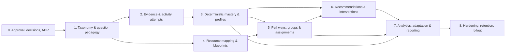

# Phase 0 — Architecture Review Report

> **DOCUMENT-CONTROL NOTE (2026-11-21):** this is the **historical Phase 0 review report** (2026-11-19).
> It records the review that led to the Phase 1 gate (D1, D2, D8) and the initial 14-decision register.
> It is **superseded for current status** by `docs/ARCHITECTURE-BASELINE.md` and
> `docs/PHASE0_DECISION_REGISTER.md` (which now carries D15). Retained unchanged as the review record.

**Status:** Review complete. Architecture is **READY FOR OWNER APPROVAL**.
**Date:** 2026-11-19
**Scope:** Architecture only. No source code, Prisma schema, migration, API route or UI was changed.
**Reviewed documents:**
- `docs/ADAPTIVE_LEARNING_ARCHITECTURE.md`
- `complete_adaptive_learning _system.md`
- `DESIGN THE COMPLETE ADAPTIVE LEARNING ARCHITECTURE..md`
- Read-only inspection of the existing Prisma schema, repositories, services, routes, UI entry points and tests.

**Related deliverables:**
- `docs/PHASE0_DECISION_REGISTER.md`
- `docs/ADR-0001-ADAPTIVE-LEARNING-FOUNDATION.md`
- Updated `docs/ADAPTIVE_LEARNING_ARCHITECTURE.md`

---

## 1. Executive verdict

The architecture is **pedagogically coherent and technically feasible**, but the first proposal contained several issues that had to be corrected before owner approval:

1. The high-stakes evidence count formula had an operator-precedence error.
2. Repeated attempts were handled by a single “latest per question” rule that could let formative retries erase summative evidence, or let a summative result erase recent improvement.
3. The evidence record did not explicitly store the assessment method, evidence lane, item key or weight components needed for reproducible explanation.
4. Teacher-assessed exercises had no per-objective/Bloom criteria, so a single exercise score could be attributed to the wrong objective or duplicated across objectives.
5. The evidence `source_type` list included source types with no corresponding table, notably `teacher_assessment`.
6. Tournament resources were not representable in resource maps or pathway items.
7. The roadmap placed the resource-map migration in Phase 2 while making Phase 4 responsible for resource mapping.
8. A mastery example used an inconsistent rubric weight, and the subject-rollup label was misleading.
9. Arabic/French support was described but lacked an explicit locale-selection/label/API-test plan.
10. Course-level mastery was not explicitly resolved from the existing `Course`/`Category` structure.
11. The threshold table could be read as requiring `M >= 0.85` for proficient, while the formula and Example 1 used `0.70 <= M < 0.85`. The bands are now explicitly cumulative; no threshold was changed.
12. The subject-rollup example showed `M = 0.740` with a “developing” label without stating that the display uses the minimum contributing objective. The rollup display rule is now explicit.
13. Retention (D9) did not define leave/transfer/deletion/school-closure/anonymization behavior.
14. Ingestion recovery (D10) relied on a dirty marker that cannot detect every crash window.
15. Evidence explanations (D12) did not give a complete four-part teacher/student explanation for every state.
16. Approval gates were ambiguous about whether all decisions were required before Phase 1.
17. Classification could be implemented from `Result.mode` alone, but the session path always writes `mode='exam'`; and an exam-shaped `Result` could carry client-supplied `mode`/`exam_id`/score. §E.2.1 fixes the classification and adds D13: summative evidence must be server-authoritative (`ExamSession` linkage + `GradingService` re-grade).

These are corrected in the updated architecture and summarized in this report. None required source code or a migration (the one added file is a test-only regression guard). The architectural direction is sound: additive pedagogical taxonomy, real evidence, deterministic mastery, teacher-controlled pathways, optional AI, and no duplicate assessment/course/game systems.

**Verdict:** Ready for the owner to review the fourteen decisions and the phase-gated approval table. Not ready for implementation until the required gate decisions are recorded and Phase 1 is explicitly authorized. (Owner dispositions 2026-11-19: D1, D2, D8 approved; Phase 1 authorized — Phase 1 only; `mastery-v1.1` acknowledged as an unvalidated candidate.)

---

## 2. Method and evidence policy

The review used only repository files and the provided specification. It did not:

- run a production database;
- use mock student data as evidence;
- infer Bloom/objectives from question text;
- create migrations or schema changes;
- modify application source.

Numerical examples in the architecture are illustrative test fixtures, not production claims. They were recalculated independently for this review.

---

## 3. Mastery methodology review

### 3.1 Verdict

The core formula is mathematically sound:

```
recency(e) = max(floor, 0.5 ^ (age_days / half_life_days))
effective_weight(e) = raw_weight(e) * recency(e)
W = Σ effective_weight(e)
M = Σ effective_weight(e) * credit(e) / W
C = 1 - exp(-W / confidence_k)
```

`M` is a weighted average in `[0,1]`; `C` is monotonic in `W` and bounded in `[0,1)`. The separation of mastery (`M`), evidence sufficiency (`C`), Bloom performance, difficulty and support level is correct. The “insufficient” state is pedagogically necessary and must not be displayed as a low grade.

**Threshold semantics.** The v1.1 constants are cumulative upper bounds: foundation `<0.55`, developing `0.55–0.70`, proficient `0.70–0.85`, advanced `>=0.85`. `proficient_below = 0.85` is the **upper bound** of the proficient band, not the entry requirement. Example 1 (`M=0.789`, `C=0.671`, two high-stakes items) is therefore `proficient` under the current default. This is not a calculation error. If the owner intends proficiency to start at `M >= 0.85`, that is a D5 policy change; Example 1 becomes `developing` and the tests must follow the owner’s decision.

However, the first proposal had consistency and policy issues that would have produced wrong or misleading results if implemented literally.

### 3.2 Mathematical consistency findings

| ID | Finding | Severity | Correction |
|---|---|---|---|
| M1 | High-stakes count expression was ambiguous: `source in {exam} or method in {...} and credit >= .60` lets exam evidence count regardless of credit if `and` binds tighter. | **Critical** | Use `(source = exam OR method = teacher_rubric) AND credit >= 0.60`, and count distinct evidence items. |
| M2 | `evidence_count` and `advanced_min_evidence` could count criterion rows, so one multi-criterion question could satisfy the four-item advanced gate. | **High** | Count distinct `evidence_item_key` values, not evidence rows. |
| M3 | `method` was used in policy/high-stakes prose but was not a stored evidence field. | **High** | Add `method = auto | teacher_rubric | self_report` to `LearningEvidence`. |
| M4 | `quality` was described as a source/method factor, but source and method weights were already in `raw_weight`; this risked double counting and was not used in the formula. | **High** | Removed `quality` from v1.1; source and method weights already represent quality. Any future completeness multiplier must be a named component and a new policy version. |
| M5 | `raw_weight` was stored, but its components were not, so a teacher could not reproduce the arithmetic from the evidence row. | **High** | Store `source_weight`, `method_weight`, `criterion_weight`, `point_factor` and `raw_weight`; recency and effective weight are computed at `as_of` from the stored `occurred_at` so a recomputation remains reproducible. |
| M6 | The point factor appeared as `min(max(1,max_points),3)` in F.2 but `min(max_points,3)` in E.9. | **Medium** | Use the explicit clamp `min(max(1, max_points), 3)` consistently. |
| M7 | In Example 3, the rubric was described as effective weight `≈1.015`, but `W=4.377`, `M=0.948`, `C=0.665` are only consistent with `≈0.908` (the exercise/teacher-rubric weight at 15 days). | **High** | Correct the example text to the actual effective weight and keep the verified arithmetic. |
| M8 | Example 4 displayed “Developing / proficient overall” for `M=0.740`. | **Medium** | Display “Developing overall (evidence-weighted); 67% coverage; partial coverage; policy under review.” Coverage is above the 0.50 provisional threshold, so the label is not “provisional by coverage.” |
| M9 | `success_count` had no definition. | **Medium** | Define `success_count` as distinct current items with credit ≥ 0.50; keep total attempts separately. |
| M10 | The trend section did not say whether repeated attempts were counted. Counting every retry can inflate a trend. | **High** | Use one representative per evidence item per window (latest by `occurred_at`, stable tie-break) for trend. |
| M11 | The rollup formula weights objectives by evidence weight, so heavily assessed objectives dominate the subject/course view. This is defensible but was not labeled. | **Medium** | Label the rollup “evidence-weighted, descriptive” and show coverage; do not present it as a curriculum-weighted level. Optionally cap objective weight or provide equal-objective weighting in a later policy. |
| M12 | `high_stakes_count` and `advanced_evidence_requirement_met` were described in prose but not fully specified in the pseudocode. | **High** | Add explicit definitions and gate order in policy v1.1. |
| M13 | `raw_weight` could be zero for self-report while evidence was still stored. | **Low** | Store self-report with zero mastery weight and label it “participation/self-check,” never mastery. |
| M14 | `max_points = 0` would divide by zero. | **Low** | Guard: `credit = max_points > 0 ? clamp(earned/max,0,1) : 0`; reject zero-max criteria. |
| M15 | The threshold row “proficient `<0.85`” could be read as an entry requirement of 0.85, contradicting Example 1 (`M=0.789`, proficient). | **High documentation risk** | State cumulative bands explicitly: proficient `0.70–0.85`; `proficient_below` is the upper bound. No threshold changed. If the owner wants 0.85 entry, record it as a D5 policy change and reclassify Example 1. |
| M16 | Example 4 displays `M=0.740` as “developing” without stating the rollup display rule, so it appears to contradict the proficiency band. | **Medium** | Display the rollup level as the minimum contributing objective level and show `M` separately as evidence-weighted; show 67% coverage as partial (above the 0.50 provisional threshold); policy remains under D5 review. This is a display-policy choice, not a threshold change. |
| M17 | Gate order was not fully normalized: `advanced_candidate` could remain after a gate, and the interaction of high-stakes, advanced and Bloom caps was prose-only. | **High** | Define the normative order: sufficiency → provisional band → high-stakes cap → advanced gate → Bloom/unclassified cap → recognition → override. Normalize `advanced_candidate` to `advanced` or `proficient`. |
| M18 | The API profile example showed `high_stakes_count: 1` for the same evidence as Example 1, which has two high-stakes items. | **Medium** | Correct the example to `2`; add a consistency test between narrative examples and API fixtures. |
| M19 | Classification could be implemented from `Result.mode` alone, but `ResultService.createFromSession` writes `mode='exam'` for **every** completed session, including a training exam. A training exam taken through the session runtime would then be classified summative and repeated training would satisfy the high-stakes gate. Separately, rule 4 alone is not enough: `mode`/`exam_id`/score are client-supplied on `POST /results` and bulk writes. | **Critical** | Add the normative classification in §E.2.1: a formal exam is `mode='exam'` **and** a real `exam_id` **and** joined `Exam.is_training=false`; every other `Result` is formative. `Exam.is_training` is the discriminator; `Result.mode` alone is not trusted. Add D13: a rule-4 row is `summative` only if server-authoritative (`ExamSession` linkage + `GradingService` re-grade). Add the positive, negative and `mode='training'`+real-`exam_id` classification tests. |
| M20 | Pathway success criteria used the key `min_confidence: 0.55`, the same name as the global insufficiency gate `min_confidence = 0.30` in F.2. A mis-wired pathway could silently move a gate. | **Medium** | Rename the pathway key to `min_proficiency_confidence` (default 0.55). No threshold value changed; only the colliding name is disambiguated. |

#### 3.2.1 Gate-order verification

The normative order in F.3.5 is now:

1. **Evidence sufficiency** — `W < 2.0` or `C < 0.30` → `insufficient`, no level. Low mastery with little evidence is not “foundation.”
2. **Provisional band** — cumulative `M`/`C` bands, producing `emerging`, `developing`, `proficient` or internal `advanced_candidate`.
3. **High-stakes cap** — no `proficient`/`advanced` without at least one high-stakes item at credit ≥ 0.60.
4. **Advanced gate** — only an `advanced_candidate` may become advanced; requires `C ≥ 0.75`, distinct item count ≥ 4, high-stakes count ≥ 1 and the advanced evidence requirement.
5. **Bloom/unclassified cap** — Evaluate/Create automatic-only evidence caps at `developing`; one qualifying rubric is required for proficient and two for advanced; an unclassified objective caps at `developing`.
6. **Recognition** — only after all caps; `summative_pending` is a badge, not a level.
7. **Teacher override** — display only; does not rewrite computed state, recognition or evidence.

No later gate may promote a state capped by an earlier gate. The advanced gate is the only promotion step, and it applies only to an `advanced_candidate` that passed the high-stakes cap. `advanced_candidate` is internal and must be normalized before storage/display.

#### 3.2.2 Independent example reconciliation

The architecture now contains a single reconciliation table (F.4.1). The review independently recalculated every value. The table below summarizes the outcome; the full inputs and gate-by-gate result are in the architecture document.

| Case | W | M | C | Final level | Key gate |
|---|---:|---:|---:|---|---|
| Example 1 | 4.452 | 0.789 | 0.671 | Proficient | Proficient band `0.70–0.85`; two high-stakes items; advanced fails on `M` |
| Example 1 with 0.85 entry (D5 alternative) | 4.452 | 0.789 | 0.671 | Developing | Only if the owner changes the entry threshold |
| Example 2a | 2.345 | 1.000 | 0.444 | Developing | `C < 0.55`; no high-stakes |
| Example 2b | 3.334 | 1.000 | 0.565 | Proficient | High-stakes passes; advanced fails on `C < 0.75` |
| Example 3a | 3.469 | 1.000 | 0.580 | Developing | Evaluate automatic cap |
| Example 3b | 4.378 | 0.948 | 0.665 | Proficient | One rubric satisfies proficient; advanced fails on `C` and rubric count |
| Example 4 | 9.000 | 0.740 | n/a | Developing overall, partial coverage | Minimum contributing objective display rule; 67% coverage is above the 0.50 provisional threshold |
| Example 5a | 2.378 | 1.000 | 0.448 | Developing | `C < 0.55` |
| Example 5b (counterfactual) | 3.657 | 0.845 | 0.599 | Proficient | Rejected by two-lane rule; not a production result |
| Single 3-point exam | 3.000 | 1.000 | 0.528 | Developing | One high-stakes item but `C < 0.55` |

**Distinction:** the arithmetic is correct in all cases. Example 1’s label is a threshold-band interpretation; Example 4’s label is a rollup display policy; Example 5b is a counterfactual showing why the two-lane rule is required. None is a hidden threshold change.

### 3.3 Repeated attempts: review and revision

#### Original rule

The first proposal used:

> For each `(question_id, objective_id, criterion_id)`, keep the latest active evidence.

That rule prevented simple farming, but it had two pedagogical flaws:

1. **A formative retry could erase a summative failure.** A student could fail a question in an exam, then answer the same question correctly in training after seeing feedback; the latest training row would replace the exam row. The student would appear to have a better current mastery and might no longer show high-stakes evidence.
2. **A summative result could erase recent improvement.** A later exam failure would replace a correct training result, hiding the improvement narrative from current mastery (though the full history remained in the evidence table).

It also made one recent correct answer disproportionately important when no other evidence existed.

#### Revised rule: two lanes, latest per lane

For current mastery, group evidence by:

```
(evidence_item_key, objective_id, criterion_identity, evidence_class)
```

where `evidence_class` is:

- **summative** — exam result, teacher rubric, teacher-assessed activity;
- **formative** — training, classroom game, tournament, Kids Space, self-directed exercise practice.

`criterion_identity` is `qcrit:<criterion_id>` for a question criterion, `acrit:<activity_criterion_id>` for an activity criterion, and `-` otherwise. It is a stored canonical identity so question and activity criteria cannot collapse when `criterion_id` is null.

For each group, keep the latest active evidence by `occurred_at` (tie-break `created_at`, then `id`). This yields at most one summative and one formative row per item/criterion.

Consequences:

- A training retry cannot overwrite an exam result.
- An exam result cannot overwrite recent training improvement.
- Repeated attempts of the same item in the same lane do not farm mastery.
- All attempts remain in `LearningEvidence`; current mastery is a selection, not a deletion.
- The teacher can show first attempt vs latest attempt, attempt count and trend.

For activity attempts, each teacher-assessed activity attempt is a distinct item. Keep the latest assessment per activity; do not merge different activities. Self-report has zero mastery weight.

#### Why this preserves learning history

`LearningEvidence` remains append-only in practice: rows are inserted, statuses can become `retracted`, and no mastery computation deletes them. The current mastery selection uses lanes, while:

- `attempt_count` counts all active attempts (including superseded ones);
- `current_evidence_count` counts the distinct current items;
- `success_count` counts distinct current items with credit ≥ 0.50;
- `first_attempt_credit` and `latest_attempt_credit` are available in the evidence trail;
- the trend uses one representative per item per window.

This satisfies “repeated attempts do not farm mastery” without erasing the student’s improvement history.

#### Residual policy decision

The owner may prefer first-attempt-only for high-stakes exams, or best-attempt within a lane. The recommended default is latest-per-lane because it reflects current performance while preserving the other lane. This is a pedagogical decision under D4/D5, not a hidden implementation choice.

### 3.4 High-stakes evidence review

#### What the gate does

`proficient` and `advanced` require at least one summative evidence item with credit ≥ 0.60. A teacher rubric or teacher-assessed activity satisfies this. Games, Kids Space and training never do.

#### Does it prevent legitimate formative learning recognition?

Potentially yes, if the UI simply says “Developing” to a student with excellent practice evidence. The correction is not to remove the gate, but to separate **evidence recognition** from the **level label**:

- Add `recognition = none | insufficient | formative_only | summative_pending | sufficient`.
- When there is no summative evidence but `M >= 0.80`, `C >= 0.60`, `W >= 3.0`, set `recognition='summative_pending'` and keep `support_level='developing'`.
- The UI says: “Strong practice evidence — ready for a short check,” not “not proficient.”
- Add recommendation rule `R10_SUMMATIVE_CHECK_READY` so the teacher can assign an existing exam or a short rubric task.
- A teacher override can promote the displayed level with a reason; the computed state remains visible.

This preserves the integrity of the `proficient` label while recognizing real formative learning. The thresholds are recommended defaults, not approved policy.

#### Edge conditions

- A single 3-point exam item correct, with no other evidence, yields `C ≈ 0.527`, below `proficient_confidence=0.55`, so one item alone cannot produce `proficient`. This is intentional.
- A student with many perfect training items can reach high `M` and `C` but remains `developing` with `summative_pending`; this is the intended conservative behavior.
- A student with a low-credit summative item (below 0.60) remains `developing`; a teacher can assign a recheck or use an override.
- Evaluate/Create **objectives** have an additional cap: automatic MCQ alone cannot exceed `developing`; one rubric at ≥0.70 is required for `proficient`, two for `advanced`. The cap is keyed to the objective’s primary Bloom, not applied to Remember/Understand/Apply/Analyze objectives.
- **One summative item is a minimum, not proof.** It can satisfy the high-stakes count, but a single perfect 3-point item **on its own** yields `C=0.528 < 0.55`, so it remains `developing`. A single item at 60% also fails the mastery band on its own. The residual risk is narrow sampling: the item may not represent the objective. The pilot must measure one-item proficiency and teacher disagreement; this is a D4 validation question, not a reason to lower the confidence gate now.
- **Teacher-rubric weight needs calibration.** The method weight is 1.2; a teacher-created activity uses source 1.1 (combined 1.32), while an exercise-based rubric uses source 0.9 (combined 1.08). Both can outweigh a 1.0 exam item before points/recency. That is intentional for open-ended reasoning but requires rubric descriptors, exemplars, moderation and a double-marking sample in the pilot.
- **Four items is a count, not a quality measure.** Four easy or near-identical items could satisfy `advanced_min_evidence`; `M≥0.85`, `C≥0.75`, high-stakes and Bloom gates still apply. The pilot must examine item breadth and blueprint coverage.
- **One policy for all subjects/ages is provisional.** The same `M` can mean different things across grades and subjects. The pilot must stratify and the owner may later approve grade/subject policy profiles as a new version.

#### 3.4.1 Pilot validation requirement

D4 and D5 must not be presented as scientifically validated. Before permanent adoption, the owner reviews a pilot report covering:

- teacher agreement with displayed levels, measured before the teacher sees the computed level;
- override rate and reasons;
- percentage of students proficient on exactly one high-stakes item;
- time spent in `summative_pending` and whether teachers can provide a check;
- rubric double-marking agreement and rubric-quality issues;
- distributions and error patterns by subject, grade, language and class;
- student comprehension of the English/French/Arabic wording;
- teacher workload and whether explanations lead to actionable next steps.

The report must separate mathematical correctness, implementation fidelity and pedagogical validity. A successful pilot supports a decision; it does not establish scientific validity.

### 3.5 Revised policy summary

The normative policy is in `docs/ADAPTIVE_LEARNING_ARCHITECTURE.md` §F and Appendix A. Key changes:

| Item | v1 draft | v1.1 review candidate |
|---|---|---|
| Algorithm version | `mastery-v1` | `mastery-v1.1` |
| Current evidence selection | latest per question/objective/criterion | latest per item/objective/**canonical criterion identity** **per lane** |
| Trend selection | “active, deduplicated” | latest per item/criterion per window |
| High-stakes count | ambiguous boolean | distinct items with `(summative) AND credit >= 0.60` |
| Evidence count | unspecified row/item | distinct `evidence_item_key` |
| Method | prose only | stored `method` |
| Weight breakdown | raw weight only | components + effective weight |
| Formative-only high mastery | capped `developing` | `developing` + `summative_pending` recognition |
| Evaluate/Create | automatic cap | cap scoped to the objective’s primary Bloom + rubric count requirements |
| Competency mastery | implied direct/rollup | explicit rollup of objective mastery, minimum contributing level, coverage flag, union counts |
| Point factor | inconsistent | uniform clamp 1–3 |
| Rollup label | “Developing / proficient overall” | Minimum contributing objective level; evidence-weighted `M` shown separately; coverage shown; below 0.50 is provisional, 0.50–1.0 with unassessed objectives is partial; policy under D5 review |

**Status:** recommended, provisional, not approved. D4 and D5 require explicit pedagogical approval.

---

## 4. Specification coverage review

### 4.1 Section-by-section status

| Specification section | Status | Where covered | Notes / correction |
|---|---|---|---|
| 1. Vision and objective | Covered | Executive summary, B, G, H | Complete adaptive ecosystem, not just tagging |
| 2. Revised Bloom six dimensions | Covered | B.2, B.3, D.2 | IDs, labels, descriptions, verbs, examples, objective links |
| 2. Bloom vs difficulty | Covered | B.2, A.4 | Separate axes; `difficulty` unchanged |
| 2. Independent attributes | Mostly covered | B.2, D.2, existing Question | Subject, category/topic, objective, competency, type, points, answer, rubric. **Course is derived** from Category/Course ancestry, not a direct Question column; see gap G1 |
| 3. Classification all question types | Covered | B.4, D.2, K.2 | Criteria are question-type agnostic; no replacement of question types |
| 3. Manual classification | Covered | K.2, J.3 | Pedagogy panel and filters |
| 3. AI-assisted classification | Covered | H.7, J.3 | Draft only, rationale/confidence, teacher accept/reject |
| 3. Multiple criteria | Covered | D.2, E.4 | Weighted criteria; sum validated |
| 3. Insufficient info flagged | Covered | D.2 status, K.2 | `needs_review` |
| 4. Continuous profile | Covered | B.6, F, D.3 | Objective/competency/Bloom/profile snapshots |
| 4. Multiple profile levels | Mostly covered | B.6, D.3 | Overall, subject, course, topic, skill, Bloom. **Course mastery needs an explicit scope resolver**; see G1 |
| 4. Attempts/success/recent/history/trend/confidence | Partially covered in schema | F, D.3 | Add `attempt_count`, `current_evidence_count`, `success_count`, `recent_mastery`, `previous_mastery`, `recognition`; do not rely only on snapshots |
| 4. Actual performance, points/weights | Covered | E, F | Evidence from answers, criteria, point cap |
| 4. Open-ended/rubric | Covered after correction | E.6, D.8 | `LearningActivityCriterion` required for per-objective rubric evidence |
| 4. Insufficient evidence vs poor performance | Covered | B.5, F.7 | `insufficient` state |
| 4. Avoid single-assessment dominance | Covered | F.2/F.3 | Point cap, confidence, evidence count, high-stakes gate |
| 5. Dynamic levels | Covered | B.7, F.3, G.7 | Per objective/competency/topic; no global level |
| 5. Teacher inspect/override | Covered | G.6, K.6 | Reason, audit, override expiry recommendation |
| 6. Recommendation engine questions | Covered | H.2–H.6 | Gaps, prerequisites, next resources, resources, verification |
| 6. Recommendation inputs | Covered | H.2 | Subject/topic via objective, Bloom, mastery, difficulty, history, interventions, resources |
| 6. Recommendation types | Covered | H.6 | Courses, exercises, activities/games, assessments |
| 6. Recommendation fields | Covered | H.6, D.4 | Reason, objective, Bloom, difficulty, duration, resources, success criteria, progression |
| 7. One class, multiple pathways | Covered | B.8, G, D.4 | Common core + pathways; no separate classes |
| 7. Flexible per-objective membership | Covered | B.8, D.4 | Groups are lightweight and per objective |
| 7. Teacher create/assign/modify/move/monitor/compare | Mostly covered | G.3, K.6, J.3 | **Add explicit “move student between pathways” endpoint/service operation**; see G2 |
| 7. Common essential objectives | Covered | B.8, L.7 | CourseClass/ExamClass retained |
| 8. Teacher workflow nine steps | Covered | G.3 | Diagnostic, analysis, pathways, validation, assign, monitor, reassess |
| 9. Class cognitive overview | Covered | K.6, J.3 | Distribution, Bloom, objectives, interventions, advanced, progression, pending |
| 9. Filters | Covered | K.6 | Class/subject/course/topic/objective/Bloom/date |
| 9. Individual profile | Covered | K.6, J.4 | Strengths, difficulties, history, courses, activities, next steps |
| 9. Meaningful visualizations | Covered | K.6/K.8 | Heatmap, bars, progression; reuse chart kit |
| 10. Assessment analytics | Covered | D.2 blueprint, K.3, J.3 | Objective/Bloom/difficulty/points/competencies; existing grading preserved |
| 10. /20 grading preserved | Covered | L.6, K.3 | No grading change |
| 11. Resource relationships | Covered | D.2, K.4/K.5 | Resource maps; questions via criteria; existing resources reused |
| 11. Manual mapping | Covered | K.4/K.5, J.3 | Teacher/admin mapping |
| 12. AI integration | Partially covered | H.7 | Current H.7 is classification/recommendation-heavy; add optional map for question quality, misconceptions, exercise/alternative explanation drafts, advanced challenges; all teacher-reviewed |
| 13. Data model entities | Covered with renames | B, C, D | `Competency(kind=skill)`, `LearningEvidence`, `StudentCompetencyMastery`, `LearningResourceMap` are the equivalents |
| 13. Traceability/history/reproducibility | Covered | E, F.6, D.3 | Source, snapshots, policy version |
| 13. Security/tenant | Covered | I.8, L.8, M.5 | Application-enforced tenant; tests |
| 13. No backend bypass/LocalStorage | Covered | A.1, K.11 | API-only |
| 14. UX/UI | Covered | K | Modern, labels, tooltips, cards, pathways, no overload |
| 14. French/Arabic RTL | Partially covered | B.3, K.9 | Add explicit locale selection, API error localization, Arabic numeral decision, RTL tests; new panels only |
| 14. No unrelated redesign | Covered | K.1 | Additive destinations/panels |
| 15. Pedagogical rules 1–12 | Covered | B, F, G | All twelve addressed; group naming should avoid stigma |
| 16. Incremental implementation | Covered | N, this report §9 | Phases with dependencies |
| 17. Acceptance scenarios 1–10 | Covered in substance | M, this report §4.2 | Add scenario-level test mapping |
| Final expectation | Covered | Whole document | Explainable, teacher-controlled, evidence-based |

### 4.2 Acceptance scenarios

| Scenario | Architecture support | Test/approval note |
|---|---|---|
| 1. Teacher creates Apply question with topic/objective/difficulty | Phase 1 taxonomy + question pedagogy | Unit/integration test: criteria, weights, tenant |
| 2. Assessment with all six Bloom dimensions | Blueprint + criteria | Coverage test; no grading change |
| 3. Individual profiles from actual answers | Evidence + mastery + profile | Exact mastery fixtures; no fake data |
| 4. Identify “understands but cannot apply” vs “does not understand” | Objective/Bloom separation | Bloom vs objective mastery test |
| 5. Different courses/exercises/games/assessments recommended | Recommendation engine + resource maps | Rule/ranking tests; no auto-assign |
| 6. Teacher validates/assigns without separate classes | LearningAssignment overlay | Access tests; common course unchanged |
| 7. New evidence updates mastery | Recompute + dirty state | Idempotency/recompute tests |
| 8. Foundation → Developing/Proficient in one competency only | Per-objective mastery; no global level | Cross-objective isolation test |
| 9. Teacher sees whether intervention improved performance | Before/after snapshots; analytics | Label association, not causation |
| 10. Works with existing systems | Additive schema/services; compatibility | Regression/contract suite |

### 4.3 Gaps and resolutions

| Gap | Impact | Resolution in updated architecture | Owner decision? |
|---|---|---|---|
| G1 Course context/mastery | Specification asks for course attribute/profile; existing Question has no `course_id` | Derive course scope from `Course.category_id` ancestry and `LearningResourceMap` targets; document a `CourseScopeResolver`; do not duplicate curriculum. If direct association is mandatory, add a join in Phase 4 | Product/architecture; not in the decision register, but should be confirmed with D2/D5 |
| G2 Move students between pathways | Scenario 7 requires it; no explicit endpoint in first draft | Add `POST /learning/assignments/:id/move` (or cancel + reassign) with enrollment/item-progress handling, audit and access recomputation | Product workflow; can be an engineering default within D11/Phase 5 |
| G3 AI capability breadth | Specification lists optional capabilities beyond classification | Expand H.7 into an optional capability map; all drafts teacher-reviewed; core works without AI | Product (AI enablement), not pedagogical threshold |
| G4 Full-app RTL | Specification asks for existing multilingual requirements | Deliver new panels in en/fr/ar with RTL; full-app RTL is a separate project (D8) | Yes — D8 |
| G5 Diagnostic assessment | Workflow asks for diagnostic | Reuse existing exams/training exams and assign as diagnostic; no new engine; record baseline via intervention/profile snapshot | Product workflow; Phase 5/6 |
| G6 Attempt history fields | Specification asks for attempts/recent/historical | Add counts and recent/previous mastery fields; all attempts retained | Engineering, within D5 |
| G7 Course/objective direct association | See G1 | Same as G1 | Confirm with D2 |
| G8 AI misconception analysis | Specification lists as potential | Optional aggregate pattern analysis from evidence; never diagnose psychological traits; teacher decides | Product/pedagogy if enabled |

---

## 5. Architecture findings

### 5.1 Critical findings (must be corrected before implementation)

| ID | Finding | Correction |
|---|---|---|
| C1 | High-stakes count formula precedence error | Correct formula and tests; distinct items, `AND credit >= 0.60` |
| C2 | Repeated-attempt rule could erase the other evidence class | Two-lane latest-per-lane selection; all attempts retained |
| C3 | Teacher-assessed exercises had no per-objective/Bloom criteria | Add `LearningActivityCriterion`; evidence from criteria, not lesson-wide guesses |
| C4 | Evidence lacked `method`, lane, item key, canonical criterion identity, source fingerprint and weight components | Add fields; update dedupe and tests |
| C5 | `source_type='teacher_assessment'` had no source table | Limit source types to `result` and `activity_attempt`; teacher assessment is a `LearningActivityAttempt` with assessed criteria, producing evidence with `method='teacher_rubric'` (the attempt table has no `method` column) |
| C6 | Phase 2/4 roadmap contradiction | Phase 2 ingests question/result evidence and activity criteria; Phase 4 owns `LearningResourceMap` UI and blueprints |

### 5.2 High findings

| ID | Finding | Correction |
|---|---|---|
| H1 | `LearningIntervention` could be read as an evidence source but had no evidence relation | Treat interventions as pedagogical actions; teacher observation that counts is an activity attempt. Document explicitly |
| H2 | Tournament resources absent from maps/pathways | Add `tournament_id`; update CHECK constraints and UI resource picker |
| H3 | `LearningActivityAttempt` CHECK forced exactly one lesson/course, excluding ad hoc activities/projects | Allow `lesson_id`, `course_id`, or a stable `activity_ref`; exactly one |
| H4 | No idempotency key for activity attempts | Add `attempt_number` + unique `(school_id, student_id, resource_key, attempt_number)` |
| H5 | `evidence_count`/`advanced_min_evidence` ambiguity | Count distinct `evidence_item_key`; add tests with multi-criterion questions |
| H6 | `quality` ambiguity/double-counting | Removed from v1.1; source and method weights represent quality; a future multiplier requires a named component and a new policy version |
| H7 | Example 3 inconsistent rubric weight | Correct to ≈0.908 and verify M/C |
| H8 | `StudentObjectiveMastery` lacked recent/previous performance and attempt counts | Add fields; snapshots alone are insufficient for table queries |
| H9 | Course mastery not explicitly resolved | Add `CourseScopeResolver`; document derived scope |
| H10 | Localization lacked locale source, API errors, numeral policy and tests | Update K.9 and tests |
| H11 | Movement between pathways not represented | Add move operation/endpoint with audit |
| H12 | `LearningAssignment` target membership not guaranteed by DB | Service must validate student belongs to class and group belongs to class; add tests |
| H13 | `LearningPathway` objective nullable but described as one objective | Either require objective for recommendation-driven pathways or document multi-objective/general pathways; service semantics must be explicit |

### 5.3 Medium findings

| ID | Finding | Correction |
|---|---|---|
| M1 | `StudentBloomPerformance` has no FK for polymorphic scope | Keep polymorphic but validate scope keys and cleanup on resource deletion; add tests |
| M2 | Unique constraints did not consistently include `school_id` | Add tenant-safe unique constraints where appropriate |
| M3 | `LearningResourceMap` unique does not prevent duplicate role semantics | Validator enforces one role per resource/objective/context; document |
| M4 | `LearningPathwayItem` unique allows same resource at different order | Validator rejects duplicate resource in a pathway; add test |
| M5 | `LearningAssignment` class/student membership checks are service-only | Explicit service validation + integration tests |
| M6 | `LearningRecommendation` is student-only; no group recommendation entity | Aggregate per-student recommendations for group display; no new entity in v1 |
| M7 | `LearningStudentState` is student-wide, not scope-specific | Accept; dirty/stale state triggers bounded full-student recompute; receipt ledger drives recovery; document performance |
| M8 | `StudentCognitiveProfile` snapshots can grow large | One/day + intervention references; D9 retention lifecycle and final periods before pilot |
| M9 | Evidence ingestion may run in request path | Post-commit, bounded, try/catch, durable receipt, dirty/stale state; no result failure |
| M10 | Backfill may be slow on SQLite | Chunked, off-peak, dry-run, progress, admin-only |
| M11 | `LearningPathway` level required but pathway may be mixed-level | Require level for recommendation-driven pathways; allow `mixed` only if product approves; document |
| M12 | `LearningObjective` lacks explicit course field | Derived scope; see G1 |
| M13 | `Question.pedagogy_status` cache can drift from criteria | Service updates atomically with criteria replacement; add reconciliation test |
| M14 | `primary_bloom_dimension_id` cache can drift | Recompute on criteria write; test tie-break by catalog order |
| M15 | `LearningEvidence.criterion_id` SetNull can lose criterion after deletion | Objective/Bloom snapshots and stored `criterion_identity` remain; taxonomy archive preferred; add test |
| M16 | `LearningObjective` mastery `onDelete: Cascade` conflicts with archive-only policy | Change to `Restrict` or prohibit hard delete when referenced; document |
| M17 | `LearningEvidence` “immutable” vs retraction status | Clarify content is immutable; status/retraction metadata may change. A correction changes `source_fingerprint`, inserts a new row and retracts the old one. |
| M18 | L.1 says “asynchronously/best-effort” but A.6 says no queue | Use “post-commit best-effort, no queue” consistently |
| M19 | “Existing API contracts unchanged” vs personalized course/exam additions | Clarify additive optional fields/items; older clients ignore; feature-flag off by default |
| M20 | Group names like “Support A” can stigmatize | Use neutral, private group names; no public labels |

### 5.4 Missing relationships

1. **`LearningActivityCriterion`** — per-objective/Bloom/competency rubric for an exercise/activity attempt. Without it, activity evidence cannot be attributed defensibly.
2. **`Tournament` ↔ `LearningResourceMap`/`LearningPathwayItem`** — existing tournament system is a valid resource and activity source.
3. **`LearningActivityAttempt` idempotency/attempt family** — otherwise retries can duplicate evidence.
4. **`LearningEvidence` weight components/method/lane** — needed for reproducibility and dedupe.
5. **`StudentObjectiveMastery` recent/previous/attempt counts** — needed for the specification’s profile fields.
6. **Course scope resolver** — not a table, but an explicit service relationship from `Course.category_id` and resource maps to objectives.
7. **Assignment move operation** — cancel/reassign semantics and audit, not a new table necessarily.
8. **Localization source** — `app.language`/user preference and labels; not a DB relationship but a cross-cutting contract.
9. **Intervention evidence** — clarified as not a source; if teacher observation must count, create an activity attempt. This avoids a misleading missing FK.

### 5.5 Contradictions found and resolved

| Contradiction | Resolution |
|---|---|
| Evidence “immutable” but retraction/reactivation allowed | Content is immutable; status transitions are recorded; no hard delete in normal flow |
| “Asynchronous/best-effort” vs “no job queue” | Post-commit best-effort, no queue; durable receipt plus dirty/stale state and bounded reconciliation |
| Phase 2 includes `learning_resources` but Phase 4 owns resource mapping | Phase 2 uses criteria/activity criteria; Phase 4 owns resource maps and blueprints |
| `source_type='teacher_assessment'` but no teacher assessment table | Use `LearningActivityAttempt` + assessed criteria, producing evidence with `method='teacher_rubric'` |
| `Result.mode` described as the exam/training discriminator, but the session path writes `mode='exam'` for training exams too | Classification is normative in §E.2.1 and does not trust `Result.mode`: a formal exam requires `mode='exam'` **and** a real `exam_id` **and** `Exam.is_training=false`; all other results are formative. A `mode='training'` row with a real `exam_id` is **not** exam evidence. See M19. |
| Rule 4 (`mode='exam'` + real `exam_id` + `is_training=false`) treated as sufficient for `summative`, but `mode`/`exam_id`/score are client-supplied on `POST /results` and bulk writes | Add D13: a rule-4 row is `summative` only if server-authoritative (linked committed `ExamSession` + `GradingService` re-grade); otherwise demoted to `formative` and flagged. See M19/§5.13. |
| High-stakes prose vs formula | Corrected boolean precedence and distinct item count |
| Automated MCQ cannot prove advanced reasoning vs Bloom performance scores | Evaluate/Create cap/rubric gates; Bloom performance is a performance view, not mastery |
| “No global level” vs overall profile/Bloom overall | Overall views are descriptive performance/coverage, not a global level; UI must not render a global badge |
| “Existing response shapes unchanged” vs personalized course items | Additive optional items/fields only, gated by feature flag; legacy behavior preserved when no assignment |
| Course mastery required vs no objective–course relation | Derived course scope via category/resource maps; document and test |
| Teacher override vs computed mastery | Override changes displayed level only; computed state remains; recommendations use effective level with computed rationale |

### 5.6 Unnecessary complexity / simplification opportunities

| Area | Assessment | Recommendation |
|---|---|---|
| 24+ new tables | Large but mostly justified by taxonomy/evidence/pathways | Keep; do not add a second content/assessment/game system |
| `StudentBloomPerformance` polymorphic scopes | Flexible but no FK | Keep with validated scope keys; do not add six separate tables |
| `StudentCognitiveProfile` full snapshots | Useful for audit but storage-heavy | Bound retention; store summary + payload; one/day |
| `LearningStudentState` | Minimal retry marker | Keep; do not turn it into a queue |
| `LearningResourceMap` + `LearningPathwayItem` | Appears duplicative | Distinct: catalog mapping vs ordered pathway; keep |
| `LearningGroup` + assignment + enrollment + item progress | Four tables | Necessary for group/individual assignments and progress; keep |
| `AssessmentBlueprint` | Optional; not needed for grading | Keep optional; no new exam engine |
| AI suggestion tables | Only needed if AI enabled | Keep but feature-flag; no AI writes |
| `quality` field | Redundant/ambiguous | Remove or define narrowly; prefer removal in v1 |
| `LearningRecommendation` group-level entity | Not necessary for v1 | Aggregate per-student; no new table |
| `LearningActivityAttempt` ad hoc activity model | Could explode scope | Support lesson exercise + teacher activity linked to lesson/course first; ad hoc `activity_ref` optional |

### 5.7 Scalability findings

| Risk | Why | Mitigation |
|---|---|---|
| Evidence row growth | One row per question criterion per attempt, plus activities | Indexes, batch insert, retention, no full-table loads |
| SQLite write contention | Ingestion near result writes | Post-commit, short transactions, `createMany`/`INSERT OR IGNORE`, no long recompute in transaction |
| Recompute cost | Student may have many evidence rows | Recompute only affected student/objectives/Bloom; bounded batch; dirty/stale state |
| Class heatmap | Students × objectives query can be large | Indexed grouped queries, pagination, precomputed mastery rows |
| Backfill | Large historical scans | Dry-run, chunked, off-peak, admin-only |
| Profile snapshots | Full JSON payload per student/scope/day | Retention, one/day, intervention-only extra snapshots |
| Recommendation generation | Class-wide candidate ranking | Batch cap, objective filter, cooldown |
| No queue | Stale profiles/backlog | Durable receipt ledger, bounded reconciliation/replay, freshness indicator, recompute endpoint, monitor pending/failed receipts; revisit queue later |
| AI calls | Latency/cost/privacy | Feature flag, rate limit, draft-only, no cross-tenant data |

### 5.8 Important positive findings

- The architecture does not duplicate question/exam/course/game systems.
- Feature flags default off; existing product remains a no-op until opt-in.
- Evidence is traceable to a real source and tenant-scoped.
- Mastery is deterministic and versioned.
- The UI plan separates Overview from detailed Learning views.
- No global level, no ranking, no LocalStorage authority.
- Teacher control and audit are explicit.

### 5.9 D9 retention and privacy lifecycle

The original D9 recommendation (“retain evidence while the student account exists”) was too vague to review. It did not distinguish an active account from a student who leaves, transfers, or is deleted, and it could be read as indefinite retention. The architecture now defines the lifecycle in L.11 and the register expands D9.

| Scenario | Required behavior | Privacy effect |
|---|---|---|
| Remains enrolled | Retain identifiable evidence while active; bounded snapshots | Normal school retention |
| Changes class | Objective mastery stays with the student; historical class context retained; archive classes rather than hard-delete | Old teacher access follows current class scope |
| Transfers to another school | Leave + new account; no cross-tenant evidence copy | Origin retains; destination starts fresh |
| Leaves school | Deactivate, start retention clock, no new evidence | Identifiable until retention action |
| Account deleted | Cascade student-linked adaptive rows; audit actor null, payload minimized | No student-level adaptive data remains |
| School closed | Suspend by default; hard delete only through platform runbook | Suspension retains; hard delete cascades |
| Corrected/retracted | New evidence or retraction; history preserved | Old row remains identifiable while account exists |
| Anonymization requested | Not a v1 student-level operation; separate de-identified archive required | Privacy design required before implementation |

The review also found that `LearningSourceIngestion` must carry `student_id` so it cascades and does not become an orphaned source-linking record after account deletion. D9 cannot be approved as “indefinite retention”; the owner must record retention period, deletion vs anonymization, cross-school transfer, audit retention and whether pre-aggregated statistics survive deletion. The final policy must be approved before a real-school pilot.

L.11 now also carries a **record-first matrix** (evidence, activity attempts, mastery + snapshots, interventions/assignments, audit, receipts, aggregated statistics) across the same events, marking each cell **P** (proposed, still unapproved) or **A** (requires owner/privacy approval with no default). It separates “proposed in the architecture” from “requires owner/privacy approval,” so the owner can approve one record class at a time and cannot read any cell as already decided. Nothing in D9 is approved.

### 5.10 D10 ingestion recovery and reconciliation

A dirty marker alone is insufficient. The architecture now adds `LearningSourceIngestion` as a durable receipt/reconciliation ledger, not a job queue. It closes these crash windows:

| Failure | Detection | Recovery |
|---|---|---|
| Source committed; evidence ingestion fails | Missing/failed receipt | Replay from source |
| Crash before receipt | Source row without receipt | Bounded source scan creates receipt |
| Crash after pending receipt | Pending receipt with expired lease | Claim, replay, complete |
| Evidence inserted; receipt incomplete | Pending receipt + existing dedupe | Insert-or-ignore, mark complete |
| Evidence inserted; recompute fails | Dirty marker or watermark gap | Recompute affected scopes |
| Result corrected/deleted | New fingerprint or missing source | New evidence/retraction, recompute |
| Duplicate delivery | Unique receipt/dedupe conflict | Return existing result |

The design remains queue-free: no broker, worker or scheduler. Processing is inline, on-demand, or a bounded startup/admin sweep. Profiles expose `freshness` (`fresh`, `stale`, `recomputing`, `error`); stale profiles and students see an “updating” message, not a definitive level. Admin health shows backlog/failure counts without student identities. This is sufficient for v1 if bounded reconciliation is actually built and tested in Phase 2; a queue remains a later option only if backlog/latency evidence demands it.

The architecture and register now also fix the operating parameters the earlier draft left implicit: named triggers (post-commit hook, startup sweep, scheduled bounded sweep that is **disabled by default**, admin/CLI run, correction/deletion hook); bounds (`limit=500`, max 5000, oldest-first, one `lease_until` per receipt, single-flight per school); downtime catch-up in bounded batches that cannot lose evidence because source rows are committed by the existing app; bounded exponential-backoff retries (1m/5m/15m/1h, `max_attempts=5`, then `failed` for manual review); duplicate prevention via the receipt unique key plus `dedupe_key` with a tested double-replay; and admin inspection endpoints (status + failed-receipt list) that expose no student names in the aggregate view. No queue is introduced.

### 5.11 D12 evidence explanation

The original D12 default listed what to show but did not explain how to distinguish a low level from insufficient evidence. The architecture and register now require every explanation to answer four questions: observed performance, evidence sufficiency, missing/limiting condition, and next action. Teacher and student wording is provided for foundation, developing, proficient, advanced, developing + `summative_pending`, and insufficient evidence.

The review specifically confirms:

- “Insufficient evidence” is never presented as a low grade.
- `summative_pending` is never presented as a level or as “proficient.”
- A stale profile is labeled before any level is shown.
- Students are not shown raw weights, dedupe keys, model constants or peer comparisons.
- Teacher overrides are labeled “Teacher-set level” and do not erase computed evidence.
- The wording avoids “weak”, “slow”, “low ability” and “failed” in all three languages.

### 5.12 Approval gates

The original wording could be read as requiring all decisions before Phase 1. The register now has a normative dependency table:

| Phase | Required decisions |
|---|---|
| Phase 1 | D1, D2, D8 |
| Phase 2 | D3, D7, D9 (retention direction), D10, D12, D13 |
| Phase 3 | D4, D5, D6, D14 |
| Phase 4 | No new decision |
| Phase 5 | D11 |
| Phase 6 | No new decision; D4/D5/D12 remain |
| Phase 7 | No new decision; D9/D12 remain |
| Phase 8 | D9 final retention/privacy; D8 full-app RTL if required; D10 re-evaluation |

A decision may be explicitly deferred to its dependent phase, but a deferral is not approval and cannot be used as an implementation default. D4/D5 may be deferred until Phase 3; D9’s retention direction must be approved before Phase 2 ingests real student evidence; D13 must be approved before Phase 2 promotes any `Result` to `summative`. Mandatory pedagogical, privacy and security approvals are not weakened.

### 5.13 D13 summative-evidence trust boundary

**Finding.** The classification rule 4 (`mode='exam'` **and** a real `exam_id` **and** `Exam.is_training=false`) answers *which rows are exam-shaped*, but not *whether they can be trusted*. Inspection of the write paths shows `mode`, `exam_id` and the score are **client-supplied** on `POST /api/v1/results` (`src/backend/routes/results.routes.js:566-655`) and `POST /api/v1/bulk/results` (`src/backend/routes/bulk.routes.js:545-676`); `answers_json` (including any `correct` flag) is stored verbatim and the score is not re-graded. Only `POST /api/v1/sessions/:id/submit` → `ResultService.createFromSession` (`src/backend/routes/sessions.routes.js:141`; `src/frontend/services/ResultService.js:16-60`) derives `exam_id`/`user_id` from the committed `ExamSession` and recomputes the score server-side.

**Impact if unaddressed.** A client could post `mode='exam'` with a real non-training `exam_id` and an arbitrary score and be classified `summative`, defeating the high-stakes gate (D4). Rule 4 alone is necessary but not sufficient.

**Correction (now normative in the architecture and register).** Add D13: a rule-4 row is promoted to `summative` only when it is server-authoritative, which is a conjunction of five checks — (1) joined `Exam.is_training=false` and tenant match; (2) `ExamSession` linkage on `exam_id` + `user_id` (non-null) + `school_id`; (3) session `status='completed'` with `completed_at` set and `date_taken >= started_at`; (4) single use (one `Result` per session; a repeat submit on a completed session is rejected); (5) re-grade with `GradingService.gradeAttempt`, never a client `correct` flag or score. A rule-4 row that fails any check is ingested `formative` and flagged (`trust='client_supplied'` / `'session_mismatch'` / `'session_reused'`) for admin review. **Governance guard:** flipping `Exam.is_training` with existing results requires an impact count, a per-change confirmation naming the consequence, an immutable audit record, and reconciliation-based recovery (retract `source_reclassified` + recompute) — never evidence edits. **Offline/paper exams (part of D13):** a row with no session is `formative` unless a teacher/admin explicitly attests the import; attested evidence is `summative` with `method='teacher_attestation'` and `trust='teacher_attested'`, is attributed and reversible (`attestation_revoked`), and is never an unattested bulk row. **D14:** every `is_training=false` exam is high-stakes by default, with an audited opt-out (`Exam.is_high_stakes`) for formal-but-non-summative exams (diagnostic/placement); the high-stakes condition reads `((source_kind='exam' AND exam_is_high_stakes) OR method='teacher_rubric') AND credit >= 0.60`. Zero code change is proposed in Phase 0; this is a Phase 2/3 design constraint.

---

## 6. Arabic/French and RTL review

### 6.1 Current state

The existing application has an `app.language` setting and content-language fields for courses, exercises and kids games. The HTML entry points are currently `lang="en"`, and there is no evidence of a complete UI-wide translation layer or full RTL layout. Therefore, the architecture should not claim full-application RTL.

### 6.2 Required corrections

1. **Label dictionary:** new learning labels in `src/frontend/learning/labels.js` with `en`, `fr`, `ar`.
2. **Bloom labels:** `BloomDimension.labels_json` with `en`, `fr`, `ar`; fallback to English.
3. **Locale source:** use existing `app.language` default; a user preference may override within the new panels.
4. **Direction:** `dir="rtl"` on the learning panel root when Arabic; CSS logical properties; test mixed content (numbers, dates, question text).
5. **Numbers/dates:** decide Western vs Eastern Arabic numerals; use `Intl` formatters with an explicit locale; do not hardcode.
6. **API messages:** new validation/error messages need French/Arabic strings or a documented fallback; do not leave English-only errors in Arabic UI.
7. **Translations:** pedagogical review of “mastery,” “developing,” “proficient,” “advanced,” “evidence,” “pathway,” “intervention”; avoid stigmatizing terms.
8. **Tests:** RTL smoke test for Learning and My Learning panels; Arabic label snapshot/key coverage; no hardcoded left/right CSS.
9. **Scope:** new panels only; full-app RTL is a separate project (D8).

### 6.3 Verdict

The architecture **supports** French/Arabic for the new learning interfaces after the K.9 corrections, but full-app RTL is not delivered. The owner must approve the scope. This is D8.

---

## 7. Backward-compatibility and existing-functionality review

### 7.1 Confirmed safeguards

- Only `Question` gains nullable columns with defaults; no existing column is renamed/retyped/removed.
- New tables are additive; no existing table rebuild.
- Existing question create/update remains valid without pedagogy fields.
- Existing exam create/update/grading/session/result flows are unchanged.
- Evidence ingestion is post-commit and must never fail result persistence.
- Existing `CourseClass` and `ExamClass` grants remain authoritative; personalized assignments are an additive overlay.
- Existing API responses remain valid; new fields/items are optional and feature-flagged.
- No adaptive data in bootstrap preload.
- No LocalStorage authority; offline adaptive data is unavailable/read-only.
- New permissions are added, not renamed.
- Feature flags default off; disabling hides features without deleting data.
- Rollback is feature-first; tables can remain.

### 7.2 Conditions that must be tested before release

1. Existing question create/update without pedagogy.
2. Existing exam create/assign/start/submit/grade/result.
3. Existing course/lesson/exercise generation and student access.
4. Existing classroom game/tournament/Kids flows.
5. Existing analytics/Overview payloads.
6. Existing offline behavior with adaptive flags off.
7. Existing tests pass unchanged.
8. Migration applied to an existing database snapshot, not just an empty DB.
9. Tenant/role/class access matrix.
10. Feature-flag off means no adaptive API calls, no new UI, no ingestion.

### 7.3 Verdict

The architecture **preserves existing functionality** if the additive/feature-flag rules are followed. No source code was changed in Phase 0.

---

## 8. Decision register outcome

The detailed register is `docs/PHASE0_DECISION_REGISTER.md`. All fourteen decisions have a recommended default and, except D1, D2 and D8 (approved 2026-11-19 for the Phase 1 gate), **none is approved**. Decisions are not all required before Phase 1; each must be approved, revised, or explicitly deferred to the phase that depends on it.

### 8.1 Decisions required before each phase

| Gate | Decisions that must be approved, revised or explicitly deferred with an owner and target date | Why this gate |
|---|---|---|
| Before Phase 1 | D1, D2, D8 | Phase 1 writes user-visible labels, objective authority and localized catalogue text; changing them later is expensive and can stigmatize students |
| Before Phase 2 | D3, D7, D9 (direction), D10, D12, D13 | Phase 2 starts real evidence ingestion, game evidence, receipt/reconciliation, the summative trust boundary and evidence visibility; privacy direction must exist before real student data arrives and no row may be promoted to `summative` before D13 |
| Before Phase 3 | D4, D5, D6, D14 | These determine how mastery is computed, displayed and overridden and which exams count as high-stakes; they may be provisionally approved for engineering against fixtures and must be finalized before a real-school pilot uses levels |
| Before Phase 4 | No new decision; D2 still governs | Resource mapping depends on Phase 1 objective governance |
| Before Phase 5 | D11 | Personalized assignments and access overlays are the product decision D11 covers |
| Before Phase 6 | No new decision; D5/D6 and D12 remain binding | Recommendations consume mastery and explanation policy |
| Before Phase 7 | No new decision; D9/D10/D12 remain binding | Reporting exposes profiles, freshness and retention behavior |
| Before Phase 8 / real-school pilot | D9 final retention and privacy approval; D8 full-app RTL decision; D10 queue re-evaluation | Production rollout, pupil-data processing and localization commitments require final sign-off |

**Deferral rules:**

1. A deferral is a recorded disposition, not an approval.
2. A deferral must name the dependent phase, the accountable owner and a target date.
3. A deferral cannot be used to skip a mandatory pedagogical, privacy or security gate; it only moves the decision to the phase where it becomes binding.
4. D4 and D5 may be provisionally approved for Phase 3 fixture testing, but must be finalized before any real student sees a mastery level.
5. D9 must have an approved retention and deletion direction before Phase 2 stores real evidence; final retention periods may be completed before the pilot.
6. If a dependency is deferred without an owner/date, the dependent phase is blocked, not silently unblocked.

### 8.2 Decisions that may be safely deferred

| Decision | Safe deferral | Condition |
|---|---|---|
| D3 backfill | Before Phase 2 apply; engineering may build the dry-run in Phase 2 | No historical evidence is imported until approved |
| D4/D5/D6 | Provisional for Phase 3 fixtures; final before pilot | No real student level is published on provisional thresholds |
| D7 games | Before Phase 2 game ingestion | Games can remain excluded while other evidence is ingested |
| D9 | Direction before Phase 2; final periods before pilot | No indefinite retention; deletion and transfer behavior must be specified before real data |
| D10 | Approved in Phase 2; queue decision re-evaluated in Phase 8 | Receipt/reconciliation is mandatory even if no queue is added |
| D11 | Before Phase 5 | No personalized assignment is built before approval |
| D12 | Before Phase 2 evidence API; wording review before Phase 3 levels | Evidence can be stored without exposing it, but not exposed without approval |
| D13 | Before Phase 2 promotes any `Result` to `summative` | Exam evidence can be ingested as `formative` while the trust-boundary check is built, but nothing may satisfy the high-stakes gate until D13 is approved |

The recommended defaults in the register are the defaults used by the updated architecture. They are not accepted until the owner records a disposition.

---

## 9. Final implementation roadmap (Phase 0–8)

This roadmap supersedes the earlier roadmap where they differ. It maps the specification’s suggested phases to the architecture phases and adds the Phase 0 corrections.

### 9.1 Dependency graph



### 9.2 Phase plan

#### Phase 0 — Approval, decisions and ADR

**Goal:** Freeze the architecture and policy candidate; no implementation.

**Deliverables:**
- This review report.
- Decision register with all 14 decisions.
- ADR-0001.
- Updated architecture document with v1.1 policy candidate and schema corrections.
- Owner approval record.

**Acceptance criteria:**
- Every decision has an owner, a disposition (approved, revised, or deferred) and a date.
- Every deferral names the dependent phase and accountable owner.
- D1, D2 and D8 have dispositions before Phase 1.
- D4/D5 are either provisionally approved for fixtures or explicitly deferred to Phase 3 with an owner; final approval is mandatory before a real student sees a level.
- D9 has an approved direction before Phase 2 stores real evidence; final retention periods are approved before the pilot.
- No source code, migration, API route or UI changed.
- Architecture marked READY FOR OWNER APPROVAL, not approved.
- Implementation authorization is recorded separately.

**Spec mapping:** §16 “First perform audit and architecture”; no implementation.

#### Phase 1 — Taxonomy and question pedagogy

**Dependencies:** Phase 0; D1, D2 and D8 dispositions recorded. D3–D7, D9–D12 may remain deferred to their dependent phases.

**Deliverables:**
- Migration: Bloom catalog, `LearningObjective`, `Competency`, `LearningObjectiveCompetency`, `LearningPrerequisite`, `QuestionAssessmentCriterion`, `QuestionClassificationSuggestion`, `Question` nullable pedagogy fields.
- Bloom seed with EN/FR/AR labels.
- Objective governance: admin create/approve; teacher proposal/mapping; school flag for teacher creation.
- Criteria CRUD, weight validation, primary Bloom cache, suggestion review.
- Pedagogy panel and filters; bulk classify.
- New permissions; audit.
- Unit/integration tests; existing tests unchanged.

**Acceptance criteria:**
- A teacher can classify a question with one or more criteria; weights sum to 1.
- A question without criteria still works in every existing flow.
- Bloom is independent of difficulty.
- Cross-tenant objective/competency/Bloom IDs rejected.
- Teacher cannot access another class/tenant.
- No evidence/mastery rows written.
- Existing question/exam/game tests pass.

**Spec mapping:** Phases 1–2.

#### Phase 2 — Evidence and activity attempts

**Dependencies:** Phase 1; D3, D7, D10, D12 and D13 dispositions recorded; D9 direction approved. D4/D5/D6 may still be deferred to Phase 3.

**Deliverables:**
- Migration: `LearningEvidence`, `LearningActivityAttempt`, `LearningActivityCriterion`, `LearningSourceIngestion`, indexes/constraints; minimal `LearningStudentState`.
- Evidence normalizer for result/game/tournament/Kids shapes.
- Classification per §E.2.1 (joins `Exam.is_training`; never trusts `Result.mode` alone), with positive/negative classification tests including a training exam taken through the session runtime.
- Durable source receipt, dirty/stale marker, idempotent reconciliation/replay endpoint and freshness fields.
- Dedupe/retraction; two-lane selection fields; attempt metadata.
- Post-commit hooks for results, sessions, games, tournaments, Kids (logged-in only).
- Activity attempt/submit/assess endpoints with per-criterion teacher assessment.
- Backfill CLI/admin dry-run (default off).
- Tests for shapes, idempotency, retraction, unmapped evidence, anonymous sessions, crash windows, duplicate delivery and reconciliation without duplication.

**Acceptance criteria:**
- Real exam/training/game/kids result produces evidence with provenance.
- A training exam (even when the session path writes `mode='exam'`) is classified formative and cannot contribute to `high_stakes`; repeated training attempts never reach `proficient`.
- Teacher-assessed activity produces evidence only through criteria.
- Repeated ingestion creates no duplicates.
- Aggregate-only results are not distributed.
- Unmapped evidence is stored but excluded from mastery.
- Retry/correction retracts old evidence and preserves history.
- Result submission never fails because evidence ingestion failed.
- A committed source row without evidence is detectable and replayable; replay does not duplicate evidence.
- A crash before the dirty marker is recoverable from the receipt ledger, not the marker alone.
- Stale or incomplete profiles are visible to teachers/admins and explained non-stigmatizingly to students.
- Deletion/transfer behavior follows the approved D9 direction.
- Backfill dry-run writes nothing.
- No mastery rows yet (or feature-flagged off).

**Spec mapping:** Phase 3 partly; evidence model §13.

#### Phase 3 — Deterministic mastery and profiles

**Dependencies:** Phase 2; D4, D5 and D6 approved or revised. Provisional approval may be used only for fixture tests; final approval is required before real students see levels.

**Deliverables:**
- Migration: `StudentObjectiveMastery`, `StudentCompetencyMastery`, `StudentBloomPerformance`, `StudentCognitiveProfile`, `LearningStudentState` fields.
- `MasteryCalculator` v1.1; evidence lanes; gates; trend; rollup; recognition.
- `MasteryService` recompute; dirty state; snapshots.
- Profile APIs; teacher student drawer; class heatmap; override.
- Unit tests for exact numerical examples; boundary/gate tests.
- No global level.

**Acceptance criteria:**
- Exact examples pass with corrected arithmetic.
- Repeated attempts: latest per lane; history retained; no farming.
- Training-only high mastery remains `developing` with `summative_pending` if thresholds met.
- Evaluate/Create automatic cap and rubric requirements work.
- High-stakes gate uses distinct items and corrected credit condition.
- “Not enough evidence” is distinct from low performance.
- Teacher override does not change computed mastery.
- Snapshot stores policy/version/watermark.
- No global student level.

**Spec mapping:** Phases 3–4.

#### Phase 4 — Resource mapping and blueprints

**Dependencies:** Phase 1 and the D2 disposition; can run in parallel with Phase 2/3 after taxonomy. No new decision is required, but objective governance remains binding.

**Deliverables:**
- Migration: `LearningResourceMap`, `AssessmentBlueprint`, `AssessmentBlueprintTarget`; tournament support; CHECK constraints.
- Map courses/lessons/exercises/exams/games/tournaments/Kids to objectives and roles.
- Course scope resolver (category ancestry + map targets).
- Exam blueprint and coverage; no grading change.
- Kids publish pedagogy snapshot.
- Coverage APIs/UI.
- `LearningAccessService` skeleton (read-only overlay).
- Tests for tenant validation, XOR, coverage.

**Acceptance criteria:**
- Each resource kind can be mapped to an objective/role.
- Course mastery scope resolves deterministically from course/category/map.
- Blueprint shows actual vs target without blocking save/publish.
- Kids snapshots include pedagogy or explicit unmapped.
- Resource maps are tenant-validated; no duplicate content records.
- Existing course/exam/game behavior unchanged.

**Spec mapping:** Phases 5–6 partly.

#### Phase 5 — Pathways, groups and assignments

**Dependencies:** Phase 2, Phase 3, Phase 4; D11 approved before personalized assignment or access-overlay behavior.

**Deliverables:**
- Migration: `LearningGroup`, `LearningGroupMember`, `LearningPathway`, `LearningPathwayItem`, `LearningAssignment`, `LearningAssignmentEnrollment`, `LearningAssignmentItemProgress`.
- Pathway builder; group management; assignment to student/group/class.
- Move student between pathways (cancel/reassign or explicit move endpoint) with audit.
- Access resolver integration with existing course/exam routes.
- Student “My Learning” tab; teacher pathway/group UI.
- Tests for enrollment shape, membership, access, progress.

**Acceptance criteria:**
- One class has multiple pathways; no separate classes.
- Pathway items reference existing resources only.
- Individual/group/class assignment creates correct enrollments.
- Targeted student can access assigned course/exam; non-target cannot.
- Existing common course/exam access unchanged.
- Student sees only own assignments; target membership validated.
- Moving a student updates access and item progress safely.
- Cancel/archive removes access but preserves history.

**Spec mapping:** Phases 5 and 7 partly.

#### Phase 6 — Recommendations and interventions

**Dependencies:** Phase 3, Phase 4, Phase 5. No new decision; D5/D6 and D12 remain binding.

**Deliverables:**
- Gap/prerequisite detection.
- Recommendation rules (R1–R10), ranker, bundle builder, success criteria.
- Recommendation queue; accept/edit/reject/assign; cooldowns/expiry/supersede.
- `summative_pending` rule R10.
- Interventions with before/after snapshots.
- Optional AI drafts (classification already Phase 1; recommendation AI here).
- Tests for rules, ranking, teacher control, AI disabled, no auto-assign.

**Acceptance criteria:**
- Recommendations derive only from real evidence/mastery.
- Every recommendation has rule/score breakdown/rationale.
- No auto-assignment; AI cannot assign.
- Teacher decisions audited.
- Prerequisite and decline rules work.
- Cooldown prevents churn.
- Student sees only teacher-approved recommendations.
- `summative_pending` suggests a check, not an automatic level change.

**Spec mapping:** Phases 6 and 8.

#### Phase 7 — Analytics, adaptation and reporting

**Dependencies:** Phase 3, Phase 5, Phase 6. No new decision; D9, D10 and D12 remain binding.

**Deliverables:**
- Class/objective/intervention analytics.
- Teacher Overview compact card; Learning tab KPIs.
- Coverage/distribution/trend/source-mix/intervention-effectiveness reports.
- Adaptation triggers: new evidence, success criteria, stale profiles, declining trend, resource archive.
- Export (CSV/PDF) if required.
- Tests for metric definitions/reconciliation.

**Acceptance criteria:**
- Every metric has a documented source and reconciles with mastery rows.
- No synthetic/inferred metric.
- Intervention effectiveness labeled association, not causation.
- Coverage and “not enough evidence” visible.
- Teacher sees objectives lacking resources.
- Adaptation updates recommendations without churn.

**Spec mapping:** Phases 4, 7, 8.

#### Phase 8 — Hardening, retention, localization and rollout

**Dependencies:** All prior phases. Final D9 retention/privacy approval; D8 full-app RTL decision if the pilot requires it; D10 queue re-evaluation. These are final gates, not new optional work.

**Deliverables:**
- Performance benchmarks and SQLite tuning.
- Full access/security matrix; pen-test-style review.
- Migration dry-run on existing DB snapshot.
- Feature flags default off; school opt-in.
- Retention/export/deletion runbook and privacy review, including leave/transfer/deletion/school-closure scenarios.
- Reconciliation/replay operational runbook and monitoring for receipts, dirty profiles and stale warnings.
- Arabic/French/RTL review for new panels; full-app RTL decision recorded.
- Admin/teacher/student guides; data dictionary.
- Rollback verification.
- Final regression suite.

**Acceptance criteria:**
- Full test suite green.
- Existing product works with flags off.
- Pilot school opt-in works.
- Backfill dry-run/apply verified.
- Rollback verified.
- No cross-tenant/class/student access.
- Performance targets met or documented.
- Retention, deletion, transfer and school-closure behavior approved for a real-school pilot.
- Receipt/reconciliation replay verified against a restored database snapshot.
- Sign-off product/pedagogy/engineering.

**Spec mapping:** Phase 9 (optional AI) is included earlier as feature-flagged; final rollout includes AI review if enabled.

### 9.3 Definition of done for every phase

- Existing tests pass unchanged.
- New tests cover acceptance criteria and exact mastery fixtures.
- Tenant/role/class/student access tests pass.
- Feature flags can disable the phase without breaking existing behavior.
- Audit entries cover writes.
- No mock data as production evidence.
- Documentation/data dictionary/API/runbook updated.
- Performance measured for new hot paths.
- No existing API contract broken.
- No LocalStorage authority.
- No duplicate content/assessment/game system.
- AI cannot write evidence/mastery/levels/assignments.

---

## 10. Owner approval checklist

### 10.1 Required before Phase 1 authorization

- [ ] D1 label approved.
- [ ] D2 objective governance approved.
- [ ] D8 Arabic/French scope approved.
- [ ] Architecture review findings accepted.
- [ ] ADR-0001 reviewed while remaining Proposed.
- [ ] `mastery-v1.1` acknowledged as a review candidate, not validated science.
- [ ] Phase 1 implementation explicitly authorized.

### 10.2 Required before Phase 2 stores real evidence

- [ ] D3 backfill approved or explicitly deferred with owner/date.
- [ ] D7 games approved or explicitly deferred with owner/date.
- [ ] D9 retention/privacy direction approved; no indefinite retention assumption.
- [ ] D10 receipt/reconciliation approach approved.
- [ ] D12 evidence visibility approved or explicitly deferred before any evidence API exposure.
- [ ] D13 summative-evidence trust boundary approved before any `Result` is promoted to `summative` (server-authoritative `ExamSession` linkage + `GradingService` re-grade).

### 10.3 Required before Phase 3 publishes mastery levels

- [ ] D4 high-stakes gate approved or revised.
- [ ] D5 thresholds/weights approved, revised, or provisionally approved for fixtures with a final approval date before the pilot.
- [ ] D6 override roles approved.
- [ ] D14 high-stakes designation approved (which formal exams count as high-stakes).
- [ ] Every published explanation template reviewed by a teacher.
- [ ] Pilot validation plan accepted.

### 10.4 Required before later phases

- [ ] D11 personalized assessment approved before Phase 5.
- [ ] D9 final retention periods and deletion runbook approved before Phase 8 / pilot.
- [ ] D8 full-app RTL decision recorded before Phase 8.
- [ ] D10 queue re-evaluation recorded before Phase 8.

**No decision is approved by this document. Until the required gate decisions are recorded and Phase 1 is explicitly authorized, the architecture is READY FOR OWNER APPROVAL, not approved, and no implementation may start.**

---

## Appendix A — Phase 0 document changes

| File | Change | Source code? |
|---|---|---|
| `docs/ADAPTIVE_LEARNING_ARCHITECTURE.md` | Status, mastery v1.1, cumulative threshold semantics, normative gate order, receipt/reconciliation design (triggers, bounds, retries, downtime, admin inspection), D9 lifecycle plus a record-class matrix, D12 explanations, staged approval, roadmap and traceability, and §E.2.1 normative data-model→evidence classification with three worked scenarios, the E.2.1.1 ingest trust boundary and the E.2.1.2 reclassification/fingerprint rules | No |
| `docs/PHASE0_DECISION_REGISTER.md` | Detailed register for all **13** decisions with staged gates, D4/D5 validation, D7 classification reference, D9 lifecycle + record-class matrix, D10 recovery operations, and D13 summative-evidence trust boundary | No |
| `docs/PHASE0_ARCHITECTURE_REVIEW.md` | This review report, including independent numerical reconciliation, the classification finding M19, the key-collision finding M20, the D13 trust-boundary section §5.13 and final validation sections | No |
| `docs/ADR-0001-ADAPTIVE-LEARNING-FOUNDATION.md` | Phase 0 ADR reconciled with receipt/reconciliation, retention, explanation, classification, the D13 trust boundary and staged gates; governance language restated as proposed decisions; remains **Proposed** with empty approval fields | No |
| `tests/unit/ResultService.session-mode.contract.test.js` | New **test-only** regression guard pinning `ResultService.createFromSession`'s `mode='exam'` write (the behaviour §E.2.1 classification works around); no production code, no adaptive feature | Test only |

No application source code, Prisma schema, migration, API route or UI file was modified in Phase 0. The only added file is a test; it changes no runtime behaviour.

---

## Appendix B — Numerical verification notes

The examples were recalculated independently from the v1.1 formula and resource tables. This appendix records the result; the normative calculation table is in `ADAPTIVE_LEARNING_ARCHITECTURE.md` §F.4.1 and the decision-level reconciliation is in `PHASE0_DECISION_REGISTER.md`.

| Example | Inputs | `W` | `M` | `C` | Gates applied | Recognition | Final level |
|---|---|---|---|---|---|---|---|
| 1 | 2 training, 1 exam, 1 teacher rubric, 1 game; 5 distinct items; high-stakes count 2 | 4.45197 | 0.78891 | 0.67143 | Sufficiency pass; high-stakes pass; advanced band not reached (`M < 0.85`), so advanced gate is not applicable; no Evaluate/Create cap | Sufficient | Proficient (`0.70–0.85`) |
| 1 with `M >= 0.85` entry rule | Same inputs | 4.45197 | 0.78891 | 0.67143 | Would fail a hypothetical 0.85 proficiency entry | `none` (high-stakes evidence exists) | Developing — **only if the owner changes D5; not the current policy** |
| 2a | 3 perfect training items | 2.34529 | 1.00000 | 0.44363 | Sufficiency pass; high-stakes cap; no summative evidence | Formative only | Developing, `formative_only` |
| 2b | 2a + 1 correct exam item | 3.33380 | 1.00000 | 0.56545 | Sufficiency pass; high-stakes pass; advanced gate fails | Sufficient | Proficient |
| 3a | 4 automatic Evaluate items, all correct | 3.46937 | 1.00000 | 0.57993 | Sufficiency pass; no rubric; Evaluate cap | `none` (summative exists; Bloom cap) | Developing |
| 3b | 3a + teacher rubric | 4.37754 | 0.94813 | 0.66525 | Sufficiency pass; rubric present; advanced gate pass; no cap | Sufficient | Proficient |
| 4 | 3 objectives, 9 evidence items; NF-3 has only 2.378 weight | 6.66 | 0.740 | per-objective `0.777/0.528/0.259` | Rollup coverage `0.667` (partial, above the 0.50 provisional threshold); minimum contributing objective is developing | n/a | Developing overall; evidence-weighted `M = 0.740` is descriptive |
| 5a | 3 failed formatives + 1 perfect summative, latest per lane | 2.37821 | 1.00000 | 0.44819 | Sufficiency pass; low confidence keeps band below proficient; high-stakes present | `none` (summative exists) | Developing |
| 5b counterfactual | All attempts counted instead of latest per lane | 3.65662 | 0.84530 | 0.59914 | Would pass sufficiency and high-stakes | `sufficient` (counterfactual only) | Proficient only in the counterfactual; rejected by the two-lane rule |
| Single 3-point exam | One perfect 3-point item | 3.00000 | 1.00000 | 0.52763 | Sufficiency pass (`C >= 0.30`); high-stakes pass; confidence below `0.55` | `none` (summative exists) | Developing |

**Threshold distinction.** The v1.1 bands are cumulative upper bounds:

- Foundation: `M < 0.55`.
- Developing: `0.55 <= M < 0.70`, or confidence below the proficient threshold with sufficient evidence.
- Proficient: `0.70 <= M < 0.85`, with `C >= 0.55` and the high-stakes gate passed.
- Advanced candidate: `M >= 0.85`, then the advanced gate.

`proficient_below = 0.85` is the upper bound of the proficient band. It is not the entry threshold. Example 1 is proficient under this reading. If the owner intends `M >= 0.85` to be required for proficiency, that is a D5 policy change and Example 1 becomes developing. No threshold was silently changed to make an example pass.

**No arithmetic error remains in the documented examples.** The issues found in this validation were documentation ambiguity (band semantics and rollup display), an API fixture inconsistency, and incomplete policy coverage — not formula errors.

**Pedagogical statement.** These examples verify that the calculation is deterministic and that the written gates produce the stated labels. They do **not** validate that the thresholds are pedagogically correct. D4/D5 remain provisional until the pilot process in `ADAPTIVE_LEARNING_ARCHITECTURE.md` §F.8 is completed with teachers and real student evidence.

These are test fixtures, not production evidence.